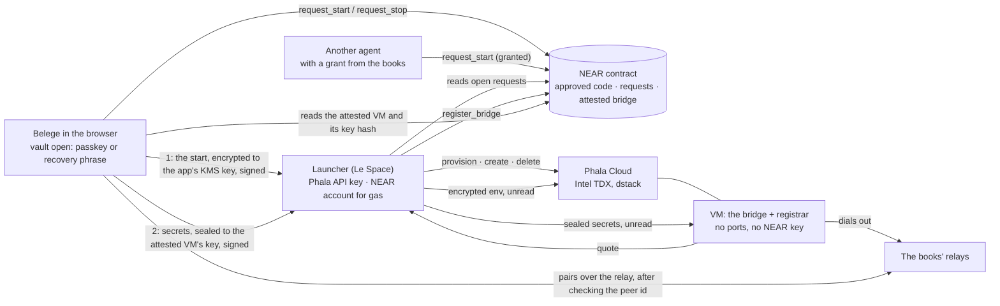
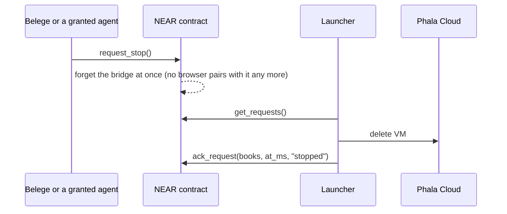

# The hosted bridge on NEAR and Phala (Intel TDX)

The bridge can run in a confidential VM instead of on the person's Mac. There are two targets:
- Aleph (AMD SEV-SNP): `bridge/rootfs`, #583.
- **Phala Cloud with dstack (Intel TDX), with a contract on NEAR:** this folder, #696.

Both run the same bridge, built by `bridge/rootfs/deploy-bridge.sh`, and its secrets arrive in the same layout.

| Folder | What |
|---|---|
| [`dstack/`](dstack/README.md) | the bridge as a container: image, entrypoint, secrets, the registrar that hands out the quote |
| [`near-contract/`](near-contract/README.md) | the contract on NEAR: approved code, start and stop requests, the attested bridge per books |
| `launcher/` | Le Space's launcher: acts on the requests, drives Phala, submits the quote |

## Who is involved



## A start, step by step

```mermaid
sequenceDiagram
  autonumber
  participant B as Belege (browser)
  participant C as NEAR contract
  participant L as Launcher
  participant P as Phala Cloud
  participant V as VM (bridge + registrar)

  B->>C: request_start() signed with the books' NEAR key
  C-->>C: event start_requested {books, at_ms}
  L->>C: get_requests()
  L->>P: provision(compose of the released image)
  P-->>L: app id, compose hash, env key
  B->>L: GET /v1/starts/<books>
  L-->>B: env key with the KMS's signature, compose hash
  B->>B: check the KMS signature; encrypt bridge_start {books, at_ms} to the env key
  B->>L: POST /v1/starts/<books> encrypted env, signed by a key of the books
  L->>C: is this key one of the books'? (view_access_key)
  L->>P: create VM (encrypted env)
  P->>V: boot; dstack decrypts the env inside the TEE (no secrets in it)
  V->>V: registrar: an X25519 intake key of its own
  V->>V: quote from dstack: report data = H(books ‖ at_ms) ‖ H(intake key)
  V->>L: POST /v1/bridge-quote (with the intake key)
  L->>P: collateral for the quote
  L->>C: register_bridge(books, attestation, H(intake key))
  C-->>C: DCAP, RTMR3, compose hash, PPID ok and answers the open start → store
  B->>C: get_books(): VM valid, intake_key_hash
  B->>L: GET /v1/starts/<books>: the intake key
  B->>B: check H(intake key) = intake_key_hash; seal the secrets to it
  B->>L: POST /v1/starts/<books>/secrets, signed by a key of the books
  V->>L: GET /v1/bridge-secrets/<books>/<at_ms>
  V->>V: open, sort into tmpfs, start the bridge (empty environment)
  B->>V: dial over the books' relay; the node key came with the secrets, so the peer id is known (#585)
```

## A stop



A start that nobody finishes (no env, no quote, or no secrets within 10 minutes) is given up the same way: the launcher deletes the VM and answers the start with its reason.

The secrets go only to a VM the contract has attested: the VM boots without them, and the browser seals them to the key in that VM's quote. The bridge's node key is one of them, so the peer id the browser dials belongs to that VM alone.

## What each party can and cannot do

| | Can | Cannot |
|---|---|---|
| **Belege (the books)** | start and stop its bridge; grant another agent the right to (at most 8, revocable) | start the bridge of other books |
| **Another agent** | start and stop, if the books granted it | see the secrets: only the browser with the open vault has them |
| **Launcher (Le Space)** | create and delete VMs, pay gas, submit quotes | read the secrets (they are sealed to the attested VM); hand the browser an env key the KMS did not sign or an intake key the contract does not show; register a bridge the quote does not prove; answer a start with a VM it made for another start |
| **Phala** | run, stop, delete the VM; see the image, run times, an encrypted env | read the secrets or the VM's memory (TDX); change the code without changing the compose hash |
| **The VM** | open the secrets sealed to its key, run the bridge, prove what runs | act on NEAR (it has no key and no money); answer an old start (the quote binds `at_ms`) |
| **The contract owner (Le Space)** | approve and withdraw code (measurements) and Phala machines (PPIDs) | — a withdrawn release makes its bridges invalid at once |

## What is public

- **On NEAR:** the books' NEAR account, when it asked for a start or stop, whom it granted, the attested VM's compose hash and the hash of its intake key.
- **At Phala:** the image (it is public anyway), a hash instead of the books' name as the VM name, and the run times.
- **Never outside the VM and the browser:** the secrets and the bridge's data.

## Measured on testnet

A first full run on 2026-11-07, still in one phase (the secrets came with the env): Phala `tdx.small` in US-WEST-1, the contract on NEAR testnet, the launcher on a laptop. The script `launcher/scripts/start-as-browser.mjs` played the browser. The second phase adds the hand-over after `register_bridge`: the browser's read of the contract, one upload, and the registrar's next poll (every 3 s).

| Step | Time |
|---|---|
| `request_start` until the transaction is final | 11 s |
| request until the VM is created (provision, env, create) | 20 s |
| VM created until its quote reaches the launcher | 56 s |
| quote until `register_bridge` is final (collateral, contract check) | 8 s |
| **start, request to attested bridge** | **about 85 s** |
| `request_stop` until the VM is deleted and the stop answered | 27 s |

The first quote of a new release is refused until the owner approves its measurements and the machine's PPID (`approve_measurements`, `approve_ppids`); the registrar retries meanwhile. The measurements are read from that quote's TCB info: MRTD, RTMR0–2, the digest of the `key-provider` event and the payload of the `compose-hash` event.

A test launcher at another URL sets `LAUNCHER_PUBLIC_URL`: the URL is part of the measured compose, so it is another compose hash to approve. `LAUNCHER_QUOTE_DIR` keeps the quotes it receives.

The compose is the same for every books: the VM's name, which is per books, is not in it. So one release and one launcher URL make one compose hash to approve.

## Hosting the launcher

At Le Space the launcher runs as a container (`launcher/Dockerfile`, `launcher/deploy/compose.yaml`) behind the host's reverse proxy, at `https://bridge-launcher.le-space.de`. The image holds no secret: the Phala key and the launcher's NEAR key are mounted at run time, readable by the launcher only. It runs read-only, without capabilities and as its own user; no port is published on the host. The start page (Le-Space/belege-bridge-near) is served from the same origin by a second, static container in that compose; the proxy sends `/v1/*` and `/healthz` to the launcher and everything else to the page. Neither key opens a books' secret: the env is encrypted to the VM and the secrets are sealed to the VM's intake key.

## Open points

- Phala offered this account US-WEST-1 only: test data only until there is an EU host.
- The launcher keeps its state in memory: after a restart it provisions open starts again, but it does not yet find running VMs.
