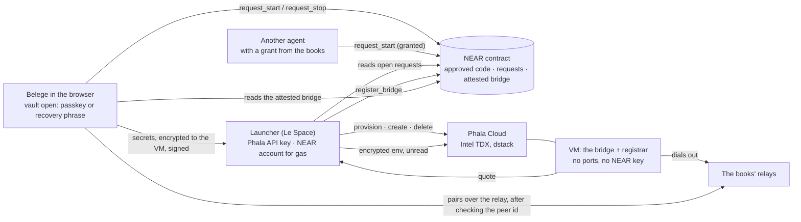
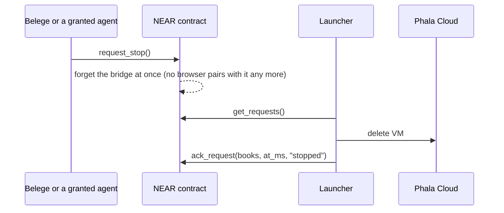

# The hosted bridge on NEAR and Phala (Intel TDX)

The bridge can run in a confidential VM instead of on the person's Mac. There are two targets:
- Aleph (AMD SEV-SNP): `bridge/rootfs`, #583.
- **Phala Cloud with dstack (Intel TDX), with a contract on NEAR:** this folder, #696.

Both run the same bridge, built by `bridge/rootfs/deploy-bridge.sh`, and its secrets arrive in the same layout.

| Folder | What |
|---|---|
| [`dstack/`](dstack/README.md) | the bridge as a container: image, entrypoint, secrets, the registrar that hands out the quote |
| [`near-contract/`](near-contract/README.md) | the contract on NEAR: approved code, start and stop requests, the attested bridge per books |
| `launcher/` | Le Space's launcher: acts on the requests, drives Phala, submits the quote |

## Who is involved



## A start, step by step

```mermaid
sequenceDiagram
  autonumber
  participant B as Belege (browser)
  participant C as NEAR contract
  participant L as Launcher
  participant P as Phala Cloud
  participant V as VM (bridge + registrar)

  B->>C: request_start() signed with the books' NEAR key
  C-->>C: event start_requested {books, at_ms}
  L->>C: get_requests()
  L->>P: provision(compose of the released image)
  P-->>L: app id, compose hash, env key
  B->>L: GET /v1/starts/<books>
  L-->>B: env key, compose hash
  B->>B: encrypt secrets + bridge_start {books, at_ms} to the env key (x25519, AES-GCM)
  B->>L: POST /v1/starts/<books> encrypted env, signed by a key of the books
  L->>C: is this key one of the books'? (view_access_key)
  L->>P: create VM (encrypted env)
  P->>V: boot; dstack decrypts the env inside the TEE
  V->>V: sort secrets into tmpfs, start the bridge (empty environment)
  V->>V: bridge writes node/public-key.sha256
  V->>V: quote from dstack: report data = H(books ‖ at_ms) ‖ H(node key)
  V->>L: POST /v1/bridge-quote
  L->>P: collateral for the quote
  L->>C: register_bridge(books, attestation, key hash)
  C-->>C: DCAP, RTMR3, compose hash, PPID ok and answers the open start → store
  B->>C: get_books(): bridge valid, peer_key_hash
  B->>V: dial over the books' relay, check H(peer id) = peer_key_hash, pair (#585)
```

## A stop



A start that nobody finishes (no env, or no quote, within 10 minutes) is given up the same way: the launcher deletes the VM and answers the start with its reason.

## What each party can and cannot do

| | Can | Cannot |
|---|---|---|
| **Belege (the books)** | start and stop its bridge; grant another agent the right to (at most 8, revocable) | start the bridge of other books |
| **Another agent** | start and stop, if the books granted it | see the secrets: only the browser with the open vault has them |
| **Launcher (Le Space)** | create and delete VMs, pay gas, submit quotes | read the secrets (they are encrypted to the VM); register a bridge the quote does not prove; answer a start with a VM it made for another start |
| **Phala** | run, stop, delete the VM; see the image, run times, an encrypted env | read the env or the VM's memory (TDX); change the code without changing the compose hash |
| **The VM** | decrypt its env, run the bridge, prove what runs | act on NEAR (it has no key and no money); answer an old start (the quote binds `at_ms`) |
| **The contract owner (Le Space)** | approve and withdraw code (measurements) and Phala machines (PPIDs) | — a withdrawn release makes its bridges invalid at once |

## What is public

- **On NEAR:** the books' NEAR account, when it asked for a start or stop, whom it granted, the attested bridge's compose hash and node key hash.
- **At Phala:** the image (it is public anyway), a hash instead of the books' name as the VM name, and the run times.
- **Never outside the VM and the browser:** the secrets and the bridge's data.

## Open points

- Phala offered this account US-WEST-1 only: test data only until there is an EU host.
- The launcher keeps its state in memory: after a restart it provisions open starts again, but it does not yet find running VMs.
