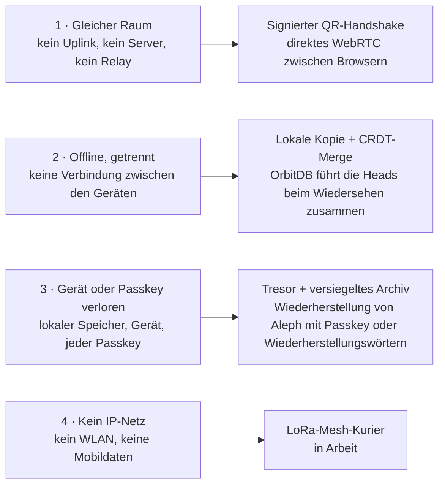

# Architektur: wie Belege weiterarbeitet, wenn das Netz es nicht tut

_English: [architecture.md](architecture.md)_

Belege läuft vollständig im Browser. Jedes Gerät hält eine vollständige, versiegelte Kopie der Bücher, und kein Server hält sie im Klartext oder könnte sie anhalten. Diese Seite ist der Überblick: welche Teile es gibt, wie sie zusammenpassen und wo jeder genauer beschrieben ist.

## Die Stufenleiter

Jede Stufe nimmt ein weiteres Stück Infrastruktur weg. Was rechts steht, hält die Bücher benutzbar.

Stufe 1–3 sind gebaut und gemessen ([resilience.de.md](resilience.de.md)). Stufe 4 ist in Arbeit in [funkpost](https://github.com/NiKrause/funkpost): Eine erste Übertragung hat einmal geklappt, sie ist noch nicht stabil und nicht Teil von Belege.

## Die Schichten

| Schicht | Was sie tut | Im Detail | Paket |
| --- | --- | --- | --- |
| **Schlüssel und Identität** | Die PRF-Antwort eines Passkeys öffnet seinen Platz im Tresor der Bücher; jeder Schlüssel wird aus der Wurzel abgeleitet, die der Tresor hält. Ein zweiter Passkey oder 24 Wiederherstellungswörter öffnen dieselben Bücher. Die Bücher schreiben als eigene Identität; Einträge werden mit Ed25519 signiert. | [keys.de.md](keys.de.md) | [@le-space/orbitdb-identity-provider-webauthn-did](https://github.com/Le-Space/orbitdb-identity-provider-webauthn-did) |
| **Versiegelung** | Jeder Datensatz und jede Belegdatei wird vor dem Schreiben versiegelt; was synchronisiert und gesichert wird, ist Chiffretext. | [keys.de.md](keys.de.md), [backup.de.md](backup.de.md) | – |
| **Transport** | Eigene Geräte treffen sich über ein Le-Space-Relay, ein Relay in der eigenen Bridge oder direkt nach zwei gescannten QR-Codes (signiertes WebRTC-Angebot und -Antwort). Kein DHT, keine Discovery. | [device-proof.de.md](device-proof.de.md) | [@le-space/libp2p-webrtc-qr](https://github.com/Le-Space/libp2p-webrtc-qr), js-libp2p |
| **Gerätenachweis** | Bevor ein Peer irgendetwas bekommt – Heads, Blöcke, gossipsub –, beweist er, dass er den Passkey hält. Ein Relay erfährt nur, dass zwei Peers verbunden sind. | [device-proof.de.md](device-proof.de.md) | – |
| **Replikation** | OrbitDB-Logs über js-libp2p und Helia. Jedes Gerät schreibt in seine eigene Kopie; auseinandergelaufene Verläufe werden über ihre Heads zusammengeführt, ohne Leader und ohne Server-Kopie. | [resilience.de.md](resilience.de.md) | [OrbitDB](https://github.com/orbitdb/orbitdb) |
| **Archiv** | Ein versiegeltes CAR aller Blöcke, aufbewahrt bei Aleph Cloud, bezahlt in Credits. Ein leeres Gerät stellt es mit einem Passkey oder den Wiederherstellungswörtern wieder her. | [backup.de.md](backup.de.md) | [@le-space/orbitdb-storage-bridge](https://github.com/NiKrause/orbitdb-storage-bridge) |
| **Die App selbst** | Ausgeliefert von belege.le-space.de und per CID von IPFS, installierbar, die App-Hülle offline. | [deploy.md](deploy.md) | – |

Wogegen das schützt und wogegen nicht: [threat-model.de.md](threat-model.de.md).

## Was gemessen ist

Aus [resilience.de.md](resilience.de.md), zwei Browser-Kontexte auf einer Maschine, erfundene Bücher:

- **Gleicher Raum, zwei QR-Codes:** 0 Anfragen verlassen die Maschine; Kopplung in 0,9–1,4 s.
- **Netztrennung mit Schreiben auf beiden Seiten:** 0 von 90 Buchungen verloren; beide Seiten sind 0,4 s nach der Wiederverbindung gleich.
- **Ein Browser, der alles verloren hat:** 10 000 Buchungen in 79 s aus dem Archiv zurück, linear, keine verloren.
- **Ein Relay, das seine Verbindung unter gossipsub schließt:** Der Schub bleibt hängen (#393); die App bemerkt den fehlenden gossipsub-Stream und holt nach etwa 53 s alles nach. Die Korrektur gehört in gossipsub.

Offen: Ein Gerät, das sein Relay verliert, wählt es nie wieder an (#403), und die 23 s Wiederverbindung nach einer Pause.
