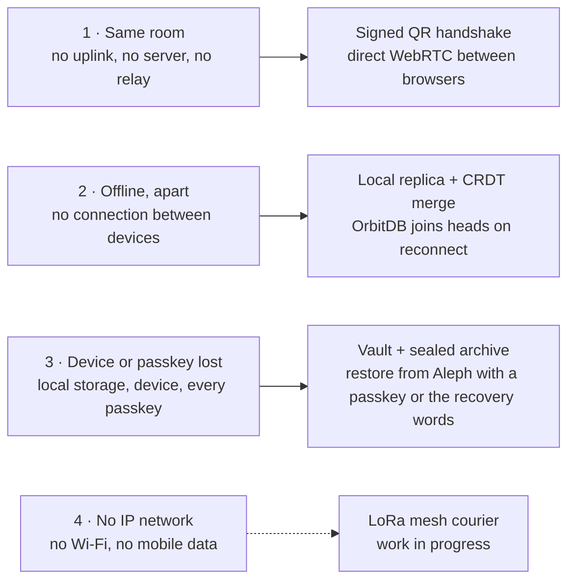

# Architecture: how Belege keeps working when the network does not

_Deutsch: [architecture.de.md](architecture.de.md)_

Belege runs entirely in the browser. Every device holds a full, sealed copy of the books, and no server holds them in the clear or could stop them. This page is the overview: what the parts are, how they fit, and where each is described in detail.

## The degradation ladder

Each step removes one more piece of infrastructure. What is on the right keeps the books usable.

Steps 1–3 are built and measured ([resilience-report.md](resilience-report.md)). Step 4 is work in progress in [funkpost](https://github.com/NiKrause/funkpost): a first transfer succeeded once, it is not yet stable, and it is not part of Belege.

## The layers

| Layer | What it does | In detail | Package |
| --- | --- | --- | --- |
| **Keys and identity** | A passkey's PRF answer opens its slot in the books' vault; every key is derived from the root the vault holds. A second passkey or 24 recovery words open the same books. The books write as an identity of their own; entries are signed with Ed25519. | [keys.md](keys.md) | [@le-space/orbitdb-identity-provider-webauthn-did](https://github.com/Le-Space/orbitdb-identity-provider-webauthn-did) |
| **Sealing** | Every record and receipt file is sealed before it is written; what syncs and what is backed up is ciphertext. | [keys.md](keys.md), [backup.md](backup.md) | – |
| **Transport** | Own devices meet through a Le Space relay, a relay in the own bridge, or directly after two scanned QR codes (signed WebRTC offer and answer). No DHT, no discovery. | [device-proof.md](device-proof.md) | [@le-space/libp2p-webrtc-qr](https://github.com/Le-Space/libp2p-webrtc-qr), js-libp2p |
| **Device proof** | Before a peer gets anything – heads, blocks, gossipsub – it proves it holds the passkey. A relay learns only that two peers are connected. | [device-proof.md](device-proof.md) | – |
| **Replication** | OrbitDB logs over js-libp2p and Helia. Each device writes to its own replica; divergent histories merge by joining heads, with no leader and no server copy. | [resilience-report.md](resilience-report.md) | [OrbitDB](https://github.com/orbitdb/orbitdb) |
| **Archive** | A sealed CAR of every block, kept on Aleph Cloud, paid in credits. An empty device restores it with a passkey or the recovery words. | [backup.md](backup.md) | [@le-space/orbitdb-storage-bridge](https://github.com/NiKrause/orbitdb-storage-bridge) |
| **The app itself** | Delivered from belege.le-space.de and from IPFS by CID, installable, the shell offline. | [deploy.md](deploy.md) | – |

What this protects against, and what it cannot: [threat-model.md](threat-model.md).

## What is measured

From [resilience-report.md](resilience-report.md), two browser contexts on one machine, made-up books:

- **Same room, two QR codes:** 0 requests leave the machine; pairing in 0.9–1.4 s.
- **Partition with writes on both sides:** 0 of 90 bookings lost; both sides agree 0.4 s after reconnecting.
- **A browser that lost everything:** 10 000 bookings back from the archive in 79 s, linear, none lost.
- **A relay that closes its circuit under gossipsub:** the burst stalls (#393); the app notices the missing gossipsub stream and recovers all of it after about 53 s. The fix belongs in gossipsub.

Open: a device that loses its relay never redials it (#403), and the 23 s reconnect after a pause.
