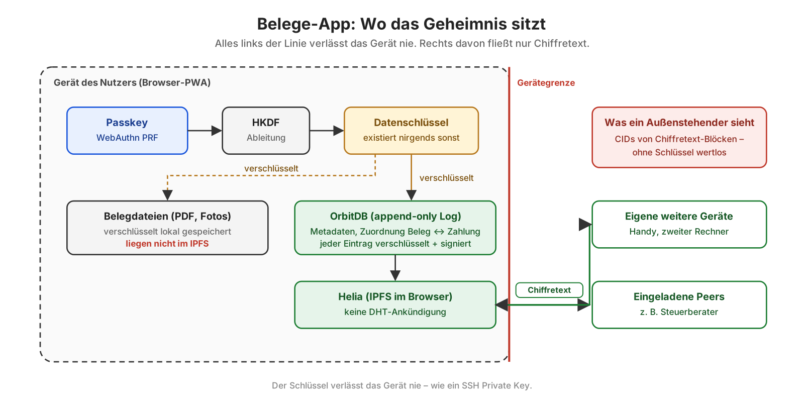

# Backup bei Aleph Cloud

_English: [backup.md](backup.md)_

Ein Backup enthält alles, was Belege in diesem Browser hält: die Datenbanken der Bücher und jede Belegdatei, auch die per Mail gekommenen. Es ist eine Datei, versiegelt mit einem Schlüssel aus dem Tresor der Bücher ([keys.de.md](keys.de.md)). Aleph Cloud bewahrt sie auf. Öffnen kann sie nur ein Passkey dieser Bücher, auch Aleph nicht.

## Was du zum Wiederherstellen brauchst

Auf einem leeren Gerät zwei Dinge:

1. **Einen Passkey dieser Bücher.** Der Schlüssel des Backups wird aus der Wurzel der Bücher abgeleitet, die jeder Passkey mit einem Fach im Tresor öffnet – auch Backups von bevor er eins hatte. Ein Passkey anderer Bücher öffnet es nicht („gehört zu anderen Büchern“).
2. **Die Adresse des Aleph-Kontos, das zahlt**, oder die CID des Backups. Über das Konto findet Belege die Backups: Es fragt Aleph nach den STORE-Nachrichten dieses Kontos im Kanal `BELEGE-BACKUP`. Die Adresse ist öffentlich; schreib sie auf. `pnpm setup:aleph` zeigt sie, eine gekoppelte Bridge nennt sie von selbst, und liegt der Tresor bei Aleph, erfährt ein leeres Gerät sie von dort.

## Einmal einrichten

1. Im Terminal, im Ordner von Belege: `pnpm setup:aleph`. Die Bridge erzeugt einen eigenen Backup-Schlüssel und hält ihn im Schlüsselbund. Sie zeigt dessen Adresse an, nie den Schlüssel selbst. Diese Adresse ist das Aleph-Konto, das das Aufbewahren der Backups bezahlt. Es ist nicht deine Wallet.
2. Lade Credits auf diese Adresse (app.aleph.cloud → Credits).
   - Ein Backup wird mit Credits bezahlt. Aleph bewahrt es nur auf, solange das Konto welche hat.
   - Aleph lehnt ein neues Backup ab, wenn die Credits nicht für einen Tag reichen (etwa 54 Credits pro MiB und Tag). Die Seite sagt dann, wie viele es braucht.
   - Abgebucht wird stündlich. Pro Backup werden keine Token bewegt, und ALEPH auf dem Konto bezahlt es nicht.
3. Starte die Bridge neu (`pnpm bridge`) und kopple sie. _Integrationen → Backup_ übernimmt die Adresse des Kontos in die Einstellungen.
4. Gib den Schlüssel dieses Browsers frei. Die Seite zeigt ihn und den Befehl:

   ```sh
   pnpm setup:aleph -- --authorize <Adresse> --channel BELEGE-BACKUP
   ```

   Oder ohne Terminal im Aleph-Dashboard mit der Wallet des Kontos: [Berechtigungen](https://app.aleph.cloud/console/permissions/), die Adresse des Browsers, Nachrichtentyp STORE, Kanal `BELEGE-BACKUP`. Credits kauft und überweist man unter [Credits](https://app.aleph.cloud/console/credits/).

   Danach unterschreibt der Browser den Auftrag an Aleph selbst, und die Bridge muss für ein Backup nicht laufen. Bis zur Freigabe unterschreibt die Bridge, wie bisher.

## Sichern

_Integrationen → Backup → „Jetzt sichern“_.

1. Der Browser packt und versiegelt das Backup.
2. Er lädt es direkt zu Alephs IPFS-Host hoch.
3. Aleph wird beauftragt, die Datei aufzubewahren, mit einer STORE-Nachricht für das Konto, bezahlt mit Credits. Diese Nachricht unterschreibt der Schlüssel dieses Browsers, wenn das Konto ihn freigegeben hat, sonst die Bridge mit ihrem Backup-Schlüssel.

Das Backup selbst läuft nie über die Bridge. Die Seite zeigt die CID des Backups; heb sie irgendwo auf.

**Vollbackups und Zuwächse.** Das erste Backup ist ein Vollbackup: alles, was dieser Browser hält. Danach lädt „Jetzt sichern“ nur hoch, was seit dem letzten Backup der Kette neu ist – einen Zuwachs: die neuen Log-Einträge (mit Manifest und den Identitäten der Schreiber jeder geänderten Datenbank) und die Belegdateien, die die Kette noch nicht hat, genauso versiegelt. Aleph bewahrt ihn mit einer STORE-Nachricht auf, deren `ref` die CID des Vollbackups ist; so findet die Wiederherstellung die Kette, ohne etwas herunterzuladen. „Neues Vollbackup“ beginnt eine neue Kette; ebenso das nächste Backup, wenn Aleph das Vollbackup nicht aufbewahrt. Einstellungen allein – jedes Backup schreibt dort seine eigene Liste – ergeben keinen Zuwachs; sie gehen mit dem nächsten mit. Wo die Kette steht (Vollbackup, letzter Zuwachs, gesicherte Heads und Belegdateien), liegt in den versiegelten Einstellungen; ein anderes eigenes Gerät setzt sie fort.

**Was es kostet.** Jedes Backup ist eine ganze Kopie, aufbewahrt – und jeden Tag bezahlt –, bis es vergessen wird. Über „Jetzt sichern“ zeigt die Seite, was die Backups bei Aleph zusammen pro Tag kosten und wie lange die Credits reichen. Würden die Credits mit einem neuen Backup keine 30 Tage mehr reichen, fragt die Seite vor dem Hochladen. Der Satz ist ein Schätzwert (etwa 54 Credits pro MiB und Tag, wie Aleph am 03.10.2026 verlangte); den Preis legt Aleph fest.

**Während es läuft.** Das Backup läuft für die ganze App: Du kannst in Belege weiterarbeiten, oben im Kopf steht, wie weit es ist („Backup 42 %“, oder „Backup wartet auf dich“, wenn es vor dem Hochladen fragt); ein Klick führt zurück. Wer den Tab schließt oder neu lädt, wird vorher gefragt – das bricht den Upload ab. Prozent beim Hochladen gibt es nur, wo der Host es zulässt; Alephs IPFS-Host erlaubt das bisher nur seiner eigenen Konsole ([aleph-im/pyaleph#1280](https://github.com/aleph-im/pyaleph/issues/1280)), dort läuft der Balken ohne Zahl und nennt die Zeit.

**Nicht gesichert, und automatisch.** Hat das letzte Backup etwas noch nicht – eine Zahlung, einen Beleg, eine Zuordnung, ein KI-Ergebnis, Einträge von einem anderen Gerät –, steht im Kopf „Nicht gesichert“, im Tooltip mit den Bereichen. Belege vergleicht dafür die Heads jeder Datenbank mit denen, die die Kette zuletzt gesichert hat; das kostet fast nichts. Mit „Automatisch sichern (auf diesem Gerät)“ lädt Belege fünf Minuten nach der letzten Änderung von selbst einen Zuwachs hoch – nie ein Vollbackup. Nur solange der Tab offen ist, das Netz nicht pausiert, dieser Browser freigegeben ist oder die Bridge läuft und die Credits länger als 30 Tage reichen; sonst sagt der Kopf, warum nicht. Auf einem Gerät einschalten, nicht auf mehreren: zwei Geräte, die gleichzeitig dieselbe Kette fortsetzen, schrieben beide ihren nächsten Zuwachs.

**Ob Aleph es aufbewahrt.** Aleph beantwortet eine STORE-Nachricht zuerst mit `pending` und entscheidet später. „Erneut prüfen“ fragt Aleph zu jedem Backup der Liste noch einmal, über seinen Auftrag (den Item-Hash der STORE-Nachricht, mit Link). Kennt Aleph einen Auftrag nicht oder hat ihn abgelehnt, steht das in der Zeile, und „Aleph erneut beauftragen“ schickt eine neue STORE-Nachricht für dieselbe Datei – hochgeladen wird nichts noch einmal.

**Wo es liegt – verteilt, verschlüsselt, mit öffentlicher Hülle.** Die Karte sagt das in einem eigenen Kasten, bevor etwas hinausgeht:

- Die versiegelte Datei liegt auf öffentlich erreichbaren IPFS-Knoten. Nach Auskunft des Aleph-Supports verteilt Aleph die Blöcke auf alle seine Knoten (das kann sich ändern). Wer die CID kennt, kann sie von jedem davon laden, über jedes IPFS-Gateway – aber nicht öffnen.
- Die CID jedes Backups steht in Alephs öffentlichem Nachrichtenverlauf, mit Zeitpunkt, Größe, zahlendem Konto und Kanal. Wer diesen Verlauf mitprotokolliert, sieht, wann und wie viel gesichert wird.
- Der Vorteil: Das Backup liegt nicht in einem Rechenzentrum. Fällt ein Anbieter oder eine Region aus – wie beim Brand im OVH-Rechenzentrum Straßburg 2021 oder bei den immer wieder auftretenden Ausfällen großer Clouds –, bleibt es erreichbar, und Zurückholen geht von jedem IPFS-Knoten, der die Datei hat. Ob das die öffentliche Hülle wert ist, entscheidet der Nutzer.
- Welche Knoten es haben: **„Wer hält es?“** unter jedem Backup der Liste fragt, nur bei diesem Klick, das IPFS-Routing nach den Knoten, die seine CID anbieten (`https://delegated-ipfs.dev/routing/v1/providers/<cid>`, über Helias `@helia/delegated-routing-v1-http-api-client`, für sich genutzt – nicht in den Helia-Knoten der App eingebaut, der es sonst nach jedem Block fragte), Alephs Aggregat `corechannel` (`0xa1B3bb7d2332383D96b7796B908fB7f7F3c2Be10`) nach den Namen seiner Kernknoten je IP und ipwho.is nach Stadt, Land und Netz jeder IP. Es zeigt Knoten, IP, Ort und Netz und die Verteilung nach Netz und Land. Der Routing-Dienst sieht die CID, ipwho.is die IPs der Knoten; alle drei sehen die IP-Adresse dieses Computers. Am 23.10.2026 hatte ein Backup 13 Anbieter, alle Aleph-Kernknoten (von 58 aktiven), 8 davon bei Hetzner (Falkenstein, Helsinki).
- Ein Backup ohne öffentliches IPFS, auf Filecoin Onchain Cloud bei ausgewählten Speicheranbietern, ist geplant: [#459](https://github.com/Le-Space/belege/issues/459).

Der Schlüssel dieses Browsers wird hier erzeugt und versiegelt in den Einstellungen gehalten, wie das Bridge-Token. Er geht mit den Büchern auf eigene Geräte und in jedes Backup. Ein gestohlener Schlüssel könnte nur auf Kosten des Kontos Dateien in diesem einen Kanal aufbewahren lassen. Er öffnet kein Backup, denn die sind mit dem Schlüssel aus dem Passkey versiegelt, und er bewegt keine Guthaben. `pnpm setup:aleph -- --revoke <Adresse>` nimmt die Freigabe zurück.

## Wiederherstellen

Ein Vollbackup kommt mit allen seinen Zuwächsen zurück: Die Karte zeigt zu jedem Vollbackup, wie viele es gibt (Alephs `refs=` und die Liste hier), lädt sie alle und lehnt eine Kette mit Lücke ab – ihre neueren Heads zeigten auf Einträge, die niemand hat. Ein Zuwachs allein wird nicht wiederhergestellt, sondern sein Vollbackup.

_Integrationen → Backup → „Wiederherstellen“_, nach dem Entsperren mit **einem Passkey dieser Bücher**. Auf einem neuen Gerät heißt das: „Mit vorhandenem Passkey wiederherstellen“.

Die Liste zeigt:

- die Backups, die für das Konto aufbewahrt werden, egal ob die Bridge oder ein freigegebener Schlüssel sie geschickt hat. Der Browser fragt Aleph direkt danach, ohne Bridge. Die Adresse kommt aus den Einstellungen oder von der gekoppelten Bridge, oder du trägst sie ein;
- die Backups aus diesem Browser.

Eine CID lässt sich auch eintippen. Nach einer Rückfrage holt der Browser die versiegelte Datei von Alephs Gateway, öffnet sie mit dem Schlüssel aus dem Passkey und spielt alle Datenbanken und Belegdateien zurück. Er **führt zusammen**: Was hier in den Büchern ist, bleibt; was das Backup enthält, kommt dazu; gelöscht wird nichts. Danach lädt die Seite neu, und der Passkey öffnet die Bücher wieder.

Ein Backup anderer Bücher lässt sich nicht öffnen („gehört zu anderen Büchern“).

## Einen anderen Schlüssel sichern lassen

Eine Anwendung kann aus dem Browser sichern, ohne dass die Bridge läuft. Sie hat einen eigenen Schlüssel, und das Konto der Bridge erlaubt diesem Schlüssel, auf seine Kosten Backups aufbewahren zu lassen. So macht es Belege selbst (Kanal `BELEGE-BACKUP`, siehe oben), und so macht es Le Space Invoice (Kanal `INVOICE-BACKUP`, Le-Space/invoice#28). Beide zeigen die Adresse ihres Schlüssels und den Befehl.

```sh
pnpm setup:aleph -- --authorize <Adresse> --channel INVOICE-BACKUP   # darf in diesem Kanal sichern
pnpm setup:aleph -- --grants                                         # wer darf
pnpm setup:aleph -- --revoke <Adresse>                               # zurücknehmen
```

Eine Freigabe ist ein Eintrag im `security`-Aggregat des Kontos bei Aleph, unterschrieben mit dem Backup-Schlüssel der Bridge: nur STORE, nur im genannten Kanal. Aleph berechnet dem Konto der Bridge, was dieser Schlüssel aufbewahren lässt, nicht dem Schlüssel (gemessen am 3.10.2026). Die Liste der Backups fragt Aleph nach dem zahlenden Konto; was so ein Schlüssel aufbewahren ließ, steht also mit darin.

## Bücher auf einen anderen Passkey umziehen

Ein Backup lässt sich nur mit dem Passkey wiederherstellen, der es gemacht hat, und ein Passkey gehört zu seiner Adresse: Bücher auf `localhost` und auf belege.le-space.de, oder unter einem alten und einem neuen Passkey, sind getrennte Bücher mit getrennten DIDs. _Bücher umziehen_ auf dieser Seite bringt Bücher aus den einen in die **leeren** Bücher eines anderen (#328):

1. In den neuen Büchern: _Bücher übernehmen …_. Sie zeigen einen Einmal-Schlüssel als QR-Code und als Text (`belege-move:…`), mit Fingerabdruck. Der Schlüssel gilt nur, solange diese Seite offen ist.
2. In den alten Büchern: _In andere Bücher umziehen …_, den Schlüssel einfügen oder scannen, prüfen, dass der Fingerabdruck derselbe ist, _Umzugsdatei erstellen_. Eine Datei `Belege-Umzug_<Datum>.belege` wird gespeichert.
3. In den neuen Büchern: die Datei wählen. Ihre Anzahlen werden gezeigt; _Übernehmen_ übernimmt sie.

Die Datei enthält jeden Eintrag jedes Bereichs (auch gelöschte) und jede Belegdatei und aufbewahrte Mail. Sie ist für genau diesen Schlüssel versiegelt: ein Einmal-X25519-Schlüssel der alten Bücher, ECDH, HKDF-SHA-256, AES-256-GCM. Lesbar sind nur Datum, Version, Anzahlen und was weggelassen wurde. Weggelassen, weil es zum alten Passkey oder Gerät gehört: die Kopplung der Bridge, Backup-Schlüssel, -Konto und -Liste, die Kopplung der Rechnungs-App, der Netzwerkmodus, das Relay im eigenen Netz, wartende Aufgaben und die Liste der eigenen Geräte. Diese in den neuen Büchern neu koppeln und einrichten.

Einträge behalten ihre IDs, Verknüpfungen und Zeiten; Belegdateien werden mit dem Schlüssel der neuen Bücher neu versiegelt. Bücher, die nicht leer sind, übernehmen nichts, und eine Datei, die sich nicht öffnet oder nicht aufgeht, schreibt nichts. Die alten Bücher bleiben, wie sie sind; löschen lassen sie sich dort unter _Einstellungen → Speicher_. Die alten Bücher bleiben in jedem Fall unverändert.

**Wenn beide Bücher nicht zugleich offen sind:** in den alten Büchern unter _In andere Bücher umziehen …_ _Mit einer Passphrase umziehen …_ öffnen und _Umzugsdatei mit Passphrase erstellen_. Belege erzeugt eine Passphrase – 20 Zeichen in Fünfergruppen, 100 Bit Zufall – und zeigt sie einmal: aufschreiben. Die Datei wird damit versiegelt (scrypt, dann AES-256-GCM). In den neuen Büchern _Bücher übernehmen …_, die Datei wählen; sie fragt nach der Passphrase (Groß- und Kleinschreibung, Leerzeichen und Bindestriche spielen keine Rolle, ebenso wenig O/0 oder I/L/1). Wer Datei und Passphrase hat, kann die Bücher lesen: beides getrennt aufbewahren. Die Passphrase lässt sich nicht wählen, also auch nicht schwach wählen.

## Was hinausgeht



_Alles links der Linie verlässt das Gerät nie; was sie überquert, ist Chiffretext. Der Datenschlüssel wird aus dem Passkey abgeleitet und existiert nirgends sonst — wie ein privater SSH-Schlüssel._

- **An Alephs IPFS-Host, aus dem Browser:** die versiegelte Datei. Aleph sieht ihre Größe und die IP-Adresse dieses Computers, nicht den Inhalt. Wer die CID kennt, kann die versiegelte Datei über IPFS laden.
- **An die Aleph-API, aus dem Browser:**
  - die STORE-Nachricht mit der Adresse des Schlüssels dieses Browsers, der Adresse des Kontos und der CID der Datei;
  - Abfragen der Freigabe und der Credits des Kontos und der Liste seiner Backups, mit seiner Adresse;
  - bei „Erneut prüfen“ der Item-Hash der STORE-Nachricht jedes Backups, um zu fragen, was aus ihm wurde.
- **An die Aleph-API, von der Bridge:**
  - ohne Freigabe die STORE-Nachricht mit der Adresse ihres Backup-Schlüssels und der CID der Datei;
  - bei `--authorize` und `--revoke` die Liste der Schlüssel, die das Konto erlaubt.

## Technisch

- **Inhalt:** jeder Block genau so, wie er gespeichert ist. Eine Wiederherstellung bringt also dieselben CIDs, dieselben signierten Einträge und denselben Schreiber zurück:
  - die Log-Einträge jeder Datenbank (schon mit dem Datenbankschlüssel versiegelt), ihr Manifest und ihr Access-Controller sowie die Identität jedes Schreibers;
  - Wurzel und 1-MiB-Stücke jeder Belegdatei (schon mit dem Blob-Schlüssel versiegelt);
  - ein dag-cbor-Manifest: die Metadaten der Storage-Bridge (jede Datenbank mit Adresse, Manifest und Heads, aus `bundleDatabases`), die Belegdateien, die App-Version und das Datum.
- **Wiederherstellen:**
  - `restoreFromBlocks` der Storage-Bridge spielt die Datenbanken aus dem geöffneten Backup zurück.
  - Lässt sich ein Head nicht einhängen, bricht die Wiederherstellung mit dem Grund ab, statt Erfolg zu melden.
- **Schreiber ([#496](https://github.com/Le-Space/belege/issues/496)):**
  - Die Bücher schreiben als eigene Identität: ein Ed25519-Schlüssel aus dem Geheimnis der Bücher (`belege/books-secret/v1`, aus dem PRF-Ergebnis des Passkeys, bis der Tresor aus [#406](https://github.com/Le-Space/belege/issues/406) es hält). Sie ist die Wurzel des Access-Controllers jeder Sammlung (`OrbitDBAccessController`, dessen eigene Listen-Datenbank wie die anderen versiegelt ist). Angezeigt wird weiter die DID des Passkeys, und sie steht als Autor in jedem Datensatz.
  - Bücher, die der Passkey geschrieben hat, ziehen einmal um, beim ersten Entsperren mit dieser Version, mit jedem Eintrag und seiner Uhr (`store/migrate.js`). Die Datenbanken sind danach andere, deshalb beginnt das nächste Backup eine neue Kette mit einem Vollbackup.
  - Ein Backup von vor dem Umzug geht in die Datenbanken des Passkeys zurück und zieht beim nächsten Entsperren um.
- **Einträge früherer Sitzungen:**
  - OrbitDB 4.0.0 merkt sich verifizierte Identitäten nach `signatures.id` und lehnt eine abweichende mit derselben ID ab.
  - Eine Passkey-Identität hat in jeder Sitzung dieselbe `signatures.id`, aber eine neue WebAuthn-Zusicherung. Einträge einer früheren Sitzung (aus einem Backup oder per Sync von einem eigenen Gerät) wurden deshalb abgelehnt.
  - Belege prüft so eine Identität noch einmal so, wie OrbitDB eine ungespeicherte prüft (Form, ID-Signatur, Passkey-Bindung im Provider), nur ohne den Vergleich ([orbitdb/orbitdb#1258](https://github.com/orbitdb/orbitdb/issues/1258); `session-identities.js`).
- **Format:** eine CAR-Datei, geschrieben von `@le-space/orbitdb-storage-bridge`, als Ganzes versiegelt mit AES-256-GCM. Der Schlüssel wird mit HKDF aus dem PRF-Ergebnis des Passkeys abgeleitet (`belege/backup-key/v1`). Die Datei ist `belegeB1 ‖ Nonce ‖ Chiffretext`.
- **Upload:** das `aleph`-Backend der Storage-Bridge, `POST https://ipfs.aleph.cloud/api/v0/add`, ohne Schlüssel.
- **Aufbewahren:**
  - Eine STORE-Nachricht im Kanal `BELEGE-BACKUP`, unterschrieben mit `personal_sign`. `content.address` ist das zahlende Konto, bezahlt wird mit Credits (`payment: { type: "credit" }`, Storage-Bridge 0.17.0). Ohne dieses Feld bucht Aleph sie als `hold`, und das deckt nur ALEPH auf dem Konto.
  - Mit Freigabe schickt sie der Browser selbst (`backup/keeper.js`), mit seinem secp256k1-Schlüssel aus den versiegelten Einstellungen (`backup/aleph-key`). Er verfolgt eine Antwort `pending`, bis Aleph entschieden hat; eine Ablehnung nennt die vorhandenen und die für einen Tag nötigen Credits.
  - Ohne Freigabe schickt sie die Bridge (`POST /backup/aleph/pin`, [bridge/README.md](../bridge/README.md)). Eine Ablehnung kommt dort als HTTP 402 `ALEPH_BACKUP_REJECTED` zurück.
- **Liste:** Der Browser fragt die Nachrichten-API von Aleph mit `owners=` (das zahlende Konto) statt `addresses=` (der Absender). STORE-Nachrichten, die ein anderer Schlüssel für das Konto geschickt hat, sind also dabei. Die gekoppelte Bridge nennt dem Browser das Konto und, in Tests, die Adressen von Aleph (`GET /backup/status`).
- **Fehlende Blöcke:** Für ein Backup wird nichts aus dem Netz geholt. Ein Block, den dieser Browser nicht hat, zählt als fehlend, und die Seite sagt es.
