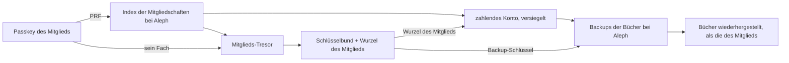
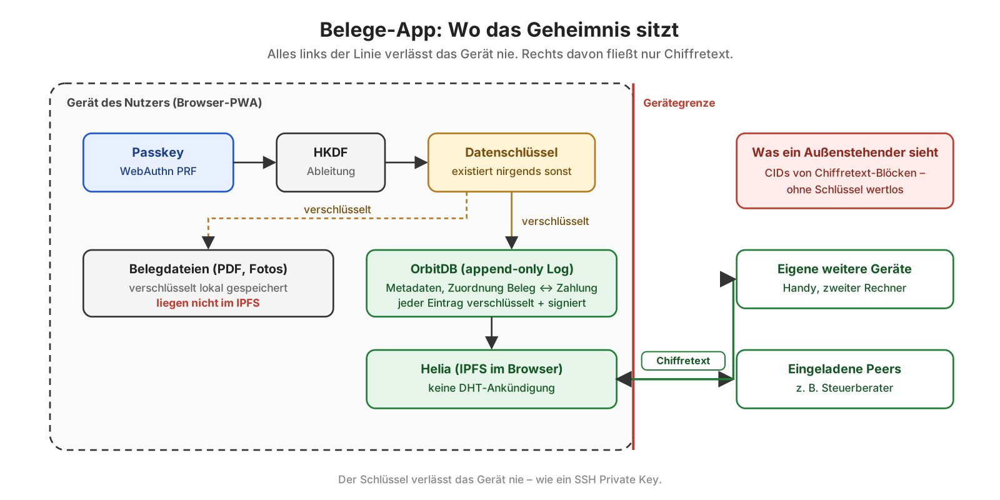

# Backup bei Aleph Cloud

_English: [backup.md](backup.md)_

Ein Backup enthält alles, was Belege in diesem Browser hält: die Datenbanken der Bücher und jede Belegdatei, auch die, die per Mail kamen. Es ist eine einzige Datei. Belege versiegelt sie mit einem Schlüssel aus dem Tresor der Bücher ([keys.de.md](keys.de.md)), und Aleph Cloud bewahrt sie auf. Öffnen kann sie nur ein Passkey dieser Bücher. Aleph kann es nicht.

## Was du zum Wiederherstellen brauchst

Auf einem leeren Gerät brauchst du zwei Dinge:

1. **Einen Passkey dieser Bücher.** Der Schlüssel des Backups kommt aus der Wurzel der Bücher. Jeder Passkey mit einem Fach im Tresor öffnet sie, auch für Backups aus der Zeit, bevor er sein Fach hatte. Ein Passkey anderer Bücher öffnet das Backup nicht („gehört zu anderen Büchern“).
2. **Die Adresse des Aleph-Kontos, das bezahlt**, oder die CID des Backups. Über das Konto findet Belege die Backups: Es fragt Aleph nach den STORE-Nachrichten dieses Kontos im Kanal `BELEGE-BACKUP`. Die Adresse ist öffentlich. Schreib sie auf. `pnpm setup:aleph` zeigt sie an, eine gekoppelte Bridge nennt sie von selbst, und liegt der Tresor bei Aleph, erfährt ein leeres Gerät sie von dort.

## Einmal einrichten

1. Im Terminal, im Ordner von Belege: `pnpm setup:aleph`. Die Bridge erzeugt einen eigenen Backup-Schlüssel und legt ihn in den Schlüsselbund. Sie zeigt seine Adresse an, nie den Schlüssel selbst. Diese Adresse ist das Aleph-Konto, das das Aufbewahren bezahlt. Es ist nicht deine Wallet.
2. Lade Credits auf diese Adresse (app.aleph.cloud → Credits).
   - Backups werden mit Credits bezahlt. Aleph bewahrt sie nur auf, solange das Konto Credits hat.
   - Reichen die Credits nicht für einen Tag (etwa 54 Credits pro MiB und Tag), lehnt Aleph ein neues Backup ab. Die Seite sagt dann, wie viele fehlen.
   - Aleph bucht stündlich ab. Pro Backup werden keine Token bewegt, und ALEPH auf dem Konto bezahlt nichts.
3. Starte die Bridge neu (`pnpm bridge`) und kopple sie. _Integrationen → Backup_ übernimmt dann die Adresse des Kontos in die Einstellungen.
4. Gib den Schlüssel dieses Browsers frei. Die Seite zeigt ihn und den Befehl:

   ```sh
   pnpm setup:aleph -- --authorize <Adresse> --channel BELEGE-BACKUP
   ```

   Ohne Terminal geht es im Aleph-Dashboard mit der Wallet des Kontos: unter [Berechtigungen](https://app.aleph.cloud/console/permissions/) die Adresse des Browsers eintragen, Nachrichtentyp STORE, Kanal `BELEGE-BACKUP`. Credits kaufst und überweist du unter [Credits](https://app.aleph.cloud/console/credits/).

   Danach unterschreibt der Browser den Auftrag an Aleph selbst, und die Bridge muss für ein Backup nicht laufen. Bis zur Freigabe unterschreibt die Bridge.

## Sichern

_Integrationen → Backup → „Jetzt sichern“_.

Oben auf der Karte steht in einer Zeile, ob alles gesichert ist und was zu tun ist. Darunter stehen „Jetzt sichern“, „Wiederherstellen …“ und „Automatisch sichern“. Alles andere liegt unter „Erweitert“: das Konto, der Schlüssel dieses Browsers und seine Freigabe, „Neues Vollbackup“, die Liste der Backups, die Kosten und der Kasten „Wo es liegt“. „Erweitert“ ist von selbst offen, solange noch etwas einzurichten ist. Sonst bleibt es so, wie du es zuletzt gelassen hast.

So läuft ein Backup ab:

1. Der Browser packt und versiegelt das Backup.
2. Er schickt es an einen API-Knoten von Aleph, zusammen mit dem Auftrag, es aufzubewahren. Der Auftrag ist eine STORE-Nachricht für das Konto, bezahlt mit Credits. Aleph bewahrt die Datei im selben Schritt auf.
3. Den Auftrag unterschreibt der Schlüssel dieses Browsers, wenn das Konto ihn freigegeben hat.

Hat das Konto den Schlüssel dieses Browsers nicht freigegeben, unterschreibt die Bridge mit ihrem Backup-Schlüssel:

- Läuft die Bridge auf diesem Rechner, gibt der Browser ihr die versiegelte Datei (bis 256 MiB). Die Bridge schickt sie zusammen mit dem Auftrag an Aleph. Sie sieht dabei nur die versiegelte Datei, nie die Bücher.
- Erreicht der Browser die Bridge nur über ein anderes Gerät oder ist das Backup größer, lädt er die Datei selbst zu Alephs IPFS-Host hoch, und die Bridge schickt den Auftrag danach. Aleph muss sich die Datei dann vom Host holen. Gelingt das nicht, lehnt Aleph den Auftrag ab.

Die Seite zeigt die CID des Backups. Heb sie irgendwo auf.

**Vollbackups und Zuwächse.** Das erste Backup ist ein Vollbackup: alles, was dieser Browser hält. Danach lädt „Jetzt sichern“ nur hoch, was seit dem letzten Backup neu ist. Das nennt Belege einen Zuwachs. Er enthält die neuen Log-Einträge (mit Manifest und den Identitäten der Schreiber jeder geänderten Datenbank) und die Belegdateien, die noch fehlen, genauso versiegelt. Ein Vollbackup und seine Zuwächse bilden eine Kette.

- Aleph bewahrt einen Zuwachs mit einer STORE-Nachricht auf, deren `ref` die CID des Vollbackups ist. So findet die Wiederherstellung die Kette, ohne etwas herunterzuladen.
- „Neues Vollbackup“ beginnt eine neue Kette. Das passiert auch von selbst, wenn Aleph das Vollbackup nicht aufbewahrt.
- Geänderte Einstellungen allein ergeben keinen Zuwachs, denn jedes Backup schreibt dort seine eigene Liste. Sie gehen mit dem nächsten Backup mit.
- Wo die Kette steht (Vollbackup, letzter Zuwachs, gesicherte Heads und Belegdateien), liegt in den versiegelten Einstellungen. Ein anderes eigenes Gerät kann die Kette deshalb fortsetzen.

**Was es kostet.** Jedes Backup ist eine ganze Kopie. Aleph bewahrt sie auf und berechnet sie jeden Tag, bis sie vergessen wird. Unter „Erweitert“ zeigt die Karte, was alle Backups bei Aleph zusammen pro Tag kosten und wie lange die Credits reichen. Würden sie mit einem neuen Vollbackup keine 30 Tage mehr reichen, fragt die Seite vor dem Hochladen. Ein Zuwachs geht ohne Frage hoch. Der Satz ist ein Schätzwert (etwa 54 Credits pro MiB und Tag, was Aleph am 03.10.2026 verlangte). Den Preis legt Aleph fest.

**Während es läuft.** Das Backup läuft im Hintergrund der ganzen App. Du kannst in Belege weiterarbeiten. Oben im Kopf steht, wie weit es ist, zum Beispiel „Backup 42 %“, oder „Backup wartet auf dich“, wenn es vor dem Hochladen fragt. Ein Klick darauf führt zurück zur Karte. Schließt du den Tab oder lädst ihn neu, fragt Belege vorher, denn das bricht den Upload ab. Prozente beim Hochladen gibt es nur, wo der Host es zulässt. Alephs IPFS-Host erlaubt das bisher nur seiner eigenen Konsole ([aleph-im/pyaleph#1280](https://github.com/aleph-im/pyaleph/issues/1280)). Dort läuft der Balken ohne Zahl und zeigt die Zeit.

**Wenn Alephs IPFS-Host keine Uploads annimmt.** Seit dem 26.10.2026 antworten Alephs IPFS-Hosts auf `/api/v0/add` mit 404 und liefern nur noch aus. Dann geht das Backup über einen API-Knoten von Aleph (`/api/v0/ipfs/add_file`, Storage Bridge `createAlephBackend`), mit Prozenten.

- Ist der Schlüssel dieses Browsers freigegeben, geht der unterschriebene Auftrag gleich mit. Aleph bewahrt die Datei dann im selben Aufruf auf, bis 1 GB.
- Unterschreibt die Bridge, lädt sie ebenso mit ihrem Schlüssel hoch.
- Ohne beides nimmt die API höchstens 25 MiB. Bei einem größeren Backup sagt die Seite, warum es gerade nicht geht.

Die CID der Datei berechnet die Storage Bridge vorher selbst, so wie Alephs Knoten sie bilden. Nach dem Hochladen prüft Aleph, dass beide übereinstimmen.

**Auf einem Telefon.** Belege hält den Bildschirm wach, solange ein Backup, eine Wiederherstellung oder der Umzug der Bücher nach einem Update läuft (Screen Wake Lock: Chrome auf Android, Safari ab 16.4; in anderen Browsern bleibt der Hinweis, den Bildschirm anzulassen). Beim Herunterladen steht, wie viele MB schon da sind. Ein Backup von mehreren hundert MB muss beim Wiederherstellen aber ganz in den Arbeitsspeicher des Tabs passen. Bricht der Browser den Tab ab, lädt die Seite neu, und nichts wurde wiederhergestellt (siehe #512).

**App-Wechsel am Telefon.** Der Wake Lock hält den Bildschirm wach, nicht die Seite. Sobald der Tab verdeckt ist, friert Android ihn nach ein paar Minuten ein und wirft ihn bei Speichermangel weg. Download oder Import brechen dann ab. Eine Seite, die hörbar Ton abspielt, friert Android nicht ein. Deshalb bietet die Backup-Karte auf Telefon und Tablet unter „Erweitert“ „Leiser Ton, solange es läuft“ an. Die Option ist standardmäßig an und wird je Browser gemerkt.

- Alle zwei Sekunden spielt ein leiser Ton, solange ein Backup, eine Wiederherstellung oder der Umzug der Bücher nach einem Update läuft.
- Dazu erscheint eine Medienanzeige („Belege stellt wieder her …“), die zurück in die App führt.
- Der Ton entsteht im Browser und wird nicht geladen. Er läuft über die Medienlautstärke des Telefons.

Ob der Ton eine Wiederherstellung über einen echten App-Wechsel trägt, und in welchen Browsern, wird noch gemessen (#525). Ohne Häkchen bleib in Belege, bis es fertig ist.

**Nicht gesichert, und automatisch.** Fehlt dem letzten Backup etwas, steht im Kopf „Nicht gesichert“. Das kann eine Zahlung sein, ein Beleg, eine Zuordnung, ein KI-Ergebnis oder Einträge von einem anderen Gerät. Der Tooltip nennt die Bereiche. Belege vergleicht dafür die Heads jeder Datenbank mit denen, die die Kette zuletzt gesichert hat. Das kostet fast nichts.

Mit „Automatisch sichern (auf diesem Gerät)“ lädt Belege fünf Minuten nach der letzten Änderung von selbst einen Zuwachs hoch, nie ein Vollbackup. Das geht nur, wenn alles davon zutrifft:

- Der Tab ist offen.
- Das Netz ist nicht pausiert.
- Dieser Browser ist freigegeben, oder die Bridge läuft.
- Die Credits reichen länger als 30 Tage.

Sonst sagt der Kopf, warum es nicht geht. Schalte es auf einem Gerät ein, nicht auf mehreren: Zwei Geräte, die gleichzeitig dieselbe Kette fortsetzen, schrieben beide ihren nächsten Zuwachs.

**Ob Aleph es aufbewahrt.** Aleph antwortet auf eine STORE-Nachricht zuerst mit `pending` und entscheidet später. „Erneut prüfen“ fragt Aleph zu jedem Backup der Liste noch einmal, über seinen Auftrag (den Item-Hash der STORE-Nachricht, mit Link). Kennt Aleph einen Auftrag nicht oder hat ihn abgelehnt, steht das in der Zeile. „Aleph erneut beauftragen“ schickt dann eine neue STORE-Nachricht für dieselbe Datei. Hochgeladen wird nichts noch einmal. Hat Aleph abgelehnt, weil es die Datei nicht holen konnte, hilft ein neuer Auftrag nicht. Die Zeile sagt das, und der Inhalt geht mit dem nächsten „Jetzt sichern“ erneut hoch: Die Kette springt auf den letzten Stand zurück, den Aleph bestätigt hat.

**Wo es liegt: verteilt, verschlüsselt, mit öffentlicher Hülle.** Die Karte sagt das unter „Erweitert“ in einem eigenen Kasten. Beim Einrichten ist „Erweitert“ offen, du liest es also, bevor etwas hinausgeht:

- Die versiegelte Datei liegt auf öffentlich erreichbaren IPFS-Knoten. Laut Aleph-Support verteilt Aleph die Blöcke auf alle seine Knoten (das kann sich ändern). Wer die CID kennt, kann die Datei von jedem dieser Knoten laden, über jedes IPFS-Gateway. Öffnen kann er sie nicht.
- Die CID jedes Backups steht in Alephs öffentlichem Nachrichtenverlauf, mit Zeitpunkt, Größe, zahlendem Konto und Kanal. Wer diesen Verlauf mitschreibt, sieht, wann und wie viel du sicherst.
- Der Vorteil: Das Backup liegt nicht in einem einzigen Rechenzentrum. Fällt ein Anbieter oder eine Region aus, wie beim Brand im OVH-Rechenzentrum Straßburg 2021 oder bei den wiederkehrenden Ausfällen großer Clouds, bleibt es erreichbar. Zurückholen geht von jedem IPFS-Knoten, der die Datei hat. Ob das die öffentliche Hülle wert ist, entscheidest du.
- Welche Knoten es haben, zeigt **„Wer hält es?“** unter jedem Backup der Liste. Nur bei diesem Klick fragt Belege drei Dienste:
  - das IPFS-Routing nach den Knoten, die die CID anbieten (`https://delegated-ipfs.dev/routing/v1/providers/<cid>`, über Helias `@helia/delegated-routing-v1-http-api-client`, für sich genutzt und nicht in den Helia-Knoten der App eingebaut, der es sonst nach jedem Block fragen würde);
  - Alephs Aggregat `corechannel` (`0xa1B3bb7d2332383D96b7796B908fB7f7F3c2Be10`) nach den Namen seiner Kernknoten je IP;
  - ipwho.is nach Stadt, Land und Netz jeder IP.

  Die Karte zeigt Knoten, IP, Ort und Netz und die Verteilung nach Netz und Land. Der Routing-Dienst sieht die CID, ipwho.is die IPs der Knoten, und alle drei sehen die IP-Adresse dieses Computers. Am 23.10.2026 hatte ein Backup 13 Anbieter, alle Aleph-Kernknoten (von 58 aktiven), 8 davon bei Hetzner (Falkenstein, Helsinki).

- Ein Backup ohne öffentliches IPFS, auf Filecoin Onchain Cloud bei ausgewählten Speicheranbietern, ist geplant: [#459](https://github.com/Le-Space/belege/issues/459).

**Der Schlüssel dieses Browsers** wird hier erzeugt und versiegelt in den Einstellungen gehalten, wie das Bridge-Token. Er geht mit den Büchern auf eigene Geräte und in jedes Backup. Ein gestohlener Schlüssel könnte nur auf Kosten des Kontos Dateien in diesem einen Kanal aufbewahren lassen. Er öffnet kein Backup, denn die sind mit dem Schlüssel aus dem Passkey versiegelt, und er bewegt kein Guthaben. `pnpm setup:aleph -- --revoke <Adresse>` nimmt die Freigabe zurück.

## Wiederherstellen

_Integrationen → Backup → „Wiederherstellen …“_, nach dem Entsperren mit **einem Passkey dieser Bücher**. Dort wählst du bei einem Vollbackup **„Wiederherstellen“**. Auf einem neuen Gerät heißt der Weg „Mit vorhandenem Passkey wiederherstellen“. Kennt die Karte das zahlende Konto noch nicht, trägst du seine Adresse ein.

Ein Vollbackup kommt mit allen seinen Zuwächsen zurück. Die Karte zeigt zu jedem Vollbackup, wie viele Zuwächse es gibt (aus Alephs `refs=` und der Liste hier), und lädt sie alle. Fehlt ein Glied der Kette, lehnt sie die Kette ab, denn die neueren Heads zeigten auf Einträge, die niemand hat. Einen Zuwachs allein stellt Belege nicht wieder her, sondern immer sein Vollbackup.

Die Liste ist nach Ketten gruppiert: ein Vollbackup mit seinen Zuwächsen, die aktuelle Kette zuerst, gelöschte eingeklappt. Sie zeigt:

- die Backups, die Aleph für das Konto aufbewahrt, egal ob die Bridge oder ein freigegebener Schlüssel sie geschickt hat. Der Browser fragt Aleph direkt, ohne Bridge. Die Adresse kommt aus den Einstellungen oder von der gekoppelten Bridge, oder du trägst sie ein;
- die Backups aus diesem Browser.

Eine CID lässt sich auch eintippen („Per CID wiederherstellen“).

Nach einer Rückfrage holt der Browser die versiegelte Datei von Alephs Gateway, öffnet sie mit dem Schlüssel aus dem Passkey und spielt alle Datenbanken und Belegdateien zurück. Dabei **führt er zusammen**: Was hier in den Büchern ist, bleibt. Was das Backup enthält, kommt dazu. Gelöscht wird nichts. Danach lädt die Seite neu, und der Passkey öffnet die Bücher wieder.

**Prüfung vor dem Öffnen.** Was zurückkommt, prüft Belege, bevor es die Datei öffnet:

- gegen die Größe, die das STORE des Backups nennt (Backups seit 0.26.2 tragen sie, die Liste zeigt sie);
- bei jedem Backup gegen seine CID: Belege baut die Datei aus den Bytes so nach, wie Alephs Hosts sie gebaut haben.

Kam ein Download unvollständig oder beschädigt an, weist Belege ihn am Gateway ab und holt ihn neu („nicht oder nicht vollständig zurückgegeben“). Früher kam so eine Datei bis zum Schlüssel und scheiterte erst dort, was wie der falsche Passkey aussah. Unter jedem Fehler beim Wiederherstellen klappt „Technische Einzelheit“ auf. Dort steht, was der gescheiterte Schritt selbst gesagt hat, etwa welches Gateway, wie viele Bytes, welche CID. Das hilft bei einer Meldung oder bei einem zweiten Versuch.

**Auf welchem Weg es zurückkommt,** wählt der Browser. Die Einstellung „Erst Alephs Gateway, dann das IPFS-Netz“ ist standardmäßig an und wird je Browser gemerkt.

- Mit Häkchen fragt der Browser zuerst Alephs Gateway. Meldet es sich 15 Sekunden lang nicht, holt er das Backup selbst über IPFS.
- Ohne Häkchen fragt er das Gateway gar nicht und holt es gleich über IPFS.
- Über IPFS startet er dafür für die Minute, die es dauert, einen Knoten, der nur abholt. Der wählt Alephs eigene IPFS-Knoten an (nur IPv6, wie Aleph sie ankündigt) und jeden, der das Backup laut öffentlichem Routing hält (cid.contact, delegated-ipfs.dev; beide sehen die CID und die IP des Browsers).

So oder so sagt die Karte, was geliefert hat (der Host des Gateways oder wie viele Knoten) und wie lange es dauerte. Jeder Block von einem Knoten wird gegen seine CID geprüft. Bytes von einem fremden Knoten sind deshalb so sicher wie die eines Gateways.

**Ein Backup von vor neuen Schlüsseln** ([keys.de.md](keys.de.md#neue-schlüssel-für-die-bücher), #628) öffnet sich mit der früheren Wurzel, die der Tresor behält. Es ersetzt die Bücher nicht:

- Es zählen nur Einträge, die die Bücher von damals unterschrieben haben. Belege prüft Identität und Signatur.
- Es fügt nur Datensätze hinzu, die die heutigen Bücher nicht haben.
- Seine Belegdateien werden neu versiegelt.
- Einstellungen bringt es keine mit.

Ein Backup anderer Bücher lässt sich nicht öffnen („gehört zu einem anderen Tresor“), denn sein Schlüssel kommt aus der Wurzel jenes Tresors. Hinein kommst du nur mit einem Passkey, der ein Fach in jenem Tresor hat (hinzugefügt auf dem Gerät mit jenen Büchern), oder mit den Wiederherstellungswörtern jener Bücher.

## Mitglieder sichern und stellen wieder her

Ein Mitglied der Bücher, das mitschreibt, zum Beispiel die Buchhaltung, macht Backups und stellt sie wieder her wie der Inhaber ([#613](https://github.com/Le-Space/belege/issues/613)). Ein Mitglied, das nur mitliest, macht keine Backups. In seinem Schlüsselbund steckt der Backup-Schlüssel der Bücher. Das Backup ist also genauso versiegelt und geht an dasselbe Aleph-Konto, unterschrieben mit dem Browser-Schlüssel, den die Bücher freigegeben haben. In der Liste der Backups steht, wer es gemacht hat („von Buchhaltung“).

Mit jedem Backup geht auch der Tresor des Mitglieds zu Aleph. Er liegt an einer eigenen Adresse, abgeleitet vom Passkey des Mitglieds und getrennt von dessen eigenen Büchern. Veröffentlicht werden der versiegelte Tresor, seine Fächer ohne Namen und das zahlende Konto, versiegelt mit einem Schlüssel, den nur der Tresor des Mitglieds öffnet. Es steht kein Name der Bücher und kein Name des Mitglieds dabei.

Auf einem leeren Gerät, mit dem Passkey des Mitglieds:

1. „Passkey wiederherstellen“ öffnet die eigenen Bücher des Mitglieds und findet die Mitgliedschaft bei Aleph.
2. Beim nächsten Entsperren die Bücher wählen, in denen du Mitglied bist. Der Tresor öffnet den Schlüsselbund.
3. Die Backup-Karte kennt das zahlende Konto schon und zeigt die Backups. „Wiederherstellen“ holt die Bücher zurück.



Ein Mitglied bekommt nie die Wurzel der Bücher, ihre Passkeys oder ihre Wiederherstellungswörter. Passkeys hinzufügen, die Bücher umziehen und weitere Mitglieder aufnehmen kann nur der Inhaber.

## Einen anderen Schlüssel sichern lassen

Eine Anwendung kann aus dem Browser sichern, ohne dass die Bridge läuft. Dafür hat sie einen eigenen Schlüssel, und das Konto der Bridge erlaubt diesem Schlüssel, auf seine Kosten Backups aufbewahren zu lassen. So macht es Belege selbst (Kanal `BELEGE-BACKUP`, siehe oben), und so macht es Le Space Invoice (Kanal `INVOICE-BACKUP`, Le-Space/invoice#28). Beide zeigen die Adresse ihres Schlüssels und den Befehl.

```sh
pnpm setup:aleph -- --authorize <Adresse> --channel INVOICE-BACKUP   # darf in diesem Kanal sichern
pnpm setup:aleph -- --grants                                         # wer darf
pnpm setup:aleph -- --revoke <Adresse>                               # zurücknehmen
```

Eine Freigabe ist ein Eintrag im `security`-Aggregat des Kontos bei Aleph, unterschrieben mit dem Backup-Schlüssel der Bridge. Sie erlaubt nur STORE und nur im genannten Kanal. Aleph berechnet, was dieser Schlüssel aufbewahren lässt, dem Konto der Bridge, nicht dem Schlüssel (gemessen am 3.10.2026). Die Liste der Backups fragt Aleph nach dem zahlenden Konto. Was so ein Schlüssel aufbewahren ließ, steht also mit darin.

## Bücher auf einen anderen Passkey umziehen

Ein Passkey gehört zu der Adresse, unter der er angelegt wurde. Bücher auf `localhost` und auf belege.le-space.de sind deshalb getrennte Bücher mit getrennten DIDs, ebenso Bücher unter einem alten und einem neuen Passkey. Ein Backup lässt sich nur mit einem Passkey der Bücher wiederherstellen, die es gemacht haben. _Bücher umziehen_ auf dieser Seite bringt Bücher aus den einen in die **leeren** Bücher eines anderen Passkeys (#328):

1. In den neuen Büchern: _Bücher übernehmen …_. Sie zeigen einen Einmal-Schlüssel als QR-Code und als Text (`belege-move:…`), mit Fingerabdruck. Der Schlüssel gilt nur, solange diese Seite offen ist.
2. In den alten Büchern: _In andere Bücher umziehen …_, den Schlüssel einfügen oder scannen, prüfen, dass der Fingerabdruck derselbe ist, dann _Umzugsdatei erstellen_. Belege speichert eine Datei `Belege-Umzug_<Datum>.belege`.
3. In den neuen Büchern: die Datei wählen. Belege zeigt ihre Anzahlen, _Übernehmen_ übernimmt sie.

**Was in der Datei steckt:** jeder Eintrag jedes Bereichs (auch gelöschte), jede Belegdatei und jede aufbewahrte Mail. Sie ist für genau diesen Schlüssel versiegelt: ein Einmal-X25519-Schlüssel der alten Bücher, ECDH, HKDF-SHA-256, AES-256-GCM. Lesbar sind nur Datum, Version, Anzahlen und was weggelassen wurde.

**Was weggelassen wird,** weil es zum alten Passkey oder Gerät gehört: die Kopplung der Bridge, Backup-Schlüssel, -Konto und -Liste, die Kopplung der Rechnungs-App, der Netzwerkmodus, das Relay im eigenen Netz, wartende Aufgaben und die Liste der eigenen Geräte. Diese koppelst und richtest du in den neuen Büchern neu ein.

Einträge behalten ihre IDs, Verknüpfungen und Zeiten. Belegdateien werden mit dem Schlüssel der neuen Bücher neu versiegelt. Bücher, die nicht leer sind, übernehmen nichts. Eine Datei, die sich nicht öffnen oder entpacken lässt, schreibt nichts. Die alten Bücher bleiben in jedem Fall unverändert. Löschen kannst du sie dort unter _Einstellungen → Speicher_.

**Wenn beide Bücher nicht zugleich offen sind:** In den alten Büchern unter _In andere Bücher umziehen …_ den Punkt _Mit einer Passphrase umziehen …_ öffnen und _Umzugsdatei mit Passphrase erstellen_ wählen. Belege erzeugt eine Passphrase aus 20 Zeichen in Fünfergruppen (100 Bit Zufall) und zeigt sie einmal. Schreib sie auf. Die Datei wird damit versiegelt (scrypt, dann AES-256-GCM). In den neuen Büchern _Bücher übernehmen …_ wählen und die Datei auswählen. Belege fragt dann nach der Passphrase. Groß- und Kleinschreibung, Leerzeichen und Bindestriche spielen keine Rolle, ebenso wenig O/0 oder I/L/1. Wer Datei und Passphrase hat, kann die Bücher lesen. Bewahre beides getrennt auf. Die Passphrase lässt sich nicht selbst wählen, also auch nicht zu schwach.

## Was hinausgeht



_Alles links der Linie verlässt das Gerät nie; was sie überquert, ist Chiffretext. Der Datenschlüssel wird aus dem Passkey abgeleitet und existiert nirgends sonst — wie ein privater SSH-Schlüssel._

- **An Aleph, aus dem Browser:** die versiegelte Datei, an einen API-Knoten zusammen mit dem Auftrag. Unterschreibt die Bridge, geht die Datei über die Bridge dorthin oder aus dem Browser an Alephs IPFS-Host. Aleph sieht ihre Größe und die IP-Adresse dieses Computers, nicht den Inhalt. Wer die CID kennt, kann die versiegelte Datei über IPFS laden.
- **An die Aleph-API, aus dem Browser:**
  - die STORE-Nachricht mit der Adresse des Schlüssels dieses Browsers, der Adresse des Kontos und der CID der Datei;
  - Abfragen der Freigabe und der Credits des Kontos und der Liste seiner Backups, mit seiner Adresse;
  - bei „Erneut prüfen“ der Item-Hash der STORE-Nachricht jedes Backups, um zu fragen, was aus ihm wurde.
- **An die Aleph-API, von der Bridge:**
  - ohne Freigabe die STORE-Nachricht mit der Adresse ihres Backup-Schlüssels und der CID der Datei;
  - bei `--authorize` und `--revoke` die Liste der Schlüssel, die das Konto erlaubt.

## Technisch

- **Inhalt:** jeder Block genau so, wie er gespeichert ist. Eine Wiederherstellung bringt also dieselben CIDs, dieselben signierten Einträge und denselben Schreiber zurück:
  - die Log-Einträge jeder Datenbank (schon mit dem Datenbankschlüssel versiegelt), ihr Manifest und ihr Access-Controller sowie die Identität jedes Schreibers;
  - die Zugriffsliste jeder Datenbank – eine eigene Datenbank, die die Mitglieder mit Schreibrecht nennt – mit ihren Einträgen. So kennt eine Wiederherstellung auf einem Gerät, das die Bücher nie gesehen hat, die Freigabe eines Mitglieds, bevor sie einhängt, was das Mitglied geschrieben hat;
  - Wurzel und 1-MiB-Stücke jeder Belegdatei (schon mit dem Blob-Schlüssel versiegelt);
  - ein dag-cbor-Manifest: die Metadaten der Storage-Bridge (jede Datenbank mit Adresse, Manifest und Heads, aus `bundleDatabases`), die Belegdateien, die App-Version und das Datum.
- **Wiederherstellen:**
  - Zuerst die Zugriffslisten, dann spielt `restoreFromBlocks` der Storage-Bridge die Datenbanken aus dem geöffneten Backup zurück.
  - Lässt sich ein Head nicht einhängen, bricht die Wiederherstellung mit dem Grund ab, statt Erfolg zu melden.
- **Schreiber ([#496](https://github.com/Le-Space/belege/issues/496)):**
  - Die Bücher schreiben als eigene Identität: ein Ed25519-Schlüssel aus dem Geheimnis der Bücher (`belege/books-secret/v1`, aus dem PRF-Ergebnis des Passkeys, bis der Tresor aus [#406](https://github.com/Le-Space/belege/issues/406) es hält). Sie ist die Wurzel des Access-Controllers jeder Sammlung (`OrbitDBAccessController`, dessen eigene Listen-Datenbank wie die anderen versiegelt ist). Angezeigt wird weiter die DID des Passkeys, und sie steht als Autor in jedem Datensatz.
  - Bücher, die der Passkey geschrieben hat, ziehen einmal um, beim ersten Entsperren mit dieser Version, mit jedem Eintrag und seiner Uhr (`store/migrate.js`). Die Datenbanken sind danach andere, deshalb beginnt das nächste Backup eine neue Kette mit einem Vollbackup.
  - Ein Backup von vor dem Umzug geht in die Datenbanken des Passkeys zurück und zieht beim nächsten Entsperren um.
- **Einträge früherer Sitzungen:**
  - OrbitDB 4.0.0 merkt sich verifizierte Identitäten nach `signatures.id` und lehnt eine abweichende mit derselben ID ab.
  - Eine Passkey-Identität hat in jeder Sitzung dieselbe `signatures.id`, aber eine neue WebAuthn-Zusicherung. Einträge einer früheren Sitzung (aus einem Backup oder per Sync von einem eigenen Gerät) wurden deshalb abgelehnt.
  - Belege prüft so eine Identität noch einmal so, wie OrbitDB eine ungespeicherte prüft (Form, ID-Signatur, Passkey-Bindung im Provider), nur ohne den Vergleich ([orbitdb/orbitdb#1258](https://github.com/orbitdb/orbitdb/issues/1258); `session-identities.js`).
- **Format:** eine CAR-Datei, geschrieben von `@le-space/orbitdb-storage-bridge`, als Ganzes versiegelt mit AES-256-GCM. Der Schlüssel wird mit HKDF aus dem PRF-Ergebnis des Passkeys abgeleitet (`belege/backup-key/v1`). Die Datei ist `belegeB1 ‖ Nonce ‖ Chiffretext`.
- **Upload:** das `aleph`-Backend der Storage-Bridge, `POST https://ipfs.aleph.cloud/api/v0/add`, ohne Schlüssel.
- **Aufbewahren:**
  - Eine STORE-Nachricht im Kanal `BELEGE-BACKUP`, unterschrieben mit `personal_sign`. `content.address` ist das zahlende Konto, bezahlt wird mit Credits (`payment: { type: "credit" }`, Storage-Bridge 0.17.0). Ohne dieses Feld bucht Aleph sie als `hold`, und das deckt nur ALEPH auf dem Konto.
  - Mit Freigabe schickt sie der Browser selbst (`backup/keeper.js`), mit seinem secp256k1-Schlüssel aus den versiegelten Einstellungen (`backup/aleph-key`). Er verfolgt eine Antwort `pending`, bis Aleph entschieden hat; eine Ablehnung nennt die vorhandenen und die für einen Tag nötigen Credits.
  - Ohne Freigabe schickt sie die Bridge (`POST /backup/aleph/pin`, [bridge/README.md](../bridge/README.md)). Eine Ablehnung kommt dort als HTTP 402 `ALEPH_BACKUP_REJECTED` zurück.
- **Liste:** Der Browser fragt die Nachrichten-API von Aleph mit `owners=` (das zahlende Konto) statt `addresses=` (der Absender). STORE-Nachrichten, die ein anderer Schlüssel für das Konto geschickt hat, sind also dabei. Die gekoppelte Bridge nennt dem Browser das Konto und, in Tests, die Adressen von Aleph (`GET /backup/status`).
- **Fehlende Blöcke:** Für ein Backup wird nichts aus dem Netz geholt. Ein Block, den dieser Browser nicht hat, zählt als fehlend, und die Seite sagt es.
