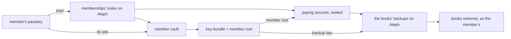
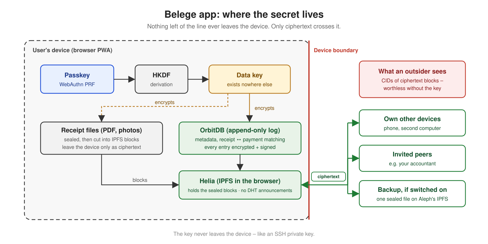

# Backup on Aleph Cloud

_Deutsch: [backup.de.md](backup.de.md)_

A backup holds everything Belege keeps in this browser: the databases of the books and every receipt file, including those that came by mail. It is one file, sealed with a key from the books' vault ([keys.md](keys.md)). Aleph Cloud keeps it. Only a passkey of these books can open it, not even Aleph.

## What you need to restore

On an empty device, two things:

1. **A passkey of these books.** The backup's key is derived from the books' root, which every passkey with a slot in the vault opens – also backups made before it had one. A passkey of other books does not open it ("gehört zu anderen Büchern").
2. **The address of the Aleph account that pays**, or the backup's CID. Belege finds the backups through the account: it asks Aleph for that account's STORE messages on the channel `BELEGE-BACKUP`. The address is public; write it down. `pnpm setup:aleph` shows it, a paired bridge names it by itself, and once the vault is kept on Aleph an empty device learns it from there.

## Set up once

1. In the terminal, in Belege's folder: `pnpm setup:aleph`. The bridge makes a backup key of its own and keeps it in the keychain. It prints the key's address, never the key itself. That address is the Aleph account that pays for keeping the backups. It is not your wallet.
2. Put credits on that address (app.aleph.cloud → Credits).
   - A backup is paid in credits. Aleph keeps it only while the account has them.
   - Aleph refuses a new backup when the account has less than a day of it (about 54 credits per MiB and day). The page then says how many credits it takes.
   - Credits are drawn by the hour. No tokens move per backup, and ALEPH held on the account does not pay for it.
3. Restart the bridge (`pnpm bridge`) and pair it. _Integrationen → Backup_ keeps the account's address in the settings.
4. Allow this browser's key. The page shows it and the command:

   ```sh
   pnpm setup:aleph -- --authorize <address> --channel BELEGE-BACKUP
   ```

   Or, without a terminal, in Aleph's dashboard with the account's wallet: [Permissions](https://app.aleph.cloud/console/permissions/), the browser's address, message type STORE, channel `BELEGE-BACKUP`. Credits are bought and transferred under [Credits](https://app.aleph.cloud/console/credits/).

   From then on the browser signs the order to Aleph itself, and the bridge need not run for a backup. Until then the bridge signs, as before.

## Back up

_Integrationen → Backup → "Jetzt sichern"_.

At the top, one line on the card says whether everything is backed up and what needs doing. Below it are "Jetzt sichern", "Wiederherstellen …" and "Automatisch sichern". Everything else sits under "Erweitert": the account, this browser's key and its grant, "Neues Vollbackup", the list of backups, the cost and the box "Wo es liegt". "Erweitert" is open by itself while something is still to set up; otherwise it stays as you last left it.

1. The browser packs and seals the backup.
2. It sends the file to one of Aleph's API nodes together with the order to keep it: a STORE message for the account, paid in credits. Aleph keeps the file in the same step.
3. This browser's key signs that order once the account has allowed it.

Where the account has not allowed this browser's key, the bridge signs with its backup key:

- With the bridge on this computer, the browser hands it the sealed file (up to 256 MiB), and the bridge sends it to Aleph with the order. It only ever sees the sealed file, never the books.
- Where the browser reaches the bridge only through another device, or the backup is bigger, it uploads the file to Aleph's IPFS host itself and the bridge sends the order afterwards. Aleph then has to fetch the file from the host, and refuses the order when it cannot.

The page shows the backup's CID; keep it somewhere.

**Full backups and increments.** The first backup is a full one: everything this browser keeps. After it, "Jetzt sichern" uploads only what is new since the last backup of the chain – an increment: the new log entries (with each changed database's manifest and its writers' identities) and the receipt files the chain has not got yet, sealed the same way. Aleph keeps it with a STORE whose `ref` is the full backup's CID, so a restore finds the chain without downloading anything. "Neues Vollbackup" starts a new chain; so does the next backup when Aleph does not keep the full one. Settings alone – every backup writes its own history there – make no increment; they go with the next one. Where the chain stands (the full backup, the last increment, the heads shipped) is kept in the sealed settings, so another own device continues it; the receipt files shipped sit beside it, one short record per backup of the chain with the files that backup added, so the chain's own record stays small however long the chain gets.

**What it costs.** Every backup is a whole copy, kept – and paid for every day – until it is forgotten. Under "Erweitert" the card shows what the backups Aleph keeps cost a day together, and how long the credits last. When a new full backup would leave less than 30 days of credits, the page asks before it uploads; an increment goes up without asking. The rate is an estimate (about 54 credits per MiB and day, as Aleph asked on 2026-10-03); Aleph sets the price.

**While it runs.** The backup runs for the whole app: you can go on working in Belege, and the header shows how far it is ("Backup 42 %", or "Backup wartet auf dich" when it asks before uploading); one click leads back. Closing or reloading the tab asks first – that ends the upload. Upload percentages appear only where the host allows them; Aleph's IPFS host so far allows that for its own console only ([aleph-im/pyaleph#1280](https://github.com/aleph-im/pyaleph/issues/1280)), so there the bar moves without a number and says for how long.

**When Aleph's IPFS host takes no uploads.** Since 2026-10-26 Aleph's IPFS hosts answer `/api/v0/add` with 404; they only serve. Then the backup goes through one of Aleph's API nodes (`/api/v0/ipfs/add_file`, storage bridge `createAlephBackend`), with percentages. With this browser's key let in, the signed order goes along and Aleph keeps the file in the same call – up to 1 GB; where the bridge signs, it uploads the same way with its own key. Only with neither does the API take at most 25 MiB, and a bigger backup says why it cannot go now. The storage bridge computes the file's CID beforehand, as Aleph's node makes it; Aleph checks after the upload that the two agree.

**On a phone.** Belege keeps the screen awake while a backup, a restore or the move of the books after an update runs (Screen Wake Lock – Chrome on Android, Safari 16.4+; elsewhere the hint to keep the screen on stays). A restore does not hold the backup in memory ([#512](https://github.com/Le-Space/belege/issues/512)): the file is opened as it arrives, a megabyte at a time, and what it holds goes straight into the browser's storage. The step says how many MB have arrived and how many blocks are stored. This holds for backups made since they are sealed in frames (see [Technical](#technical)). A backup made before that can only be opened whole, and needs about three times its size in the tab's memory: several hundred MB are more than a phone gives, and a browser that ends the tab reloads the page with nothing restored. Make a new full backup with a current Belege, on a computer, and restore that one on the phone.

**Switching apps on a phone.** The wake lock holds the screen, not the page: the moment the tab is hidden, Android freezes it after a few minutes and discards it under memory pressure, and the download or the import breaks off. A page that is audibly playing is not frozen. So on a phone or tablet the backup card offers, under "Erweitert", "Leiser Ton, solange es läuft" (on by default, remembered per browser): a soft note every two seconds while a backup, a restore or the move of the books after an update runs, and a media notification ("Belege stellt wieder her …") that leads back into the app. The note is made in the browser, not downloaded; it plays through the phone's media volume. Whether it carries a restore through a real app switch, and in which browsers, is being measured (#525); unticked, stay in Belege until it is done.

**Not backed up, and automatic.** When the last backup lacks something – a payment, a receipt, a link, an AI result, entries from another device – the header says "Nicht gesichert", with the areas in its tooltip. Belege compares each database's heads with the ones the chain last shipped; that costs next to nothing. With "Automatisch sichern (auf diesem Gerät)" Belege uploads an increment by itself five minutes after the last change – never a full backup. Only while the tab is open, the network is not paused, this browser is let in or the bridge runs, the credits last more than 30 days, and Aleph did not refuse the last increment; otherwise the header says why not. When Aleph refuses an increment – it could not fetch the file, or the credits did not cover it – the chain goes back to the last point Aleph confirmed and the header says "Nicht gesichert" again. An automatic increment would then upload everything since that point once more, and often be refused again, every five minutes. So "Automatisch sichern" waits for you: the header says Aleph refused, the card says why. "Jetzt sichern" still works; once Aleph keeps (or is still deciding on) a backup of the chain again, Belege backs up by itself again. Switch it on on one device, not several: two devices continuing the same chain at once would both write its next increment.

**Whether Aleph kept it.** Aleph answers a STORE with `pending` first and decides later. Until it has, the line at the top says "Gesichert – Aleph bestätigt noch" with an amber dot instead of "Alles gesichert". After a backup that is still pending, the page asks Aleph again by itself – after about 15 seconds, 45 seconds, 2 and 5 minutes, then it stops – and shows its decision without a reload. It does not ask while the network is paused, nor once the card is closed; what is still pending then is asked again when the card opens and before the next backup. "Erneut prüfen" asks Aleph about every backup in the list again, by its request (the STORE's item hash, shown with a link). If Aleph does not know a request, or refused it, the row says so, and "Aleph erneut beauftragen" sends a new STORE for the same file – nothing is uploaded again. Where Aleph refused because it could not fetch the file, a new order does not help: the row says so, and its content goes up again with the next "Jetzt sichern", because the chain goes back to the last point Aleph confirmed.

**Where it lies – spread out, encrypted, with a public envelope.** The card says this under "Erweitert", in a box of its own. While you set up, "Erweitert" is open, so you read it before anything goes up:

- The sealed file lies on publicly reachable IPFS nodes. According to Aleph's support, Aleph distributes the blocks to all its nodes (and this may change). Whoever knows the CID can download it from any of them, through any IPFS gateway – but not open it.
- Every backup's CID is in Aleph's public message log, with time, size, the paying account and the channel. Anyone recording that log sees when and how much is backed up.
- The upside: the backup is not in one data centre. When a provider or a region goes down – as in the fire at OVH's Strasbourg data centre in 2021, or the outages that keep hitting the big clouds – it stays reachable, and a restore works from any IPFS node that has the file. Whether that is worth the public envelope is the user's choice.
- Which nodes have it: **"Wer hält es?"** under each backup in the history asks, on that click only, IPFS delegated routing for the peers announcing its CID (`https://delegated-ipfs.dev/routing/v1/providers/<cid>`, through Helia's `@helia/delegated-routing-v1-http-api-client`, used on its own – not wired into the app's Helia node, which would then ask it for every block), Aleph's `corechannel` aggregate (`0xa1B3bb7d2332383D96b7796B908fB7f7F3c2Be10`) for its core nodes' names by IP, and ipwho.is for each IP's city, country and network. It lists node, IP, place and network, and the spread by network and country. The routing service sees the CID, ipwho.is the nodes' IPs; all three see this computer's IP address. On 2026-10-23 one backup had 13 providers, all of them Aleph core channel nodes (of 58 active), 8 of them at Hetzner (Falkenstein, Helsinki).
- A backup without public IPFS, on Filecoin Onchain Cloud with chosen storage providers, is planned: [#459](https://github.com/Le-Space/belege/issues/459).

This browser's key is made here and kept sealed in the settings, as the bridge token is. It goes with the books to your own devices and into every backup. A stolen key could only have Aleph keep files on that one channel at the account's expense. It opens no backup, since those are sealed with the passkey's key, and it moves no funds. `pnpm setup:aleph -- --revoke <address>` takes the grant back.

## Restore

A full backup comes back together with all its increments: the card lists each full backup with how many there are (Aleph's `refs=`, and the history here), fetches them all, and refuses a chain with a hole – its newer heads would point at entries nobody has. An increment alone is not restored; its full backup is.

_Integrationen → Backup_, in the "Backups" list, **"Wiederherstellen"** on a full backup, after unlocking with **a passkey of these books**. On a new device that means "Mit vorhandenem Passkey wiederherstellen", then entering the paying account's address if the card does not know it yet.

The list shows, grouped by chain – a full backup with its increments, the current chain first, deleted ones folded away –:

- the backups kept for the account, whether the bridge or an allowed key sent them. The browser asks Aleph directly, without the bridge. The address comes from the settings or the paired bridge, or you enter it;
- the backups made from this browser.

A CID can also be typed ("Per CID wiederherstellen"). After a question, the browser fetches the sealed file from Aleph's gateway, opens it with the key from the passkey as it arrives, and puts every database and receipt file back. It **merges**: what is in the books here stays, what the backup holds is added, nothing is deleted. The page then reloads, and the passkey opens the books again.

What comes back is checked, in this order:

- **The key, first.** A check in front of the file says whether this passkey's key opens it, before anything is stored. A wrong passkey is therefore never confused with a damaged file.
- **Every piece as it arrives.** The file is sealed in frames of a megabyte; each one is authenticated, with its place in the file, before what it holds is used. A frame that was altered, left out or moved is refused, and so is a file that ends early ("nicht oder nicht vollständig zurückgegeben"; the technical detail names the frame). Every block inside is checked against its own CID.
- **Whose backup it is.** The backup's first block names its databases. If they are not these books', the restore stops before anything is stored.
- **The whole file, at its end.** Against the size the backup's STORE names (backups since 0.26.2 carry it, the list shows it) and against its CID – the file is built again from the bytes the way Aleph's hosts built it.

The books are only touched after all of that: until the last frame has opened, nothing is joined, and a restore that fails on the way leaves them as they were. What it had stored until then stays in the browser's storage as sealed blocks nothing refers to. A connection that drops is picked up at the byte it stopped at. Under every restore error, "Technical detail" unfolds what the failing step said in its own words – which gateway, how many bytes, which CID – for a report, or for a second try that knows why.

**Which way it comes back** is the browser's choice, kept per browser ("Erst Alephs Gateway, dann das IPFS-Netz", on by default): one request to Aleph's gateway, and when it stays silent for 15 seconds, the browser fetches the backup itself over IPFS – a fetch-only node for the minute it takes, dialling Aleph's own IPFS nodes (IPv6 only, as they announce) and whoever the public routing says holds the CID (cid.contact, delegated-ipfs.dev; both see the CID and the browser's IP). Unticked, the gateway is not asked at all. Either way the card says what delivered – the gateway's host or how many peers – and how long it took. Every block over peers is checked against its CID, so a stranger's bytes are as safe as a gateway's.

**A backup made before the books got new keys** ([keys.md](keys.md#new-keys-for-the-books), #628) opens with the earlier root the vault keeps. It does not replace the books: only entries the books of that time signed count – their identity and signature are checked –, they add only records today's books do not have, and its receipt files are sealed anew. It brings no settings.

A backup of other books cannot be opened ("gehört zu einem anderen Tresor"): its key comes from that vault's root. The way in is a passkey with a slot in that vault – added on the device with those books – or those books' recovery words.

## Members back up and restore

A member of the books who writes along – the bookkeeping, say – backs up and restores like the owner ([#613](https://github.com/Le-Space/belege/issues/613)); a member who only reads along does not back up. Their key bundle holds the books' backup key, so the backup is sealed the same way and goes to the same Aleph account, signed with the browser key the books allowed. The list of backups says who made each one ("von Buchhaltung").

With each backup, the member's vault goes to Aleph too: at an address of its own, derived from the member's passkey, apart from the passkey's own books. Published are the sealed vault, its slots without names, and the paying account, sealed under a key only the member's vault opens. No name of the books, no member's name.

On an empty device, with the member's passkey:

1. "Passkey wiederherstellen" opens the member's own books and finds the membership on Aleph.
2. On the next unlock, choose the books you are a member of. The vault opens the key bundle.
3. The backup card already knows the paying account and lists the backups. "Wiederherstellen" brings the books back.



A member never gets the books' root, their passkeys or their recovery words. Adding a passkey to the books, moving them or inviting another member stays with the owner.

## Let another key back up

An application can back up from the browser without the bridge running. It holds a key of its own, and the bridge's account lets that key keep backups at its expense. Belege itself does this (channel `BELEGE-BACKUP`, above), and so does Le Space Invoice (channel `INVOICE-BACKUP`, Le-Space/invoice#28). Both show their key's address and the command.

```sh
pnpm setup:aleph -- --authorize <address> --channel INVOICE-BACKUP   # may keep backups on that channel
pnpm setup:aleph -- --grants                                         # who may
pnpm setup:aleph -- --revoke <address>                               # take it back
```

A grant is an entry in the account's `security` aggregate on Aleph, signed with the bridge's backup key: STORE only, on the named channel only. Aleph charges the bridge's account for what that key keeps, not the key (measured 2026-10-03). The list of backups asks Aleph by the paying account, so what such a key kept is in it too.

## Move books to another passkey

A backup restores only with a passkey of the books that made it, and a passkey belongs to its address: books on `localhost` and on belege.le-space.de, or under an old and a new passkey, are separate books with separate DIDs. _Bücher umziehen_ on this page takes books from one into the **empty** books of another (#328):

1. In the new books: _Bücher übernehmen …_. They show a one-time key as a QR code and as text (`belege-move:…`), with a fingerprint. The key exists only while that page stays open.
2. In the old books: _In andere Bücher umziehen …_, paste or scan the key, check that the fingerprint is the same, _Umzugsdatei erstellen_. A file `Belege-Umzug_<date>.belege` is saved.
3. In the new books: choose the file. Its counts are shown; _Übernehmen_ takes it over.

The file holds every record of every collection (deleted ones too) and every receipt file and kept mail. It is sealed for that one key: an ephemeral X25519 key of the old books, ECDH, HKDF-SHA-256, AES-256-GCM. Only the date, the version, the counts and what was left out are readable. Left out, as they belong to the old passkey or device: the bridge pairing, the backup key, account and list, the invoicing app's pairing, the network mode, the relay in your own network, waiting jobs and the list of own devices; and, as they belong to the old books' vault, whether its keys are kept on Aleph, a pointer to newer keys, and the members. Pair and set these up again in the new books; members join them anew.

Records keep their ids, links and times; receipt files are sealed anew with the new books' key. Books that are not empty take nothing over, and a file that does not open or does not add up writes nothing. The old books stay as they are; delete them there under _Einstellungen → Speicher_. The old books stay untouched either way.

**When both books are not open at once:** in the old books, under _In andere Bücher umziehen …_, open _Mit einer Passphrase umziehen …_ and _Umzugsdatei mit Passphrase erstellen_. Belege makes a passphrase – 20 characters in groups of five, 100 random bits – and shows it once: write it down. The file is sealed with it (scrypt, then AES-256-GCM). In the new books, _Bücher übernehmen …_, choose the file; it asks for the passphrase (case, spaces and dashes do not matter, nor O/0 or I/L/1). Whoever has both the file and the passphrase can read the books: keep them apart. A passphrase cannot be chosen, so it cannot be a weak one.

## What leaves



_Everything left of the line never leaves the device; what crosses it is ciphertext. The data key is derived from the passkey and exists nowhere else — like an SSH private key._

- **To Aleph, from the browser:** the sealed file, to an API node together with the order. Where the bridge signs, the file goes there through the bridge, or from the browser to Aleph's IPFS host. Aleph sees its size and this computer's IP address, not what is in it. Anyone who knows the CID can fetch the sealed file from IPFS.
- **To the Aleph API, from the browser:**
  - the STORE message, with the address of this browser's key, the account's and the file's CID;
  - reads of the account's grants, its credits and its list of backups, by its address;
  - on "Erneut prüfen", the item hash of each backup's STORE, to ask what became of it.
- **To the Aleph API, from the bridge:**
  - without the grant, the STORE message with the address of its backup key and the file's CID;
  - on `--authorize` and `--revoke`, the list of keys the account allows.

## Technical

- **Content:** every block exactly as it is stored. A restore therefore brings back the same CIDs, the same signed entries and the same writer:
  - each database's log entries (already sealed with the database key), its manifest and access controller, and every writer's identity;
  - each database's access list – its own database, which names the members allowed to write – with its entries, so that a restore on a device that never saw the books knows a member's grant before it joins what the member wrote;
  - each receipt file's root and 1 MiB chunks (already sealed with the blob key);
  - a dag-cbor manifest: the storage bridge's metadata (each database with address, manifest and heads, from `bundleDatabases`), the receipt files, the app version and the date.
- **Restore:**
  - each sealed file – the full backup, then its increments, one after the other – is opened frame by frame, and its blocks go into the blockstore as they are read (the storage bridge's `openFrames` and `storeBlocksFromCAR`). Only their names are kept in memory;
  - then the access lists, then the storage bridge's `restoreFromStoredBlocks` puts the databases back from the blockstore;
  - if a head cannot be joined, the restore stops with the reason instead of reporting success.
- **Writer ([#496](https://github.com/Le-Space/belege/issues/496)):**
  - the books write as an identity of their own, an Ed25519 key derived from the books' secret (`belege/books-secret/v1`, from the passkey's PRF result until the vault of [#406](https://github.com/Le-Space/belege/issues/406) keeps it). It is the root of every collection's access controller (`OrbitDBAccessController`, its own list database sealed like the others). The passkey's DID is still the one shown, and what a record names as its author;
  - books written by the passkey move once, on the first unlock with this version, with every entry and its clock (`store/migrate.js`). The databases are others then, so the next backup starts a new chain with a full backup;
  - a backup from before the move goes back into the passkey's databases and moves in on the next unlock. Restored under another passkey of the books – one added later, or made with the recovery words ([#555](https://github.com/Le-Space/belege/issues/555)) –, it still fits: its databases are recognised by their names, the writer is read from the backup's own access controller, and this browser keeps that DID (`belege.former-writer:<books identity>` in `localStorage`, nothing secret), so the next unlock moves them in under it.
- **Entries from earlier sessions:**
  - OrbitDB 4.0.0 remembers verified identities by `signatures.id` and refuses a different one with the same id;
  - a passkey identity has the same `signatures.id` in every session but a new WebAuthn assertion, so entries from an earlier session (from a backup, or synced from an own device) were refused;
  - Belege checks such an identity again the way OrbitDB checks an unstored one (shape, id signature, passkey binding in the provider), only without that comparison ([orbitdb/orbitdb#1258](https://github.com/orbitdb/orbitdb/issues/1258); `session-identities.js`).
- **Format:** a CAR file, written by `@le-space/orbitdb-storage-bridge`, with the backup's manifest as its first block, sealed in frames with AES-256-GCM. The backup key is derived with HKDF from the books' root (`belege/backup-key/v1`). The file is `belegeB2 ‖ envelope`, the envelope being the storage bridge's `OSBE` version 2:

  ```
  "OSBE" | 2 | frame size (4 bytes) | salt (32) | key check (16) | frame 0 | frame 1 | … | last frame
  ```

  - **A key per file:** HKDF-SHA-256 from the backup key, the salt, the frame size and the context `belegeB2`. The backup key seals many files; the derived key seals one.
  - **A frame** is up to 1 MiB of the CAR and a 16-byte tag. Its nonce is its index and a mark (more behind it, the last one, the key check); the header, the index and the mark are authenticated with it. Every frame but the last is full, so the file carries no lengths.
  - **The key check** is the tag of an empty plaintext: a wrong key is known there.
  - **What it gives:** a frame can be opened by itself, so the file can be read as it arrives. A frame left out, moved, repeated or altered, a file cut short and a file with anything appended are refused at the frame.

- **Format up to 0.48:** `belegeB1 ‖ nonce ‖ ciphertext`, the whole CAR sealed in one piece with AES-256-GCM under the backup key itself. It still restores. One tag at the end of the file vouches for all of it, so it can only be opened whole.
- **Memory:** a restore of a backup in frames holds a frame, a block and the names of the blocks: measured in Node with blocks on disk, about 9 MiB for a backup of 64 MiB against about 190 MiB for the same backup in one piece (`restore-memory.spec.js`, `bench/restore-memory.js`). Making a backup still builds the file in memory, and the upload sends it as one body.
- **Upload:** the storage bridge's `aleph` backend (`backup/keeper.js` `createBackupUploader`):
  - with this browser's key granted, to one of Aleph's API nodes (`POST /api/v0/ipfs/add_file`) with the signed STORE in the same request, so the node keeps the file at once (up to 1 GiB);
  - without the grant and with the bridge on this computer, the browser hands the sealed file to the bridge (up to 256 MiB), which sends it to the API node with its own STORE the same way;
  - otherwise (a bridge reached only through another device, or a bigger backup) the browser uploads the file without a key – to Aleph's IPFS host (`/api/v0/add`), or, where that host takes no uploads, to an API node (at most 25 MiB) – and the bridge sends the STORE afterwards.
- **Keeping:**
  - A STORE message on the channel `BELEGE-BACKUP`, signed with `personal_sign`. `content.address` is the paying account, and it is paid in credits (`payment: { type: "credit" }`, storage bridge 0.17.0). Without that field Aleph books it as `hold`, which only ALEPH held on the account covers.
  - With the grant, the browser sends it itself (`backup/keeper.js`), with its secp256k1 key from the sealed settings (`backup/aleph-key`). It follows a `pending` answer for up to a minute until Aleph has decided (the backup card asks again later, `backup/recheck.js`); a refusal names the credits there are and the credits a day takes.
  - Without the grant, the bridge sends it (`POST /backup/aleph/pin`, [bridge/README.md](../bridge/README.md)). A refusal comes back from there as HTTP 402 `ALEPH_BACKUP_REJECTED`.
- **List:** the browser asks Aleph's messages API with `owners=` (the paying account) instead of `addresses=` (the sender), so STORE messages another key sent for the account are included. The paired bridge names the account and, in tests, Aleph's addresses (`GET /backup/status`).
- **Missing blocks:** nothing is fetched from the network for a backup. A block this browser does not have counts as missing, and the page says so. A receipt file goes into a backup only whole, its root and every chunk: one this browser has only in part (a receipt that came by sync before its file) is left out and not counted as shipped, so the next increment after its blocks have arrived carries it.
- **What an increment reads:** what the chain has shipped of each database is known by the heads it shipped last. The first increment in a session walks each log from there once; each increment then adds its own entries, so the next one reads only what is new.
