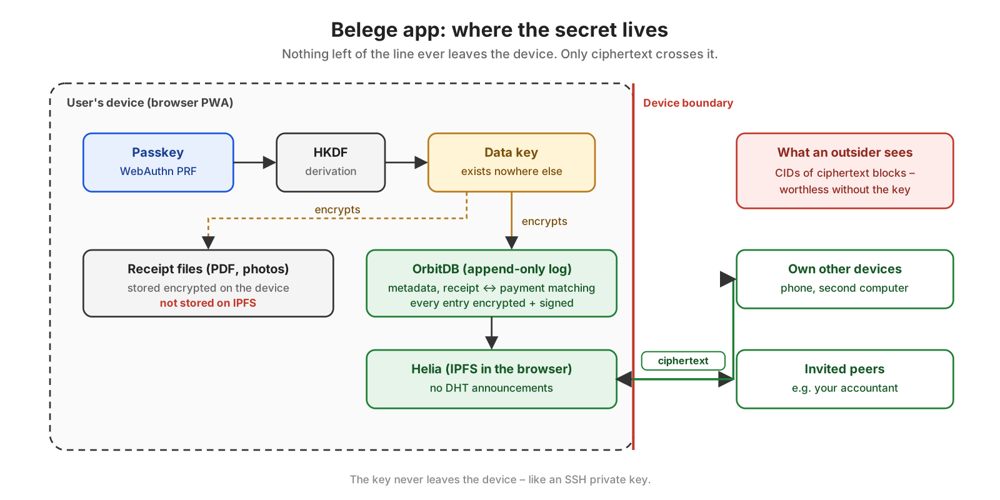

# Backup on Aleph Cloud

_Deutsch: [backup.de.md](backup.de.md)_

A backup holds everything Belege keeps in this browser: the databases of the books and every receipt file, including those that came by mail. It is one file, sealed with a key from the books' vault ([keys.md](keys.md)). Aleph Cloud keeps it. Only a passkey of these books can open it, not even Aleph.

## What you need to restore

On an empty device, two things:

1. **A passkey of these books.** The backup's key is derived from the books' root, which every passkey with a slot in the vault opens – also backups made before it had one. A passkey of other books does not open it ("gehört zu anderen Büchern").
2. **The address of the Aleph account that pays**, or the backup's CID. Belege finds the backups through the account: it asks Aleph for that account's STORE messages on the channel `BELEGE-BACKUP`. The address is public; write it down. `pnpm setup:aleph` shows it, a paired bridge names it by itself, and once the vault is kept on Aleph an empty device learns it from there.

## Set up once

1. In the terminal, in Belege's folder: `pnpm setup:aleph`. The bridge makes a backup key of its own and keeps it in the keychain. It prints the key's address, never the key itself. That address is the Aleph account that pays for keeping the backups. It is not your wallet.
2. Put credits on that address (app.aleph.cloud → Credits).
   - A backup is paid in credits. Aleph keeps it only while the account has them.
   - Aleph refuses a new backup when the account has less than a day of it (about 54 credits per MiB and day). The page then says how many credits it takes.
   - Credits are drawn by the hour. No tokens move per backup, and ALEPH held on the account does not pay for it.
3. Restart the bridge (`pnpm bridge`) and pair it. _Integrationen → Backup_ keeps the account's address in the settings.
4. Allow this browser's key. The page shows it and the command:

   ```sh
   pnpm setup:aleph -- --authorize <address> --channel BELEGE-BACKUP
   ```

   Or, without a terminal, in Aleph's dashboard with the account's wallet: [Permissions](https://app.aleph.cloud/console/permissions/), the browser's address, message type STORE, channel `BELEGE-BACKUP`. Credits are bought and transferred under [Credits](https://app.aleph.cloud/console/credits/).

   From then on the browser signs the order to Aleph itself, and the bridge need not run for a backup. Until then the bridge signs, as before.

## Back up

_Integrationen → Backup → "Jetzt sichern"_.

1. The browser packs and seals the backup.
2. It uploads the file directly to Aleph's IPFS host.
3. Aleph is asked to keep the file, with a STORE message for the account, paid in credits. This browser's key signs that message once the account has allowed it; otherwise the bridge signs it with its backup key.

The backup never passes through the bridge. The page shows the backup's CID; keep it somewhere.

**Full backups and increments.** The first backup is a full one: everything this browser keeps. After it, "Jetzt sichern" uploads only what is new since the last backup of the chain – an increment: the new log entries (with each changed database's manifest and its writers' identities) and the receipt files the chain has not got yet, sealed the same way. Aleph keeps it with a STORE whose `ref` is the full backup's CID, so a restore finds the chain without downloading anything. "Neues Vollbackup" starts a new chain; so does the next backup when Aleph does not keep the full one. Settings alone – every backup writes its own history there – make no increment; they go with the next one. Where the chain stands (the full backup, the last increment, the heads shipped, the receipt files shipped) is kept in the sealed settings, so another own device continues it.

**What it costs.** Every backup is a whole copy, kept – and paid for every day – until it is forgotten. Above "Jetzt sichern" the page shows what the backups Aleph keeps cost a day together, and how long the credits last. When a new backup would leave less than 30 days of credits, the page asks before it uploads. The rate is an estimate (about 54 credits per MiB and day, as Aleph asked on 2026-10-03); Aleph sets the price.

**Whether Aleph kept it.** Aleph answers a STORE with `pending` first and decides later. "Erneut prüfen" asks Aleph about every backup in the list again, by its request (the STORE's item hash, shown with a link). If Aleph does not know a request, or refused it, the row says so, and "Aleph erneut beauftragen" sends a new STORE for the same file – nothing is uploaded again.

**Where it lies – spread out, encrypted, with a public envelope.** The card says this in a box of its own, before anything goes up:

- The sealed file lies on publicly reachable IPFS nodes. According to Aleph's support, Aleph distributes the blocks to all its nodes (and this may change). Whoever knows the CID can download it from any of them, through any IPFS gateway – but not open it.
- Every backup's CID is in Aleph's public message log, with time, size, the paying account and the channel. Anyone recording that log sees when and how much is backed up.
- The upside: the backup is not in one data centre. When a provider or a region goes down – as in the fire at OVH's Strasbourg data centre in 2021, or the outages that keep hitting the big clouds – it stays reachable, and a restore works from any IPFS node that has the file. Whether that is worth the public envelope is the user's choice.
- Which nodes have it: **"Wer hält es?"** under each backup in the history asks, on that click only, IPFS delegated routing for the peers announcing its CID (`https://delegated-ipfs.dev/routing/v1/providers/<cid>`, through Helia's `@helia/delegated-routing-v1-http-api-client`, used on its own – not wired into the app's Helia node, which would then ask it for every block), Aleph's `corechannel` aggregate (`0xa1B3bb7d2332383D96b7796B908fB7f7F3c2Be10`) for its core nodes' names by IP, and ipwho.is for each IP's city, country and network. It lists node, IP, place and network, and the spread by network and country. The routing service sees the CID, ipwho.is the nodes' IPs; all three see this computer's IP address. On 2026-10-23 one backup had 13 providers, all of them Aleph core channel nodes (of 58 active), 8 of them at Hetzner (Falkenstein, Helsinki).
- A backup without public IPFS, on Filecoin Onchain Cloud with chosen storage providers, is planned: [#459](https://github.com/Le-Space/belege/issues/459).

This browser's key is made here and kept sealed in the settings, as the bridge token is. It goes with the books to your own devices and into every backup. A stolen key could only have Aleph keep files on that one channel at the account's expense. It opens no backup, since those are sealed with the passkey's key, and it moves no funds. `pnpm setup:aleph -- --revoke <address>` takes the grant back.

## Restore

A full backup comes back together with all its increments: the card lists each full backup with how many there are (Aleph's `refs=`, and the history here), fetches them all, and refuses a chain with a hole – its newer heads would point at entries nobody has. An increment alone is not restored; its full backup is.

_Integrationen → Backup → "Wiederherstellen"_, after unlocking with **a passkey of these books**. On a new device that means "Mit vorhandenem Passkey wiederherstellen".

The list shows:

- the backups kept for the account, whether the bridge or an allowed key sent them. The browser asks Aleph directly, without the bridge. The address comes from the settings or the paired bridge, or you enter it;
- the backups made from this browser.

A CID can also be typed. After a question, the browser fetches the sealed file from Aleph's gateway, opens it with the key from the passkey and puts every database and receipt file back. It **merges**: what is in the books here stays, what the backup holds is added, nothing is deleted. The page then reloads, and the passkey opens the books again.

A backup of other books cannot be opened ("gehört zu anderen Büchern").

## Let another key back up

An application can back up from the browser without the bridge running. It holds a key of its own, and the bridge's account lets that key keep backups at its expense. Belege itself does this (channel `BELEGE-BACKUP`, above), and so does Le Space Invoice (channel `INVOICE-BACKUP`, Le-Space/invoice#28). Both show their key's address and the command.

```sh
pnpm setup:aleph -- --authorize <address> --channel INVOICE-BACKUP   # may keep backups on that channel
pnpm setup:aleph -- --grants                                         # who may
pnpm setup:aleph -- --revoke <address>                               # take it back
```

A grant is an entry in the account's `security` aggregate on Aleph, signed with the bridge's backup key: STORE only, on the named channel only. Aleph charges the bridge's account for what that key keeps, not the key (measured 2026-10-03). The list of backups asks Aleph by the paying account, so what such a key kept is in it too.

## Move books to another passkey

A backup restores only with the passkey that made it, and a passkey belongs to its address: books on `localhost` and on belege.le-space.de, or under an old and a new passkey, are separate books with separate DIDs. _Bücher umziehen_ on this page takes books from one into the **empty** books of another (#328):

1. In the new books: _Bücher übernehmen …_. They show a one-time key as a QR code and as text (`belege-move:…`), with a fingerprint. The key exists only while that page stays open.
2. In the old books: _In andere Bücher umziehen …_, paste or scan the key, check that the fingerprint is the same, _Umzugsdatei erstellen_. A file `Belege-Umzug_<date>.belege` is saved.
3. In the new books: choose the file. Its counts are shown; _Übernehmen_ takes it over.

The file holds every record of every collection (deleted ones too) and every receipt file and kept mail. It is sealed for that one key: an ephemeral X25519 key of the old books, ECDH, HKDF-SHA-256, AES-256-GCM. Only the date, the version, the counts and what was left out are readable. Left out, as they belong to the old passkey or device: the bridge pairing, the backup key, account and list, the invoicing app's pairing, the network mode, the relay in your own network, waiting jobs and the list of own devices. Pair and set these up again in the new books.

Records keep their ids, links and times; receipt files are sealed anew with the new books' key. Books that are not empty take nothing over, and a file that does not open or does not add up writes nothing. The old books stay as they are; delete them there under _Einstellungen → Speicher_. The old books stay untouched either way.

**When both books are not open at once:** in the old books, under _In andere Bücher umziehen …_, open _Mit einer Passphrase umziehen …_ and _Umzugsdatei mit Passphrase erstellen_. Belege makes a passphrase – 20 characters in groups of five, 100 random bits – and shows it once: write it down. The file is sealed with it (scrypt, then AES-256-GCM). In the new books, _Bücher übernehmen …_, choose the file; it asks for the passphrase (case, spaces and dashes do not matter, nor O/0 or I/L/1). Whoever has both the file and the passphrase can read the books: keep them apart. A passphrase cannot be chosen, so it cannot be a weak one.

## What leaves



_Everything left of the line never leaves the device; what crosses it is ciphertext. The data key is derived from the passkey and exists nowhere else — like an SSH private key._

- **To Aleph's IPFS host, from the browser:** the sealed file. Aleph sees its size and this computer's IP address, not what is in it. Anyone who knows the CID can fetch the sealed file from IPFS.
- **To the Aleph API, from the browser:**
  - the STORE message, with the address of this browser's key, the account's and the file's CID;
  - reads of the account's grants, its credits and its list of backups, by its address;
  - on "Erneut prüfen", the item hash of each backup's STORE, to ask what became of it.
- **To the Aleph API, from the bridge:**
  - without the grant, the STORE message with the address of its backup key and the file's CID;
  - on `--authorize` and `--revoke`, the list of keys the account allows.

## Technical

- **Content:** every block exactly as it is stored. A restore therefore brings back the same CIDs, the same signed entries and the same writer:
  - each database's log entries (already sealed with the database key), its manifest and access controller, and every writer's identity;
  - each receipt file's root and 1 MiB chunks (already sealed with the blob key);
  - a dag-cbor manifest: the storage bridge's metadata (each database with address, manifest and heads, from `bundleDatabases`), the receipt files, the app version and the date.
- **Restore:**
  - the storage bridge's `restoreFromBlocks` puts the databases back from the opened backup;
  - if a head cannot be joined, the restore stops with the reason instead of reporting success.
- **Writer ([#496](https://github.com/Le-Space/belege/issues/496)):**
  - the books write as an identity of their own, an Ed25519 key derived from the books' secret (`belege/books-secret/v1`, from the passkey's PRF result until the vault of [#406](https://github.com/Le-Space/belege/issues/406) keeps it). It is the root of every collection's access controller (`OrbitDBAccessController`, its own list database sealed like the others). The passkey's DID is still the one shown, and what a record names as its author;
  - books written by the passkey move once, on the first unlock with this version, with every entry and its clock (`store/migrate.js`). The databases are others then, so the next backup starts a new chain with a full backup;
  - a backup from before the move goes back into the passkey's databases and moves in on the next unlock.
- **Entries from earlier sessions:**
  - OrbitDB 4.0.0 remembers verified identities by `signatures.id` and refuses a different one with the same id;
  - a passkey identity has the same `signatures.id` in every session but a new WebAuthn assertion, so entries from an earlier session (from a backup, or synced from an own device) were refused;
  - Belege checks such an identity again the way OrbitDB checks an unstored one (shape, id signature, passkey binding in the provider), only without that comparison ([orbitdb/orbitdb#1258](https://github.com/orbitdb/orbitdb/issues/1258); `session-identities.js`).
- **Format:** a CAR file, written by `@le-space/orbitdb-storage-bridge`, sealed as a whole with AES-256-GCM. The key is derived with HKDF from the passkey's PRF result (`belege/backup-key/v1`). The file is `belegeB1 ‖ nonce ‖ ciphertext`.
- **Upload:** the storage bridge's `aleph` backend, `POST https://ipfs.aleph.cloud/api/v0/add`, with no key.
- **Keeping:**
  - A STORE message on the channel `BELEGE-BACKUP`, signed with `personal_sign`. `content.address` is the paying account, and it is paid in credits (`payment: { type: "credit" }`, storage bridge 0.17.0). Without that field Aleph books it as `hold`, which only ALEPH held on the account covers.
  - With the grant, the browser sends it itself (`backup/keeper.js`), with its secp256k1 key from the sealed settings (`backup/aleph-key`). It follows a `pending` answer until Aleph has decided; a refusal names the credits there are and the credits a day takes.
  - Without the grant, the bridge sends it (`POST /backup/aleph/pin`, [bridge/README.md](../bridge/README.md)). A refusal comes back from there as HTTP 402 `ALEPH_BACKUP_REJECTED`.
- **List:** the browser asks Aleph's messages API with `owners=` (the paying account) instead of `addresses=` (the sender), so STORE messages another key sent for the account are included. The paired bridge names the account and, in tests, Aleph's addresses (`GET /backup/status`).
- **Missing blocks:** nothing is fetched from the network for a backup. A block this browser does not have counts as missing, and the page says so.
