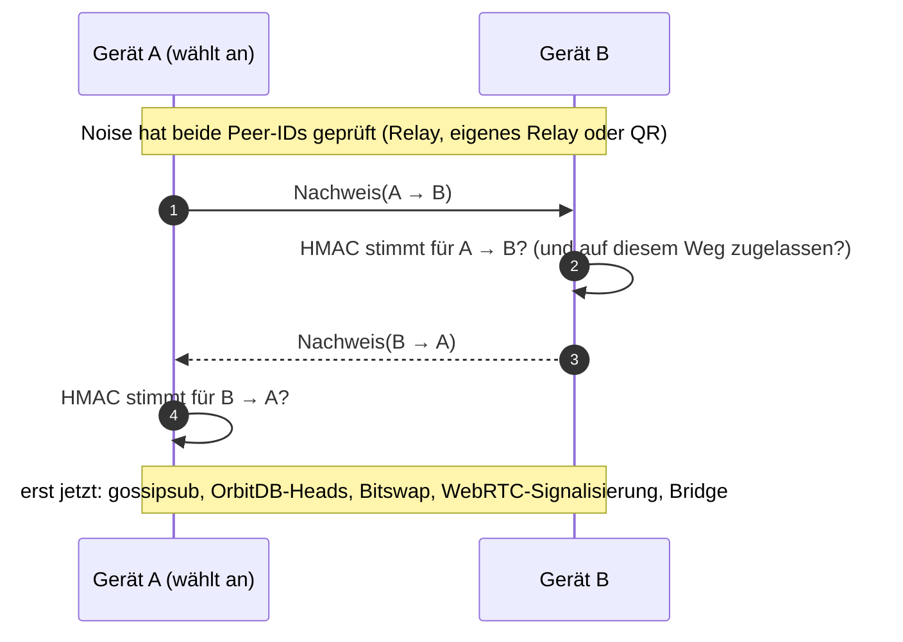

# Der Gerätenachweis: nur eigene Geräte bekommen die Bücher

_English: [device-proof.md](device-proof.md)_

Ist „Eigene Geräte synchronisieren“ an, geht der Knoten, der die Bücher abgleicht, ins Netz. Er ist dann über ein Le-Space-Relay erreichbar, über ein Relay in der eigenen Bridge oder direkt, nachdem zwei Geräte ihre QR-Codes gescannt haben. Wer seine Peer-ID kennt, kann ihn erreichen: das Relay, oder wer den QR-Code des Geräts gesehen hat.

Die Einträge sind versiegelt, bevor sie geschrieben werden. OrbitDB gibt seine Heads und Bitswap seine Blöcke aber jedem Peer, der fragt. Deshalb muss ein Peer zuerst beweisen, dass er den Schlüssel dieser Bücher hat. Erst dann bekommt er etwas.

Der Code: [`app/src/lib/sync/device-gate.js`](../app/src/lib/sync/device-gate.js), daneben [`first-contact.js`](../app/src/lib/sync/first-contact.js), [`quiet-identify.js`](../app/src/lib/sync/quiet-identify.js) und [`qr-link.js`](../app/src/lib/sync/qr-link.js).

## Der Nachweis

Beim Entsperren leitet Belege aus der Wurzel der Bücher einen Schlüssel ab: `deviceAuthKey = HKDF-SHA-256(Wurzel, "belege/device-auth/v1")` ([`database-keys.js`](../app/src/lib/database-keys.js)). Die Wurzel öffnet der Passkey über den Tresor ([keys.de.md](keys.de.md)). Jedes Gerät dieser Bücher kommt so auf denselben Schlüssel. Er wird nie übertragen und nie gespeichert.

Verbinden sich zwei Geräte, beweist das anwählende Gerät zuerst, über das Protokoll `/belege/device-proof/1.0.0`:

```
Nachweis = HMAC-SHA-256(deviceAuthKey, "belege/device-proof/v1\n" + Peer-ID des Beweisenden + "\n" + Peer-ID des Prüfenden)
```



Bis ein Peer den Nachweis erbracht hat, antwortet ihm der Knoten nur mit identify, dem Circuit-Relay und dem Nachweis selbst. Das funktioniert so:

- Ein libp2p-Dienst, der als erster startet, umhüllt die Registry.
- Jeder andere Protokoll-Handler wartet bis zu zehn Sekunden auf den Nachweis. Kommt keiner, bricht er den Stream ab.
- Die Topologien von libp2p (gossipsub, Bitswap) erfahren erst nach dem Nachweis von dem Peer.

Scheitert ein Austausch, versucht der Geräte-Sync es in jeder Runde neu, solange ein bekanntes Gerät verbunden ist.

## Was ein Relay oder ein Fremder sieht

- **identify:** Ein Peer ohne Nachweis, auch jedes Relay, erfährt nur identify und die Relay-Protokolle. Alles andere nennt der Knoten einem Gerät erst nach seinem Nachweis: die Datenbanken (OrbitDB legt je Datenbank ein Protokoll mit ihrer Adresse im Namen an), gossipsub, Bitswap, die WebRTC-Signalisierung und die Extensions, die ein Rechner den eigenen Geräten anbietet. Der Knoten nennt sich `js-libp2p`, nicht mit dem User-Agent des Browsers ([`quiet-identify.js`](../app/src/lib/sync/quiet-identify.js)).
- **Das Protokoll des Nachweises** bietet der Knoten nur Geräten an. Einem Relay, das er anwählt, bietet er es nicht an, und er kündigt es nicht an. Sein Name verriete sonst, welche App hinter einer Peer-ID steckt.
- **Was bleibt:** dass zwei Peer-IDs verbunden sind, wann, und wie viele Bytes fließen. Das Relay trägt die Verbindung, die mit Noise verschlüsselt ist, und kann sie nicht lesen.

## Welche Geräte hereinkommen

- **Ein Eintrag allein gibt nichts.** Der Eintrag eines Geräts in den Büchern (`device:<Peer-ID>`) sagt, wen der Knoten anwählt. Eine versehentlich eingetippte Peer-ID wird angewählt, erbringt aber nie den Nachweis und bleibt „nicht verbunden“.
- **Es kommen nur Geräte herein, die die Bücher kennen,** in jedem Modus ([`first-contact.js`](../app/src/lib/sync/first-contact.js)). Ein Gerät, das die Bücher noch nicht kennen, kommt auf zwei Wegen herein:
  - über das eigene Netz: zwei gescannte QR-Codes oder das Relay der Bridge;
  - wenn jemand es hereinlässt: Ein Gerät, das den Schlüssel beweist, aber nicht auf der Liste steht, erscheint unter _Eigene Geräte_ mit „möchte dazukommen“ und den Knöpfen „Zulassen“ und „Ablehnen“.

  Sobald sein Eintrag bei den anderen Geräten angekommen ist, darf es über jeden Weg kommen. Ein Gerät, das jemand mit einem geleakten Passkey aus der Ferne hinzufügt, bekommt nichts, solange es niemand hereinlässt. Dasselbe gilt für ein herausgenommenes Mitglied mit einem neuen Gerät.

- **Das erste Gerät.** Bücher, die noch nie ein anderes Gerät kannten, lassen ihr erstes Gerät herein, denn es gibt noch keine Liste, gegen die sie prüfen könnten. Das betrifft ein neues eigenes Gerät oder ein Mitglied, das gerade beigetreten ist. Entfernte Geräte zählen als bekannt. Bücher, die je ein anderes Gerät hatten, gelten also nicht als neu.
- **Die Bridge-Freigabe zwischen eigenen Geräten** (`belege-bridge`) antwortet einem Peer nur, wenn drei Dinge zutreffen: Die Bücher kennen ihn als Gerät, es ist kein Gerät eines Mitglieds, und er hat auf dieser Verbindung den Schlüssel bewiesen. Ein Telefon ruft nur Geräte an, die den Schlüssel bewiesen haben.
- **Der eigene Knoten der Bridge** (`bridge/src/node.js`) läuft mit demselben Tor, aber mit einem eigenen Schlüssel:
  - Beim Koppeln per Einladung leitet ein Gerät diesen Schlüssel aus der Wurzel der Bücher ab, nur für diese Bridge und eine Generation der Kopplung. Es gibt ihn der Bridge, und die legt ihn in ihren Schlüsselbund. Der Geräteschlüssel der Bücher verlässt den Browser nie.
  - Die Geräte weisen sich mit dem Bridge-Schlüssel nur gegenüber dieser einen Bridge aus. Sie lassen die Bridge an keines ihrer eigenen Protokolle, also kein gossipsub und kein Bitswap. Eine Kopie des Schlüssels öffnet also kein Gerät.
  - Die eine Ausnahme ist `/le-space/bridge-blocks/1.0.0`, ein zweites Bitswap mit einem eigenen Speicher im Arbeitsspeicher. Darüber gibt die Bridge große Antworten ab, etwa ein Paperless-Original (#578). Die Blöcke der Bücher liegen nie in diesem Speicher.
  - Die Bridge lässt nur Peers auf ihrer Geräteliste zu und bietet ihre Funktionen über den Stream nur ihnen an. Diese Liste pflegt das Gerät, das die Bridge gekoppelt hat. Jedes andere Gerät der Bücher kann Geräte nur von der Liste nehmen, nie das koppelnde Gerät.
  - „Kopplung lösen“ geht auf dem koppelnden Gerät oder am Rechner der Bridge. Es schaltet die Bücher auf die nächste Generation, dann ist der alte Schlüssel wertlos.
- **Die Geräte eines Mitglieds** ([keys.de.md](keys.de.md#mitglieder)) weisen sich aus wie eigene Geräte, denn der Schlüsselbund des Mitglieds enthält den Schlüssel für den Gerätenachweis. Ihre Peer-ID kommt aus der eigenen Wurzel des Mitglieds, nicht aus der Wurzel der Bücher. Beim Aufnehmen kommt das Gerät, das beigetreten ist, auf die Geräteliste. Ein weiteres Gerät des Mitglieds kommt herein wie ein neues eigenes Gerät: über das eigene Netz, oder wenn ein Gerät der Bücher es zulässt.
- **Ein Gerät entfernen** löscht seinen Eintrag. Jedes Gerät legt dann auf und lässt es nicht mehr herein.

## Warum das sicher ist

- **Ohne den Schlüssel der Bücher kein Nachweis.** Ihn haben nur Geräte, die die Bücher öffnen: mit einem Passkey dieser Bücher, mit ihren Wiederherstellungswörtern oder, als Mitglied, mit dem Schlüsselbund. Eine Peer-ID zu kennen, aus einem QR-Code, einem Screenshot oder vom Relay, reicht nicht.
- **Ein Nachweis gilt nur für ein Paar von Peers.** Er nennt beide Peer-IDs, und zwar die, die Noise mit den eigenen Schlüsseln der Peers geprüft hat. Auf dem QR-Weg binden das signierte WebRTC-Angebot und die Antwort den DTLS-Fingerabdruck ebenso an beide Peer-IDs. Ein Nachweis, den jemand anderswo mitliest oder weiterreicht, ist wertlos, denn auf jeder anderen Verbindung sind die Peer-IDs andere. Mitlesen geht ohnehin nicht, die Verbindung ist durchgehend verschlüsselt.
- **Standardbausteine.** HMAC-SHA-256 mit einem 256-Bit-Schlüssel aus HKDF. Geprüft wird mit `crypto.subtle.verify`.
- **Belegdateien kommen auf jedes eigene Gerät.** Ein Beleg-Datensatz repliziert mit OrbitDB; seine Datei sind versiegelte Blöcke in Helias Blockstore. Jedes Gerät holt die Dateien, die seine Belege nennen und ihm fehlen, über Bitswap von den verbundenen eigenen Geräten, im Hintergrund – beim Entsperren und sobald ein Beleg per Sync kommt oder ein eigenes Gerät sich verbindet ([`receipts/prefetch.js`](../app/src/lib/receipts/prefetch.js)) –, damit eine Datei auch dann aufgeht, wenn das Gerät, das sie hinzugefügt hat, offline ist. Wie OrbitDBs Austausch der Heads läuft das Bitswap der Bücher nur über eine direkte Verbindung, nie durch einen Relay: Ein öffentlicher Relay trüge sonst jede Datei und kann eine Verbindung kappen, lange bevor ein 1-MiB-Block durch ist. Wird ein Gerät direkt erreichbar, kommt jede fehlende Datei noch einmal an die Reihe. Zwei Dateien zugleich, bis 32 MiB je Datei (eine größere kommt, wenn sie geöffnet wird), eine fehlgeschlagene nach einer sich verdoppelnden Pause noch einmal; nichts, solange das Netz pausiert oder die Gerätesynchronisation aus ist. Die Blöcke sind, was gespeichert ist: versiegelt. Die Bridge liefert sie nie: Sie erreicht kein Bitswap der Bücher.
- **Der Inhalt ist sowieso versiegelt.** Jeder Eintrag und jede Belegdatei wird versiegelt, bevor sie geschrieben wird (AES-256-GCM, jedes Mal eine frische Nonce). Der Nachweis hält die versiegelten Bücher, ihre Namen und wie oft sie sich ändern von Peers fern, die keine Geräte der Bücher sind. Das Versiegeln ersetzt er nicht.

## Grenzen

- Wer den Schlüssel der Bücher hat, gilt als Gerät der Bücher. Er könnte die Bücher ohnehin öffnen.
- Ein Gerät zu entfernen beendet seinen Abgleich, nicht seinen Zugang: Was es schon hat, kann es weiter öffnen.
- Der Nachweis zeigt den Schlüssel, nicht welches Gerät. Zwei Geräte mit demselben Schlüssel unterscheidet er nicht. Das tun die Einträge in den Büchern.
- Hinter dem Tor sind die Einträge von OrbitDB doppelt versiegelt: der Inhalt (`data`) und der ganze Eintrag (`replication`, mit eigenem Schlüssel aus der Wurzel). Ein Peer, der am Tor vorbeikäme, bekäme Blöcke, die er nicht dekodieren kann. Er sähe weder Identität noch Uhr noch Verweise eines Eintrags und könnte das Log weder durchlaufen noch replizieren.

## Tests

[`device-gate.spec.js`](../app/src/lib/sync/device-gate.spec.js) lässt echte libp2p-Knoten über den Memory-Transport laufen:

- Zwei Geräte derselben Bücher bekommen Daten und gossipsub.
- Ein Peer ohne Tor und einer mit anderem Schlüssel bekommen nichts, ob sie anwählen oder angewählt werden.
- Ein gescheiterter Austausch wird neu bewiesen.

Die End-to-End-Tests für Geräte-Sync und Bridge laufen über ein lokales Relay durch das Tor.
