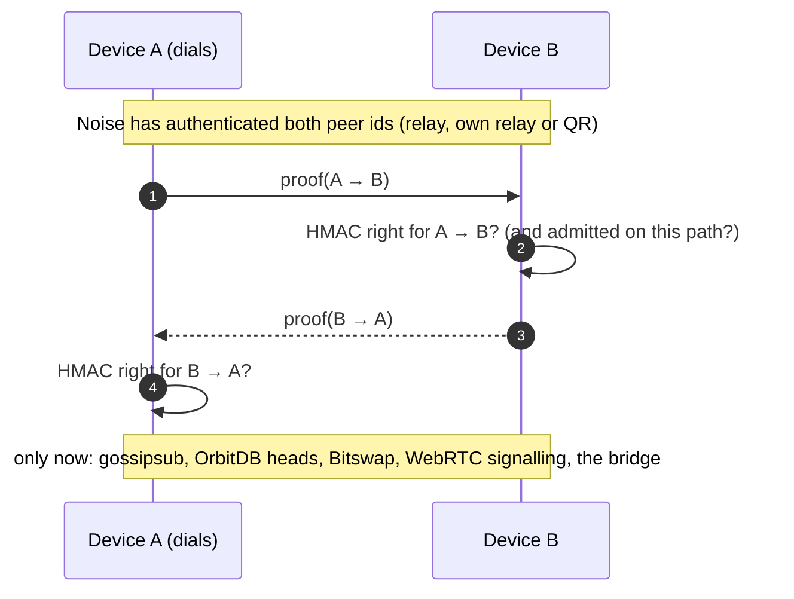

# The device proof: only own devices get the books

_Deutsch: [device-proof.de.md](device-proof.de.md)_

With "Eigene Geräte synchronisieren" on, the node that syncs the books goes online: through a Le-Space relay, a relay in the own bridge, or directly after two scanned QR codes. Anyone who knows its peer id can reach it — the relay, or whoever saw the device's QR code. The entries are sealed before they are written, but OrbitDB hands its heads and Bitswap its blocks to every peer that asks. So before a peer gets anything, it proves that it holds the same passkey.

The code: [`app/src/lib/sync/device-gate.js`](../app/src/lib/sync/device-gate.js), with [`first-contact.js`](../app/src/lib/sync/first-contact.js), [`quiet-identify.js`](../app/src/lib/sync/quiet-identify.js) and [`qr-link.js`](../app/src/lib/sync/qr-link.js) next to it.

## The proof

At unlock, Belege derives a key from the books' root: `deviceAuthKey = HKDF-SHA-256(root, "belege/device-auth/v1")` ([`database-keys.js`](../app/src/lib/database-keys.js)). The passkey opens the root through the vault ([keys.md](keys.md)). Every device of these books gets the same key. It is never sent and never stored.

When two devices connect, the one that dialled proves first, on the protocol `/belege/device-proof/1.0.0`:

```
proof = HMAC-SHA-256(deviceAuthKey, "belege/device-proof/v1\n" + prover's peer id + "\n" + verifier's peer id)
```



Until a peer has proved it, the node answers it only with identify, the circuit relay and the proof itself. A libp2p service listed first wraps the registrar: every other protocol handler waits up to ten seconds for the peer's proof and aborts the stream without it, and libp2p's topologies (gossipsub, Bitswap) learn of the peer only after its proof. If an exchange fails, device sync tries again each round while a known device is connected.

## What a relay or a stranger sees

- **identify:** a peer that has not proved the passkey, every relay included, is told identify and the relay protocols only. The databases (OrbitDB registers one protocol per database, with its address in the name), gossipsub, Bitswap, WebRTC signalling and the extensions a desktop serves its own devices are named to a device after its proof. The node calls itself `js-libp2p`, not the browser's user agent ([`quiet-identify.js`](../app/src/lib/sync/quiet-identify.js)).
- **The proof's protocol** is offered to devices only, not to a relay the node dials, and not announced: its name would tell which app is behind a peer id.
- **What remains:** that two peer ids are connected, when, and how many bytes flow — the relay carries the Noise-encrypted connection and cannot read it.

## Which devices are let in

- A device's record in the books (`device:<peer id>`) says whom to dial. A record alone gives nothing: a peer id typed in by mistake is dialled, never proves, and stays "nicht verbunden".
- **In every mode, only devices the books know are let in** ([`first-contact.js`](../app/src/lib/sync/first-contact.js)). A device the books do not know yet comes in over the own network — a connection built by two scanned QR codes, or one through the bridge's relay — or when someone lets it in: a device that proves the key but is not on the list shows up under _Eigene Geräte_ as "möchte dazukommen", with "Zulassen" and "Ablehnen". Once its record has replicated, it may come over any path. A device someone adds from far away with a passkey that leaked, or a member taken out with a new device, gets nothing unless it is let in.
- **Books that never knew another device** – a new own device, a member who just joined – let their first device in: there is no list yet to check it against. Removed devices count as known ones, so books that ever had another device do not.
- **The bridge between own devices** (`belege-bridge`) answers a peer only if the books know it as a device, it is not a member's device, _and_ it proved the key on this connection; a phone calls only devices that proved.
- **The bridge's own node** (`bridge/src/node.js`) runs the same gate, on a key of its own. At its pairing by invitation a device derives that key from the books' root, for this bridge and one generation of the pairing, and hands it over; the bridge keeps it in its keychain. The books' device key never leaves the browser. Devices prove themselves with the bridge's key toward that one peer only, and let it reach none of their own protocols (no gossipsub, no Bitswap): a copy of the key opens no device. The one protocol it does reach is `/le-space/bridge-blocks/1.0.0`, a second Bitswap with a store of its own in memory, on which it hands over big answers such as a Paperless original (#578); the books' blocks are never in that store. The bridge admits only peers on its device list and serves its functions over the stream to them only. The device that paired the bridge keeps that list; any other device of the books may only take devices off it, never the one that paired. "Kopplung lösen", on the device that paired it or on the bridge's own machine, moves the books to the next generation, so the old key is worth nothing.
- **A member's devices** ([keys.md](keys.md#members)) prove themselves like own devices: the member's key bundle carries the device-proof key. Their peer id comes from the member's own root, not from the books' root. Admitting a member puts the device that joined on the device list; another device of the member comes in like a new own device (over the own network, or once a device of the books lets it in).
- **Removing a device** deletes its record; every device hangs up on it and refuses it from then on.

## Why it is sound

- **Without the books' key, no proof.** Only devices that open the books have it: with a passkey of these books, their recovery words or, as a member, the key bundle. Knowing a peer id — from a QR code, a screenshot, the relay — is not enough.
- **A proof is bound to one pair of peers.** It names both peer ids, and those are the ones Noise authenticated with the peers' own keys (on the QR path, the signed WebRTC offer and answer bind the DTLS fingerprint to both peer ids the same way). A proof read or relayed elsewhere is worth nothing: on any other connection the peer ids differ. Reading it is not possible either: the connection is encrypted end to end.
- **Standard parts.** HMAC-SHA-256 under a 256-bit key from HKDF; the check is `crypto.subtle.verify`.
- **Receipt files go to every own device.** A receipt record replicates with OrbitDB; its file is sealed blocks in Helia's blockstore. Each device fetches the files its receipts name and it lacks over Bitswap from the connected own devices, in the background – at unlock and whenever a receipt comes by sync or an own device connects ([`receipts/prefetch.js`](../app/src/lib/receipts/prefetch.js)) – so a file opens even after the device that added it went offline. Like OrbitDB's head exchange, the books' Bitswap runs only over a direct connection, never through a relay: a public relay would carry every file, and may cut a circuit long before a 1 MiB block is through. When a device turns direct, every missing file is tried again. Two files at a time, up to 32 MiB each (a larger one is fetched when it is opened), a failed one again after a doubling wait; nothing while the network is paused or device sync is off. The blocks are what is stored: sealed. The bridge never serves them: it reaches no Bitswap of the books.
- **Content is sealed anyway.** Every entry and every receipt file is sealed (AES-256-GCM, a fresh nonce each) before it is written. The proof keeps the sealed books, their names and their rhythm of change away from peers that are not own devices; it does not replace the sealing.

## Limits

- Whoever holds the books' key counts as a device of the books. They could open the books anyway.
- Removing a device ends its syncing, not its access: what it has, it can still open.
- The proof shows the key, not which device: two devices with the same key cannot be told apart by it; the records in the books name them.
- Behind the gate, OrbitDB's entries are sealed twice: the payload (`data`), and the whole entry (`replication`, its own key from the root). A peer that slipped past the gate would get blocks it cannot decode — not an entry's identity, clock or links — so it could not walk or replicate the log.

## Tests

[`device-gate.spec.js`](../app/src/lib/sync/device-gate.spec.js) runs real libp2p nodes over the memory transport: two devices of one passkey get the data and gossipsub; a peer without the gate and one with another passkey get neither, dialling or dialled; a failed exchange is proved again. The device-sync and bridge end-to-end tests run through the gate over a local relay.
