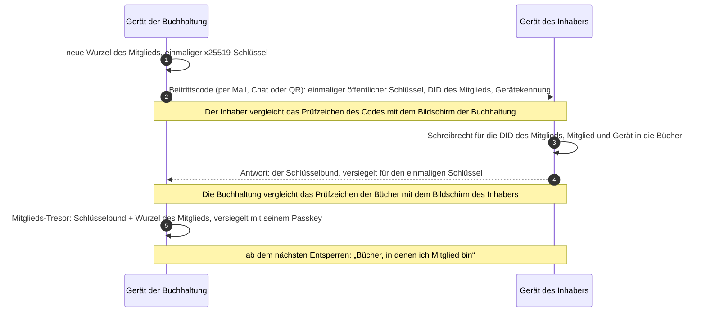

# Schlüssel und Wiederherstellung

_English: [keys.md](keys.md)_

Diese Seite erklärt, woher Belege seine Schlüssel bekommt, was wo liegt und was passiert, wenn ein Passkey verloren geht.

## Kurz

- **Deine Passkeys öffnen die Bücher.** Beim Entsperren gibt der Passkey eine Antwort (die PRF-Antwort). Mit ihr öffnet er sein Fach im Tresor der Bücher. Aus dem Inhalt des Tresors leitet Belege jeden Schlüssel ab. Gespeichert wird keiner davon.
- **Leg einen zweiten Passkey an.** Das geht unter _Einstellungen → Schlüssel_, zum Beispiel mit einem Sicherheitsschlüssel, den du gut aufbewahrst. Jeder Passkey hat ein eigenes Fach. Jedes Fach öffnet dieselben Bücher und jedes Backup, auch auf einem leeren Gerät.
- **Ein synchronisierter Passkey ist auf allen deinen Geräten.** Liegt er im iCloud-Schlüsselbund oder im Google Passwortmanager, öffnet er die Bücher auf jedem Gerät mit diesem Konto.
- **Schreib dir die Wiederherstellungswörter auf.** Das sind 24 Wörter auf Papier. Belege bietet sie gleich nach dem Anlegen der Bücher an, und später unter _Einstellungen → Schlüssel_. Sind alle Passkeys weg, öffnen die Wörter die Bücher auf einem leeren Gerät. Dabei legst du einen neuen Passkey an.
- **Ohne Passkey und ohne Wörter sind die Bücher verloren.** Hast du nur einen Passkey, der nicht synchronisiert ist, und keine Wörter, dann gilt: Geht er verloren, lassen sich weder die Bücher noch ein Backup öffnen. Das Backup liegt dann zwar weiter bei Aleph, aber niemand kann es lesen. Die Seite „Schlüssel“ weist darauf hin, solange das so ist.

Bücher muss man lange aufbewahren: Belege 8 Jahre, Bücher 10 Jahre (§ 147 AO). Schreib also die Wiederherstellungswörter auf oder leg einen zweiten Passkey an, und mach regelmäßig ein Backup.

## Der Tresor

<picture>
  <source media="(prefers-color-scheme: dark)" srcset="media/keys-vault-de-dark.svg">
  
</picture>

- **Die Wurzel R** ist der Wert, aus dem jeder Schlüssel abgeleitet wird. Es ist die PRF-Antwort des Passkeys, der die Bücher angelegt hat (32 Byte). Bücher, die älter sind als der Tresor, behalten ihre Schlüssel: Beim ersten Entsperren mit Tresor kommt genau dieser Wert hinein.
- **Der Tresor** enthält R einmal, versiegelt mit einem zufälligen Tresorschlüssel (AES-256-GCM).
- **Ein Fach** enthält diesen Tresorschlüssel, versiegelt mit einem Schlüssel, den nur sein Passkey erzeugen kann. Dieser Schlüssel kommt aus der PRF-Antwort des Passkeys und ist an den Tresor und an diesen Passkey gebunden. Jedes Fach öffnet den Tresor.
- **Einen Passkey hinzufügen** geht, während die Bücher offen sind. Der neue Passkey bekommt ein Fach. Dafür fragt der Browser zweimal: nach dem neuen Passkey und nach seiner Antwort.
- **Einen Passkey entfernen** nimmt sein Fach heraus. Danach wird er abgewiesen. Wählst du **mit Erneuerung**, bekommt der Tresor außerdem einen neuen Tresorschlüssel, und jeder verbleibende Passkey antwortet einmal. Das ist für einen Passkey gedacht, der in fremde Hände geraten sein könnte.
- **Was Entfernen nicht kann:** Ein Passkey, der die Bücher schon einmal geöffnet hat, kennt R. R ändert sich nur mit [neuen Schlüsseln für die Bücher](#neue-schlüssel-für-die-bücher). In älteren Backups steckt sein Fach weiter.

## Wiederherstellungswörter

- **Was sie sind:** 24 Wörter nach BIP39, also 256 Zufallsbits und eine Prüfsumme. paperless-anywhere nutzt dasselbe Verfahren, und das Paket plant es ebenfalls ([#92](https://github.com/Le-Space/orbitdb-identity-provider-webauthn-did/issues/92)). Belege wählt die Wörter zufällig, nie ein Mensch. Sie werden einmal gezeigt, danach fragt die Seite drei davon ab.
- **Das Fach der Wörter:** Aus den Wörtern entsteht der BIP39-Seed (PBKDF2-HMAC-SHA512). Aus ihm leitet HKDF (`belege/vault-slot/words/v1`) den Schlüssel des Fachs ab. Weder die Wörter noch der Seed werden gespeichert. Ein Tresor hat höchstens einen Satz Wörter. Legst du neue an, ersetzen sie die alten.
- **Auf einem leeren Gerät:** Auf dem Startbildschirm „Mit Wiederherstellungswörtern öffnen“ wählen. Die Wörter öffnen den Tresor, aus diesem Browser oder über ihren Index bei Aleph. Dann legst du einen neuen Passkey an (zwei Abfragen). Er bekommt ein Fach und entsperrt ab dann wie jeder andere. Ist ein Wort vertippt oder sind zwei vertauscht, merkt das die Prüfsumme, bevor etwas angelegt wird.
- **Wie viel sie wert sind:** so viel wie alle Passkeys zusammen. Wer sie gesehen hat, kennt R. Erneuerst du den Tresor, fallen die Wörter heraus. Leg danach neue an.

Der Tresor ist ein Datensatz aus `@le-space/orbitdb-identity-provider-webauthn-did` (`createVault`, `addSlot`). Belege verwaltet ihn in `app/src/lib/books-vault.js`.

## Wo ein leeres Gerät den Tresor findet

In diesem Browser liegt der Tresor im `localStorage`. Auf einem leeren Gerät findet ein Passkey ihn bei Aleph, wenn er dort hinterlegt ist. Das stellst du unter _Einstellungen → Schlüssel_ ein; ab dann wird er nach jedem Backup aktualisiert. Bei Aleph gibt es vier Stellen:

- **den eigenen Index des Passkeys:** eine Adresse aus seiner PRF-Antwort. Dort liegt der Tresor, seit der Passkey sein Fach bekommen hat.
- **den Index der Wörter:** eine Adresse aus dem Seed der Wiederherstellungswörter, ebenso.
- **den Index der Bücher:** eine Adresse aus R. Dort liegen der aktuelle Tresor und, versiegelt, das Aleph-Konto, das die Backups bezahlt.
- **den Index der Mitgliedschaften,** für ein [Mitglied](#mitglieder): eine Adresse aus der PRF-Antwort seines Passkeys, unter einem anderen Label. Dort liegt jeder Mitglieds-Tresor, den dieser Passkey öffnet, und, versiegelt mit der Wurzel des Mitglieds, das Konto, das die Backups der Bücher bezahlt. Das Mitglied schreibt ihn, wenn es ein Backup macht.

Alles dort ist versiegelt und unterschrieben, mit Schlüsseln, die nur aus dem Passkey oder aus R entstehen. Es enthält keine Namen und keine Wallet, neben dem Tresor nur die Credential-ID und das Datum jedes Fachs (`app/src/lib/backup/vault-index.js`). „Mit vorhandenem Passkey wiederherstellen“ fragt dort nach, außer das Netz ist pausiert. Dann öffnen sich die Bücher mit ihren Schlüsseln, und „Wiederherstellen“ zeigt die Backups.

## Was aus R entsteht

HKDF-SHA-256 leitet jeden Schlüssel unter einem eigenen Label aus R ab (`app/src/lib/database-keys.js`). Die wichtigsten:

| Schlüssel             | Label                                       | Wofür                                                                                                                      |
| --------------------- | ------------------------------------------- | -------------------------------------------------------------------------------------------------------------------------- |
| Datenbankschlüssel    | `belege/db-key/v1`                          | versiegelt jeden Datensatz                                                                                                 |
| Replikationsschlüssel | `belege/replication-key/v1`                 | versiegelt jeden Log-Eintrag als Ganzes                                                                                    |
| Datenbanknamen        | `belege/db-name/v2`                         | benennt die Datenbanken, ohne zu verraten, was darin ist                                                                   |
| Belegdatei-Schlüssel  | `belege/blob-key/v1`                        | versiegelt Belegdateien und Mails                                                                                          |
| Backup-Schlüssel      | `belege/backup-key/v1`                      | versiegelt ein Backup, bevor es das Gerät verlässt                                                                         |
| Geheimnis der Bücher  | `belege/books-secret/v1`                    | die eigene Identität der Bücher; sie schreibt in jede Sammlung (#496)                                                      |
| Geräte-Nachweis       | `belege/device-auth/v1`                     | eigene Geräte zeigen, dass sie die Schlüssel der Bücher haben ([device-proof.de.md](device-proof.de.md))                   |
| Bridge-Schlüssel      | `belege/bridge-auth/v1` und eine Generation | der einzige Schlüssel, der den Browser verlässt: Damit weist sich die Bridge aus ([unten](#was-die-bridge-hält-und-warum)) |

Aus einem Schlüssel lässt sich kein anderer berechnen.

## Was wo liegt

| Was                                            | Wo                                                                                 | In welcher Form                                                                                                                                                        |
| ---------------------------------------------- | ---------------------------------------------------------------------------------- | ---------------------------------------------------------------------------------------------------------------------------------------------------------------------- |
| PRF-Antwort, R und alle abgeleiteten Schlüssel | Arbeitsspeicher, solange die Bücher offen sind                                     | im Klartext; weg, wenn der Tab zugeht                                                                                                                                  |
| der Tresor                                     | `localStorage` dieser Website; bei Aleph, wenn gewählt                             | versiegelt; die Namen der Passkeys nur in diesem Browser                                                                                                               |
| die Bücher                                     | IndexedDB dieser Website                                                           | versiegelt, je Datensatz und je Eintrag                                                                                                                                |
| Belegdateien                                   | IndexedDB dieser Website                                                           | versiegelt                                                                                                                                                             |
| Angaben zum Passkey, Merker                    | `localStorage` dieser Website                                                      | öffentlich: Credential-ID, öffentlicher Schlüssel, DID, PRF-Eingabe                                                                                                    |
| Backups                                        | Aleph Cloud                                                                        | mit dem Backup-Schlüssel versiegelt ([backup.de.md](backup.de.md))                                                                                                     |
| der Aleph-Schlüssel der Bücher                 | die versiegelten Einstellungen der Bücher                                          | versiegelt; unterschreibt Backup-Aufträge und, wenn eingeschaltet, Anfragen an Le Space Credits. Seine Adresse ist das Credits-Konto, auf jedem eigenen Gerät dieselbe |
| der private Schlüssel des Passkeys             | der Authenticator                                                                  | verlässt ihn nie                                                                                                                                                       |
| der Bridge-Schlüssel                           | Schlüsselbund der Bridge (`bridge-auth`)                                           | nur, wenn die Bridge per Einladung gekoppelt ist                                                                                                                       |
| ein Mitglieds-Tresor                           | `localStorage` im Browser des Mitglieds; bei Aleph nach einem Backup des Mitglieds | versiegelt mit dem Passkey des Mitglieds                                                                                                                               |

## Was die Bridge hält, und warum

Die Bridge ist ein kleines Programm auf deinem Rechner. Sie macht, was ein Browser nicht darf:
Sie fragt deine Bank, dein Postfach und ein Sprachmodell, und sie läuft weiter, wenn der Tab zu
ist. Dafür braucht sie deren Passwörter und Schlüssel. Die bleiben auf diesem Rechner, im
Schlüsselbund, und gehen nie an den Browser
([bridge/README.md](../bridge/README.md#where-things-are-kept)).

Einen Schlüssel deiner Bücher bekommt sie nie. Die Schlüssel oben bleiben im Browser, mit einer
Ausnahme: Koppelst du die Bridge per Einladung, damit dein Telefon sie über ein Relay erreicht,
gibt ihr ein Gerät einen eigenen Schlüssel. Damit zeigt die Bridge deinen Geräten, dass sie
deine Bridge ist. Mehr öffnet er nicht, keine Bücher und kein anderes Gerät. „Kopplung lösen“
schaltet die Bücher auf eine neue Generation dieses Schlüssels. Der alte ist dann wertlos.

Wer also deinen Rechner mit der Bridge mitnimmt, bekommt, was die Bridge hält: Bank, Postfach
und Modell. Deine Bücher bekommt er nicht. Darum braucht ein Backup der Bücher den Passkey oder
die Wiederherstellungswörter, nicht die Bridge.

Umgekehrt begrenzt die Bridge, was ein Gerät bei ihr darf ([#579](https://github.com/Le-Space/belege/issues/579)):

- Jeder Befehl gehört zu einem Bereich, etwa Bank lesen, Postfach lesen oder Sprachmodell. Ein Gerät darf nur die Bereiche, die es hat.
- Deine eigenen Geräte haben alle Bereiche, wie bisher. Ein Mitglied hat Zugang nur, wenn du es beim Aufnehmen erlaubt hast.
- Nutzt ein Gerät die Bridge 90 Tage nicht, verliert es den Zugang. Das Gerät, das die Bridge gekoppelt hat, erneuert ihn unter _Integrationen → Eigene Geräte → Erweitert_.
- Was Geld kostet, ist pro Gerät begrenzt: Aufrufe des Sprachmodells pro Minute, seine Tokens pro Tag und Backups pro Stunde. Ein gestohlenes Telefon kann so nicht dein Guthaben leeren, bevor du es entfernst.

## Mitglieder

Du kannst eine zweite Person in die Bücher lassen, zum Beispiel die Buchhaltung ([#6](https://github.com/Le-Space/belege/issues/6)). Sie behält ihren eigenen Passkey und ihre eigenen Bücher. Für deine Bücher bekommt sie einen **Schlüsselbund**.

Beide Seiten vergleichen also ein Prüfzeichen, bevor etwas geschrieben oder aufbewahrt wird ([#640](https://github.com/Le-Space/belege/issues/640)). Stimmt es nicht, wurde der Code oder die Antwort unterwegs getauscht, und man bricht ab.

**Was im Schlüsselbund steckt:**

- immer: der Datenbankschlüssel, der Replikationsschlüssel, der Schlüssel für Belegdateien und der Schlüssel für den Geräte-Nachweis, dazu die Namen und Adressen der Datenbanken und die öffentliche Identität der Bücher;
- bei einem Mitglied, das mitschreibt, zusätzlich der Backup-Schlüssel;
- wenn es die Bridge nutzen darf, außerdem die Grundlage des Bridge-Schlüssels.

**Was nie darin steckt:** R, das Geheimnis der Bücher, der Tresorschlüssel, ein Fach eines Passkeys oder die Wiederherstellungswörter.

**Zwei Rollen** ([#641](https://github.com/Le-Space/belege/issues/641)). Du wählst sie beim Aufnehmen:

- **Schreibt mit:** die Buchhaltung oder eine Assistenz, die in den Büchern arbeitet. Sie liest, schreibt unter eigenem Namen, macht Backups und stellt sie wieder her. Ihr Name ist eine DID aus ihrer eigenen Wurzel, und die Zugriffslisten der Bücher lassen diese DID schreiben. Ob sie deine Bridge (Bank, Postfach, KI) nutzen darf, entscheidest du mit einem Häkchen beim Aufnehmen. Ohne Häkchen steckt kein Bridge-Schlüssel im Schlüsselbund.
- **Liest mit:** eine Assistenz, die die Bücher nur verfolgt. Sie bekommt nur die Schlüssel zum Lesen und Abgleichen: kein Schreibrecht, keinen Backup-Schlüssel, keinen Bridge-Schlüssel. Ihre Sitzung öffnet die Bücher nur zum Lesen. Schreibt sie trotzdem, lehnt jedes Gerät das ab.

**Was beim Inhaber bleibt:** die Passkeys und Wiederherstellungswörter der Bücher, der Umzug der Bücher, Mitglieder aufnehmen und herausnehmen.

**Der Mitglieds-Tresor** funktioniert wie der Tresor der Bücher. Er enthält den Schlüsselbund und die Wurzel des Mitglieds, versiegelt mit einem Tresorschlüssel, und hat ein Fach für den Passkey des Mitglieds. Er liegt im Browser des Mitglieds (`belege.memberships.v1`). Nach dem ersten Backup des Mitglieds liegt er auch am Index seiner Mitgliedschaften bei Aleph, versiegelt und ohne Namen. Dort findet ihn der Passkey des Mitglieds auf einem leeren Gerät ([backup.de.md](backup.de.md#mitglieder-sichern-und-stellen-wieder-her)).

**Ein Mitglied herausnehmen** geht unter _Integrationen → Zusammenarbeit_ ([#614](https://github.com/Le-Space/belege/issues/614)):

- Was es bis dahin geschrieben hat, bleibt.
- Was es danach schreibt, lehnt jedes Gerät der Bücher ab.
- Seine Geräte verschwinden aus der Geräteliste und werden abgewiesen. Sein alter Beitrittscode gilt nicht mehr.
- Hat es eine Einstellung geändert, die nur dem Inhaber zusteht (wo die Backups liegen und wer sie unterschreibt, die Bridge, wie Geräte sich treffen, der Tresor bei Aleph, die App für Rechnungen), wird sie zurückgesetzt.

Technisch wird das Schreibrecht in OrbitDB nicht entzogen. OrbitDB prüft auch alte Einträge gegen die aktuelle Liste, und die früheren Einträge des Mitglieds ließen sich dann nicht mehr abgleichen. Stattdessen bekommt die Zugriffsliste jeder Sammlung `removed:<seine DID>` mit den Hashes seiner bisherigen Einträge. Ein Eintrag von ihm gilt nur, wenn er einer davon ist (`app/src/lib/store/books-access.js`).

**Was sich nicht zurücknehmen lässt:** was das Mitglied schon gelesen hat. Mit seinem Schlüsselbund könnte es auch spätere Einträge lesen, wenn es an sie herankommt. Das endet erst mit [neuen Schlüsseln für die Bücher](#neue-schlüssel-für-die-bücher).

## Neue Schlüssel für die Bücher

Unter _Einstellungen → Schlüssel → Neue Schlüssel für die Bücher_ ([#627](https://github.com/Le-Space/belege/issues/627)). Das brauchst du, nachdem du ein Mitglied herausgenommen hast, oder wenn ein Passkey in fremde Hände geraten sein könnte. So läuft es ab:

1. Belege erzeugt eine neue zufällige Wurzel R′ und einen neuen Tresor. Jeder Passkey, den du ankreuzt, bekommt ein Fach und antwortet dafür einmal. Die früheren Wurzeln bleiben versiegelt im Tresor.
2. Belege packt die Bücher in diesem Browser wie bei einem Umzug, versiegelt mit einem Schlüssel aus R′. Das Paket liegt in IndexedDB, bis die neuen Bücher es übernommen haben.
3. Der neue Tresor kommt in die alten Bücher. Er enthält nichts Geheimes im Klartext; öffnen kann ihn nur ein Passkey mit Fach.
4. Die Seite lädt neu. Nach dem Entsperren öffnen sich neue Datenbanken unter R′, mit neuen Namen, neuen Schlüsseln und einer neuen Identität der Bücher. Sie übernehmen die gepackten Bücher, danach wird das Paket gelöscht.
5. Deine anderen Geräte finden den neuen Tresor in den alten Büchern. Sie wechseln, wenn ihr Passkey ein Fach hat, und verbinden sich dann mit diesem Gerät. Ein Gerät folgt dem Hinweis nur, wenn die Bücher selbst ihn geschrieben haben, nicht ein Mitglied ([#638](https://github.com/Le-Space/belege/issues/638)).

**Was nicht mitkommt:**

- die Wiederherstellungswörter: Schreib neue auf.
- die Mitglieder: Sie treten mit einem neuen Beitrittscode wieder bei.
- die Kopplung der Bridge: Kopple sie neu.
- die Backup-Kette: Das nächste Backup ist ein Vollbackup.

**Ältere Backups** lassen sich weiter wiederherstellen ([#628](https://github.com/Le-Space/belege/issues/628)). Das Backup öffnet sich mit der früheren Wurzel aus dem Tresor. Es zählen nur Einträge, die die Bücher von damals unterschrieben haben. Sie fügen nur Datensätze hinzu, die die heutigen Bücher noch nicht haben, und keine Einstellungen. Die Belegdateien werden neu versiegelt.

Ein Passkey, den du nicht angekreuzt hast, und ein herausgenommenes Mitglied behalten nur die alten Bücher. Dort kommt nichts Neues mehr an.

## Passkey-Abfragen

So oft fragt der Browser nach dem Passkey:

- **Anlegen:** zweimal, nach dem Passkey und nach seiner PRF-Antwort.
- **Entsperren:** einmal, nach der PRF-Antwort.
- **Wiederherstellen auf einem neuen Gerät:** dreimal. Zwei Berührungen finden den Passkey und seine DID, die dritte liefert die PRF-Antwort.
- **Passkey hinzufügen:** zweimal, nach dem neuen Passkey und nach seiner PRF-Antwort.
- **Entfernen mit Erneuerung:** einmal je verbleibendem Passkey.
- **Mit Wiederherstellungswörtern öffnen:** zweimal, nach dem neuen Passkey und nach seiner PRF-Antwort.
