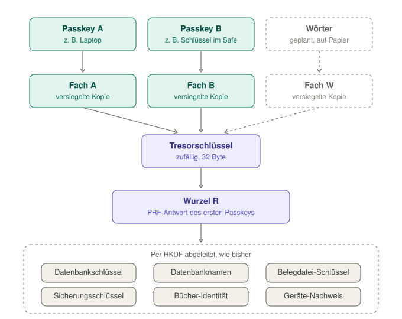
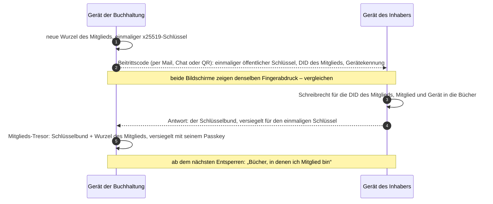

# Schlüssel und Wiederherstellung

_English: [keys.md](keys.md)_

Woher Belege seine Schlüssel bekommt, was wo liegt und was passiert, wenn ein Passkey verloren geht.

## Kurz

- **Deine Passkeys öffnen die Bücher.** Bei jedem Entsperren antwortet der Passkey einmal mit seiner PRF-Antwort; damit öffnet er sein Fach im Tresor der Bücher, und jeder Schlüssel wird aus dem abgeleitet, was der Tresor hält. Keiner der Schlüssel wird gespeichert.
- **Leg einen zweiten Passkey an.** Unter _Einstellungen → Schlüssel_ – etwa einen Sicherheitsschlüssel, den du sicher aufbewahrst. Jeder Passkey hat ein eigenes Fach, und jedes Fach öffnet dieselben Bücher und jede Sicherung, auch auf einem leeren Gerät.
- **Ein synchronisierter Passkey wandert mit.** Einer im iCloud-Schlüsselbund oder im Google Passwortmanager öffnet dieselben Bücher auf jedem Gerät dieses Kontos.
- **Schreib dir Wiederherstellungswörter auf.** 24 Wörter auf Papier, angeboten gleich nach dem Anlegen der Bücher und unter _Einstellungen → Schlüssel_. Ist jeder Passkey weg, öffnen sie die Bücher auf einem leeren Gerät; dabei wird ein neuer Passkey angelegt.
- **Ohne Passkey und ohne Wörter keine Bücher.** Bei einem einzigen, nicht synchronisierten Passkey ohne Wörter heißt sein Verlust: Weder die Bücher noch eine Sicherung lassen sich wieder öffnen, auch wenn die Sicherung selbst bei Aleph weiter liegt. Die Seite „Schlüssel“ sagt das, solange es so ist.

Bücher müssen jahrelang aufbewahrt werden (Belege 8 Jahre, Bücher 10 Jahre, § 147 AO): Wiederherstellungswörter aufschreiben oder einen zweiten Passkey anlegen, und regelmäßig sichern.

## Der Tresor

<picture>
  <source media="(prefers-color-scheme: dark)" srcset="media/keys-vault-de-dark.svg">
  
</picture>

- **Die Wurzel R** ist das, woraus jeder Schlüssel abgeleitet wird: die PRF-Antwort des Passkeys, der die Bücher angelegt hat (32 Byte). Bücher von vor dem Tresor behalten genau ihre Schlüssel – das erste Entsperren mit dem Tresor legt genau diesen Wert hinein.
- **Der Tresor** bewahrt R einmal auf, versiegelt mit einem zufälligen Tresorschlüssel (AES-256-GCM).
- **Ein Fach** ist dieser Tresorschlüssel, versiegelt mit einem Schlüssel, den nur sein Passkey erzeugen kann: abgeleitet aus dessen PRF-Antwort, gebunden an den Tresor und an diesen Passkey. Jedes Fach öffnet den Tresor.
- **Einen Passkey hinzufügen**, während die Bücher offen sind, gibt ihm ein Fach: zwei Abfragen, der neue Passkey und seine Antwort.
- **Einen Passkey entfernen** nimmt sein Fach heraus; er wird ab dann abgewiesen. **Mit Erneuerung** bekommt der Tresor außerdem einen neuen Tresorschlüssel, und jeder verbleibende Passkey antwortet einmal – für einen Passkey, der in fremde Hände geraten sein könnte. Was Entfernen nicht kann: Ein Passkey, der die Bücher schon geöffnet hat, kennt R, und R lässt sich nicht ändern, ohne die Bücher neu zu versiegeln; ältere Sicherungen tragen sein Fach weiter.

## Wiederherstellungswörter

- **Was sie sind:** 24 Wörter nach BIP39 – 256 Zufallsbits und eine Prüfsumme –, wie paperless-anywhere sie nutzt und wie das Paket sie plant ([#92](https://github.com/Le-Space/orbitdb-identity-provider-webauthn-did/issues/92)). Belege würfelt sie, nie ein Mensch; gezeigt werden sie einmal, drei davon fragt die Seite zurück.
- **Das Fach W:** Aus den Wörtern entsteht der BIP39-Seed (PBKDF2-HMAC-SHA512), aus ihm per HKDF (`belege/vault-slot/words/v1`) der Schlüssel des Fachs. Gespeichert werden weder die Wörter noch der Seed. Ein Tresor hat höchstens einen Satz Wörter; neue ersetzen die alten.
- **Auf einem leeren Gerät:** „Mit Wiederherstellungswörtern öffnen“ auf dem Startbildschirm. Die Wörter öffnen den Tresor – aus diesem Browser oder über ihren Index bei Aleph –, ein neuer Passkey wird angelegt (zwei Abfragen) und bekommt ein Fach; ab dann entsperrt er wie jeder andere. Ein vertipptes oder vertauschtes Wort fängt die Prüfsumme ab, bevor etwas angelegt wird.
- **Was sie wiegen:** so viel wie alle Passkeys zusammen. Wer sie gesehen hat, kennt R. Erneuern des Tresors nimmt die Wörter heraus; danach neue anlegen.

Der Tresor ist ein Datensatz von `@le-space/orbitdb-identity-provider-webauthn-did` (`createVault`, `addSlot`), verwaltet in `app/src/lib/books-vault.js`.

## Wo ein leeres Gerät den Tresor findet

In diesem Browser liegt der Tresor-Datensatz im `localStorage`. Auf einem leeren Gerät findet ein Passkey ihn bei Aleph, wenn er dort hinterlegt wurde (_Einstellungen → Schlüssel_, und ab dann nach jeder Sicherung):

- **an seinem eigenen Index** – einer Adresse aus der PRF-Antwort dieses Passkeys, wo der Tresor abgelegt wurde, als der Passkey sein Fach bekam;
- **am Index der Wörter** – einer Adresse aus dem Seed der Wiederherstellungswörter, ebenso;
- **am Index der Bücher** – einer Adresse aus R, mit dem aktuellen Tresor und, versiegelt, dem Aleph-Konto, für das die Sicherungen aufbewahrt werden;
- **am Index seiner Mitgliedschaften** – für ein Mitglied ([unten](#mitglieder)): einer Adresse aus der PRF-Antwort dieses Passkeys unter einem anderen Label, mit jedem Mitglieds-Tresor, den der Passkey öffnet, und, versiegelt mit der Wurzel des Mitglieds, dem Konto, für das die Sicherungen der Bücher aufbewahrt werden. Geschrieben, wenn das Mitglied sichert.

Beides ist versiegelt, unterschrieben von Schlüsseln, zu denen nur der Passkey oder R führen, und trägt keine Namen, kein Wallet: neben dem Tresor nur die Credential-ID und das Datum jedes Fachs (`app/src/lib/backup/vault-index.js`). „Mit vorhandenem Passkey wiederherstellen“ fragt dort, außer das Netz ist pausiert; dann öffnen sich die Bücher mit ihren Schlüsseln, und „Wiederherstellen“ listet die Sicherungen.

## Was aus R entsteht

HKDF-SHA-256 leitet jeden Schlüssel unter einem eigenen Label aus R ab (`app/src/lib/database-keys.js`), die wichtigsten:

| Schlüssel             | Label                                       | Wofür                                                                                                         |
| --------------------- | ------------------------------------------- | ------------------------------------------------------------------------------------------------------------- |
| Datenbankschlüssel    | `belege/db-key/v1`                          | versiegelt jeden Datensatz                                                                                    |
| Replikationsschlüssel | `belege/replication-key/v1`                 | versiegelt jeden Log-Eintrag als Ganzes                                                                       |
| Datenbanknamen        | `belege/db-name/v2`                         | benennt die Datenbanken, ohne zu verraten, was darin ist                                                      |
| Belegdatei-Schlüssel  | `belege/blob-key/v1`                        | versiegelt Belegdateien und Mails                                                                             |
| Sicherungsschlüssel   | `belege/backup-key/v1`                      | versiegelt eine Sicherung, bevor sie das Gerät verlässt                                                       |
| Geheimnis der Bücher  | `belege/books-secret/v1`                    | die eigene Identität der Bücher, Schreiber jeder Sammlung (#496)                                              |
| Geräte-Nachweis       | `belege/device-auth/v1`                     | eigene Geräte weisen nach, dass sie die Schlüssel der Bücher haben ([device-proof.de.md](device-proof.de.md)) |
| Bridge-Schlüssel      | `belege/bridge-auth/v1` und eine Generation | der einzige Schlüssel, der den Browser verlässt: Damit weist sich die Bridge aus (unten)                      |

Ein Schlüssel verrät nichts über einen anderen.

## Was wo liegt

| Was                                            | Wo                                                                                    | In welcher Form                                                                                                                                                         |
| ---------------------------------------------- | ------------------------------------------------------------------------------------- | ----------------------------------------------------------------------------------------------------------------------------------------------------------------------- |
| PRF-Antwort, R und alle abgeleiteten Schlüssel | Arbeitsspeicher, solange die Bücher offen sind                                        | im Klartext, weg, wenn der Tab zugeht                                                                                                                                   |
| der Tresor                                     | `localStorage` dieser Website; bei Aleph, wenn gewählt                                | versiegelt; die Namen der Passkeys nur in diesem Browser                                                                                                                |
| die Bücher                                     | IndexedDB dieser Website                                                              | versiegelt, je Datensatz und je Eintrag                                                                                                                                 |
| Belegdateien                                   | IndexedDB dieser Website                                                              | versiegelt                                                                                                                                                              |
| Angaben zum Passkey, Merker                    | `localStorage` dieser Website                                                         | öffentlich: Credential-ID, öffentlicher Schlüssel, DID, PRF-Eingabe                                                                                                     |
| Sicherungen                                    | Aleph Cloud                                                                           | mit dem Sicherungsschlüssel versiegelt ([backup.de.md](backup.de.md))                                                                                                   |
| der Aleph-Schlüssel der Bücher                 | die versiegelten Einstellungen der Bücher                                             | versiegelt; unterschreibt Backup-Aufträge und, wenn eingeschaltet, Anfragen an Le Space Credits – seine Adresse ist das Credits-Konto, auf jedem eigenen Gerät dieselbe |
| der private Schlüssel des Passkeys             | der Authenticator                                                                     | verlässt ihn nie                                                                                                                                                        |
| der Bridge-Schlüssel                           | Schlüsselbund der Bridge (`bridge-auth`)                                              | nur, wenn die Bridge per Einladung gekoppelt ist                                                                                                                        |
| ein Mitglieds-Tresor                           | `localStorage` im Browser des Mitglieds; bei Aleph nach einer Sicherung des Mitglieds | versiegelt mit dem Passkey des Mitglieds                                                                                                                                |

## Was die Bridge hält, und warum

Die Bridge ist ein kleines Programm auf deinem Rechner. Sie macht, was ein Browser nicht darf:
Sie fragt deine Bank, dein Postfach und ein Sprachmodell, und sie läuft weiter, wenn der Tab zu
ist. Dafür braucht sie deren Passwörter und Schlüssel. Die bleiben auf diesem Rechner, im
Schlüsselbund, und gehen nie an den Browser
([bridge/README.md](../bridge/README.md#where-things-are-kept)).

Einen Schlüssel deiner Bücher bekommt sie nie. Die Schlüssel oben bleiben im Browser, mit einer
Ausnahme: Koppelst du die Bridge per Einladung, damit dein Telefon sie über ein Relay erreicht,
gibt ihr ein Gerät einen eigenen Schlüssel. Damit zeigt die Bridge deinen Geräten, dass sie
deine Bridge ist. Mehr öffnet er nicht, keine Bücher und kein anderes Gerät. „Kopplung lösen“
schaltet die Bücher auf eine neue Generation dieses Schlüssels; der alte ist dann wertlos.

Wer also deinen Rechner mit der Bridge mitnimmt, bekommt, was die Bridge hält – Bank, Postfach,
Modell –, aber nicht deine Bücher. Deshalb braucht ein Backup der Bücher den Passkey oder die
Wiederherstellungswörter, nicht die Bridge.

## Mitglieder

Die Bücher können eine zweite Person hereinlassen, zum Beispiel die Buchhaltung ([#6](https://github.com/Le-Space/belege/issues/6)). Sie behält ihren eigenen Passkey und ihre eigenen Bücher; für deine bekommt sie einen **Schlüsselbund**.

**Was im Schlüsselbund steckt:** der Datenbank-Schlüssel, der Replikationsschlüssel, der Schlüssel für Belegdateien, der Sicherungsschlüssel, der Schlüssel für den Gerätenachweis und die Grundlage des Bridge-Schlüssels, die Namen und Adressen der Datenbanken und die öffentliche Identität der Bücher. **Was nie darin steckt:** R, das Geheimnis der Bücher, der Tresorschlüssel, ein Passkey-Fach oder die Wiederherstellungswörter.

**Was ein Mitglied kann:** die Bücher lesen, schreiben – unter eigenem Namen, einer DID aus seiner eigenen Wurzel, die die Zugriffslisten der Bücher erlauben –, sichern und wiederherstellen und die Bridge des Inhabers nutzen. **Was beim Inhaber bleibt:** Passkeys und Wiederherstellungswörter der Bücher, der Umzug der Bücher und Mitglieder aufnehmen.

**Der Mitglieds-Tresor** funktioniert wie der Tresor der Bücher: Schlüsselbund und Wurzel des Mitglieds, versiegelt mit einem Tresorschlüssel, mit einem Fach für den Passkey des Mitglieds. Er liegt im Browser des Mitglieds (`belege.memberships.v1`) und nach seiner ersten Sicherung am Index seiner Mitgliedschaften bei Aleph – versiegelt, ohne Namen. Auf einem leeren Gerät findet der Passkey des Mitglieds ihn dort ([backup.de.md](backup.de.md#mitglieder-sichern-und-stellen-wieder-her)).

**Ein Mitglied herausnehmen** (_Integrationen → Zusammenarbeit_, [#614](https://github.com/Le-Space/belege/issues/614)): Was es bis dahin geschrieben hat, bleibt; was es danach schreibt, lehnt jedes Gerät der Bücher ab; seine bisherigen Geräte kommen von der Geräteliste und werden abgewiesen. Das Schreibrecht wird in OrbitDB nicht entzogen – OrbitDB prüft auch alte Einträge gegen die aktuelle Liste, und die früheren Einträge des Mitglieds ließen sich nicht mehr abgleichen. Stattdessen bekommt die Zugriffsliste jeder Sammlung `removed:<seine DID>` mit den Hashes seiner bisherigen Einträge, und ein Eintrag von ihm gilt nur, wenn er einer davon ist (`app/src/lib/store/books-access.js`).

**Was sich nicht zurücknehmen lässt:** was das Mitglied gelesen hat. Mit den Schlüsseln aus seinem Schlüsselbund könnte es auch spätere Einträge lesen, wenn es an sie kommt, bis die Bücher [neue Schlüssel](#neue-schlüssel-für-die-bücher) bekommen.

## Neue Schlüssel für die Bücher

_Einstellungen → Schlüssel → Neue Schlüssel für die Bücher_ ([#627](https://github.com/Le-Space/belege/issues/627)) – nachdem ein Mitglied herausgenommen wurde, oder wenn ein Passkey in fremde Hände geraten sein könnte:

1. Eine neue zufällige Wurzel R′, in einem neuen Tresor mit einem Fach für jeden Passkey, den du ankreuzt (jeder antwortet einmal). Die früheren Wurzeln bleiben darin, versiegelt.
2. Die Bücher werden in diesem Browser gepackt wie bei einem Umzug, versiegelt mit einem Schlüssel aus R′, und liegen in IndexedDB, bis sie übernommen sind.
3. Der neue Tresor kommt in die alten Bücher. Er enthält nichts Geheimes im Klartext; öffnen kann ihn nur ein Passkey mit Fach.
4. Die Seite lädt neu; einmal entsperren öffnet neue Datenbanken unter R′ – neue Namen, neue Schlüssel, eine neue Identität der Bücher –, und sie übernehmen die gepackten Bücher. Das Paket wird gelöscht.
5. Ein anderes Gerät von dir findet den neuen Tresor in den alten Büchern und wechselt, wenn sein Passkey ein Fach hat; dann wählt es dieses Gerät an.

Was nicht mitkommt: die Wiederherstellungswörter (schreib neue auf), Mitglieder (sie treten mit einem neuen Beitrittscode wieder bei), die Kopplung der Bridge (neu koppeln), die Backup-Kette (die nächste Sicherung ist eine vollständige). Ältere Sicherungen lassen sich weiter wiederherstellen ([#628](https://github.com/Le-Space/belege/issues/628)): Die Sicherung öffnet sich mit der früheren Wurzel aus dem Tresor, und ihre Datensätze kommen einzeln in die heutigen Bücher – nur wo diese keine neuere Fassung haben –, die Belegdateien neu versiegelt. Ein Passkey, den du nicht ankreuzt, und ein herausgenommenes Mitglied behalten nur die alten Bücher, in die nichts Neues mehr kommt.

## Passkey-Abfragen

- **Anlegen:** zwei – der Passkey, dann seine PRF-Antwort.
- **Entsperren:** eine – die PRF-Antwort.
- **Wiederherstellen auf einem neuen Gerät:** drei – zwei Berührungen, die den Passkey und seine DID finden, dann die PRF-Antwort.
- **Passkey hinzufügen:** zwei – der neue Passkey, dann seine PRF-Antwort.
- **Entfernen mit Erneuerung:** eine je verbleibendem Passkey.
- **Mit Wiederherstellungswörtern öffnen:** zwei – der neue Passkey, dann seine PRF-Antwort.
