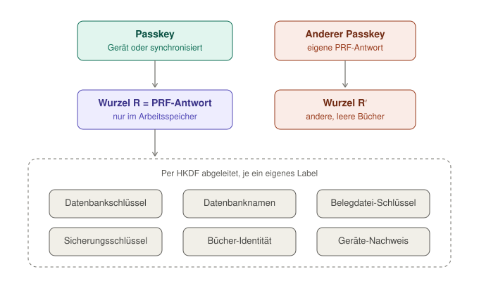

# Schlüssel und Wiederherstellung

_English: [keys.md](keys.md)_

Woher Belege seine Schlüssel bekommt, was wo liegt und was passiert, wenn ein Passkey verloren geht.

## Kurz

- **Ein Passkey öffnet die Bücher.** Bei jedem Entsperren antwortet er einmal mit seiner PRF-Antwort. Daraus leitet Belege jeden Schlüssel ab und bewahrt keinen davon auf.
- **Nichts Geheimes wird gespeichert.** Die Schlüssel leben im Arbeitsspeicher, solange die Bücher offen sind, und sind weg, wenn der Tab zugeht.
- **Ein synchronisierter Passkey wandert mit.** Einer im iCloud-Schlüsselbund oder im Google Passwortmanager öffnet dieselben Bücher auf jedem Gerät dieses Kontos.
- **Ohne Passkey keine Bücher.** Ein Passkey, der nicht synchronisiert wird (ein Sicherheitsschlüssel, ein Passkey nur auf einem Gerät), lässt sich nicht ersetzen: Ohne ihn öffnen sich weder die Bücher noch eine Sicherung, auch wenn die Sicherung selbst bei Aleph weiter liegt.
- **Ein zweiter Passkey hilft noch nicht.** Er hat seine eigene PRF-Antwort und öffnet andere, leere Bücher.

Bücher müssen jahrelang aufbewahrt werden (Belege 8 Jahre, Bücher 10 Jahre, § 147 AO). Bis es den Tresor unten gibt: einen synchronisierten Passkey nutzen und regelmäßig sichern.

## Woher die Schlüssel kommen

<picture>
  <source media="(prefers-color-scheme: dark)" srcset="media/keys-today-de-dark.svg">
  
</picture>

Die PRF-Antwort des Passkeys ist die Wurzel von allem: 32 Byte, für diesen Passkey und diese Website jedes Mal gleich, herausgegeben erst nach der Bestätigung (Fingerabdruck, Gesicht, PIN). HKDF-SHA-256 leitet daraus jeden Schlüssel unter einem eigenen Label ab (`app/src/lib/database-keys.js`), die wichtigsten:

| Schlüssel             | Label                       | Wofür                                                                                            |
| --------------------- | --------------------------- | ------------------------------------------------------------------------------------------------ |
| Datenbankschlüssel    | `belege/db-key/v1`          | versiegelt jeden Datensatz                                                                       |
| Replikationsschlüssel | `belege/replication-key/v1` | versiegelt jeden Log-Eintrag als Ganzes                                                          |
| Datenbanknamen        | `belege/db-name/v2`         | benennt die Datenbanken, ohne zu verraten, was darin ist                                         |
| Belegdatei-Schlüssel  | `belege/blob-key/v1`        | versiegelt Belegdateien und Mails                                                                |
| Sicherungsschlüssel   | `belege/backup-key/v1`      | versiegelt eine Sicherung, bevor sie das Gerät verlässt                                          |
| Geheimnis der Bücher  | `belege/books-secret/v1`    | die eigene Identität der Bücher, Schreiber jeder Sammlung (#496)                                 |
| Geräte-Nachweis       | `belege/device-auth/v1`     | eigene Geräte weisen nach, dass sie den Passkey haben ([device-proof.de.md](device-proof.de.md)) |

Ein Schlüssel verrät nichts über einen anderen.

## Was wo liegt

| Was                                         | Wo                                             | In welcher Form                                                       |
| ------------------------------------------- | ---------------------------------------------- | --------------------------------------------------------------------- |
| PRF-Antwort und alle abgeleiteten Schlüssel | Arbeitsspeicher, solange die Bücher offen sind | im Klartext, weg, wenn der Tab zugeht                                 |
| die Bücher                                  | IndexedDB dieser Website                       | versiegelt, je Datensatz und je Eintrag                               |
| Belegdateien                                | IndexedDB dieser Website                       | versiegelt                                                            |
| Angaben zum Passkey, Merker                 | `localStorage` dieser Website                  | öffentlich: Credential-ID, öffentlicher Schlüssel, DID, PRF-Eingabe   |
| Sicherungen                                 | Aleph Cloud                                    | mit dem Sicherungsschlüssel versiegelt ([backup.de.md](backup.de.md)) |
| der private Schlüssel des Passkeys          | der Authenticator                              | verlässt ihn nie                                                      |

## Passkey-Abfragen

- **Anlegen:** zwei – der Passkey, dann seine PRF-Antwort.
- **Entsperren:** eine – die PRF-Antwort.
- **Wiederherstellen auf einem neuen Gerät:** drei – zwei Berührungen, die den Passkey und seine DID finden, dann die PRF-Antwort.

## Geplant: ein Tresor für die Bücher ([#406](https://github.com/Le-Space/belege/issues/406))

Die Wurzel R kommt in einen Tresor: einmal aufbewahrt, versiegelt mit einem zufälligen Tresorschlüssel, mit einem Fach je Passkey. In jedem Fach liegt eine Kopie des Tresorschlüssels, versiegelt mit einem Schlüssel, den nur dieser Passkey erzeugen kann. Ein zweiter Passkey – etwa ein Sicherheitsschlüssel im Safe – öffnet dann dieselben Bücher und jede Sicherung, auch auf einem leeren Gerät. Wiederherstellungswörter auf Papier folgen als weiteres Fach. Diese Seite ändert sich mit.
