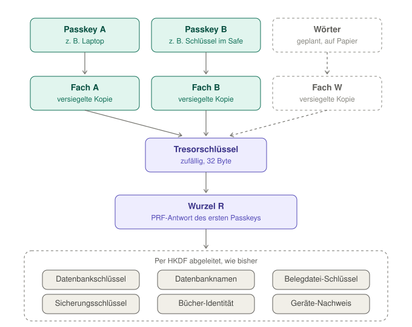

# Schlüssel und Wiederherstellung

_English: [keys.md](keys.md)_

Woher Belege seine Schlüssel bekommt, was wo liegt und was passiert, wenn ein Passkey verloren geht.

## Kurz

- **Deine Passkeys öffnen die Bücher.** Bei jedem Entsperren antwortet der Passkey einmal mit seiner PRF-Antwort; damit öffnet er sein Fach im Tresor der Bücher, und jeder Schlüssel wird aus dem abgeleitet, was der Tresor hält. Keiner der Schlüssel wird gespeichert.
- **Leg einen zweiten Passkey an.** Unter _Einstellungen → Schlüssel_ – etwa einen Sicherheitsschlüssel, den du sicher aufbewahrst. Jeder Passkey hat ein eigenes Fach, und jedes Fach öffnet dieselben Bücher und jede Sicherung, auch auf einem leeren Gerät.
- **Ein synchronisierter Passkey wandert mit.** Einer im iCloud-Schlüsselbund oder im Google Passwortmanager öffnet dieselben Bücher auf jedem Gerät dieses Kontos.
- **Schreib dir Wiederherstellungswörter auf.** 24 Wörter auf Papier, angeboten gleich nach dem Anlegen der Bücher und unter _Einstellungen → Schlüssel_. Ist jeder Passkey weg, öffnen sie die Bücher auf einem leeren Gerät; dabei wird ein neuer Passkey angelegt.
- **Ohne Passkey und ohne Wörter keine Bücher.** Bei einem einzigen, nicht synchronisierten Passkey ohne Wörter heißt sein Verlust: Weder die Bücher noch eine Sicherung lassen sich wieder öffnen, auch wenn die Sicherung selbst bei Aleph weiter liegt. Die Seite „Schlüssel“ sagt das, solange es so ist.

Bücher müssen jahrelang aufbewahrt werden (Belege 8 Jahre, Bücher 10 Jahre, § 147 AO): Wiederherstellungswörter aufschreiben oder einen zweiten Passkey anlegen, und regelmäßig sichern.

## Der Tresor

<picture>
  <source media="(prefers-color-scheme: dark)" srcset="media/keys-vault-de-dark.svg">
  
</picture>

- **Die Wurzel R** ist das, woraus jeder Schlüssel abgeleitet wird: die PRF-Antwort des Passkeys, der die Bücher angelegt hat (32 Byte). Bücher von vor dem Tresor behalten genau ihre Schlüssel – das erste Entsperren mit dem Tresor legt genau diesen Wert hinein.
- **Der Tresor** bewahrt R einmal auf, versiegelt mit einem zufälligen Tresorschlüssel (AES-256-GCM).
- **Ein Fach** ist dieser Tresorschlüssel, versiegelt mit einem Schlüssel, den nur sein Passkey erzeugen kann: abgeleitet aus dessen PRF-Antwort, gebunden an den Tresor und an diesen Passkey. Jedes Fach öffnet den Tresor.
- **Einen Passkey hinzufügen**, während die Bücher offen sind, gibt ihm ein Fach: zwei Abfragen, der neue Passkey und seine Antwort.
- **Einen Passkey entfernen** nimmt sein Fach heraus; er wird ab dann abgewiesen. **Mit Erneuerung** bekommt der Tresor außerdem einen neuen Tresorschlüssel, und jeder verbleibende Passkey antwortet einmal – für einen Passkey, der in fremde Hände geraten sein könnte. Was Entfernen nicht kann: Ein Passkey, der die Bücher schon geöffnet hat, kennt R, und R lässt sich nicht ändern, ohne die Bücher neu zu versiegeln; ältere Sicherungen tragen sein Fach weiter.

## Wiederherstellungswörter

- **Was sie sind:** 24 Wörter nach BIP39 – 256 Zufallsbits und eine Prüfsumme –, wie paperless-anywhere sie nutzt und wie das Paket sie plant ([#92](https://github.com/Le-Space/orbitdb-identity-provider-webauthn-did/issues/92)). Belege würfelt sie, nie ein Mensch; gezeigt werden sie einmal, drei davon fragt die Seite zurück.
- **Das Fach W:** Aus den Wörtern entsteht der BIP39-Seed (PBKDF2-HMAC-SHA512), aus ihm per HKDF (`belege/vault-slot/words/v1`) der Schlüssel des Fachs. Gespeichert werden weder die Wörter noch der Seed. Ein Tresor hat höchstens einen Satz Wörter; neue ersetzen die alten.
- **Auf einem leeren Gerät:** „Mit Wiederherstellungswörtern öffnen“ auf dem Startbildschirm. Die Wörter öffnen den Tresor – aus diesem Browser oder über ihren Index bei Aleph –, ein neuer Passkey wird angelegt (zwei Abfragen) und bekommt ein Fach; ab dann entsperrt er wie jeder andere. Ein vertipptes oder vertauschtes Wort fängt die Prüfsumme ab, bevor etwas angelegt wird.
- **Was sie wiegen:** so viel wie alle Passkeys zusammen. Wer sie gesehen hat, kennt R. Erneuern des Tresors nimmt die Wörter heraus; danach neue anlegen.

Der Tresor ist ein Datensatz von `@le-space/orbitdb-identity-provider-webauthn-did` (`createVault`, `addSlot`), verwaltet in `app/src/lib/books-vault.js`.

## Wo ein leeres Gerät den Tresor findet

In diesem Browser liegt der Tresor-Datensatz im `localStorage`. Auf einem leeren Gerät findet ein Passkey ihn bei Aleph, wenn er dort hinterlegt wurde (_Einstellungen → Schlüssel_, und ab dann nach jeder Sicherung):

- **an seinem eigenen Index** – einer Adresse aus der PRF-Antwort dieses Passkeys, wo der Tresor abgelegt wurde, als der Passkey sein Fach bekam;
- **am Index der Wörter** – einer Adresse aus dem Seed der Wiederherstellungswörter, ebenso;
- **am Index der Bücher** – einer Adresse aus R, mit dem aktuellen Tresor und, versiegelt, dem Aleph-Konto, für das die Sicherungen aufbewahrt werden.

Beides ist versiegelt, unterschrieben von Schlüsseln, zu denen nur der Passkey oder R führen, und trägt keine Namen, kein Wallet: neben dem Tresor nur die Credential-ID und das Datum jedes Fachs (`app/src/lib/backup/vault-index.js`). „Mit vorhandenem Passkey wiederherstellen“ fragt dort, außer das Netz ist pausiert; dann öffnen sich die Bücher mit ihren Schlüsseln, und „Wiederherstellen“ listet die Sicherungen.

## Was aus R entsteht

HKDF-SHA-256 leitet jeden Schlüssel unter einem eigenen Label aus R ab (`app/src/lib/database-keys.js`), die wichtigsten:

| Schlüssel             | Label                       | Wofür                                                                                                         |
| --------------------- | --------------------------- | ------------------------------------------------------------------------------------------------------------- |
| Datenbankschlüssel    | `belege/db-key/v1`          | versiegelt jeden Datensatz                                                                                    |
| Replikationsschlüssel | `belege/replication-key/v1` | versiegelt jeden Log-Eintrag als Ganzes                                                                       |
| Datenbanknamen        | `belege/db-name/v2`         | benennt die Datenbanken, ohne zu verraten, was darin ist                                                      |
| Belegdatei-Schlüssel  | `belege/blob-key/v1`        | versiegelt Belegdateien und Mails                                                                             |
| Sicherungsschlüssel   | `belege/backup-key/v1`      | versiegelt eine Sicherung, bevor sie das Gerät verlässt                                                       |
| Geheimnis der Bücher  | `belege/books-secret/v1`    | die eigene Identität der Bücher, Schreiber jeder Sammlung (#496)                                              |
| Geräte-Nachweis       | `belege/device-auth/v1`     | eigene Geräte weisen nach, dass sie die Schlüssel der Bücher haben ([device-proof.de.md](device-proof.de.md)) |

Ein Schlüssel verrät nichts über einen anderen.

## Was wo liegt

| Was                                            | Wo                                                     | In welcher Form                                                       |
| ---------------------------------------------- | ------------------------------------------------------ | --------------------------------------------------------------------- |
| PRF-Antwort, R und alle abgeleiteten Schlüssel | Arbeitsspeicher, solange die Bücher offen sind         | im Klartext, weg, wenn der Tab zugeht                                 |
| der Tresor                                     | `localStorage` dieser Website; bei Aleph, wenn gewählt | versiegelt; die Namen der Passkeys nur in diesem Browser              |
| die Bücher                                     | IndexedDB dieser Website                               | versiegelt, je Datensatz und je Eintrag                               |
| Belegdateien                                   | IndexedDB dieser Website                               | versiegelt                                                            |
| Angaben zum Passkey, Merker                    | `localStorage` dieser Website                          | öffentlich: Credential-ID, öffentlicher Schlüssel, DID, PRF-Eingabe   |
| Sicherungen                                    | Aleph Cloud                                            | mit dem Sicherungsschlüssel versiegelt ([backup.de.md](backup.de.md)) |
| der private Schlüssel des Passkeys             | der Authenticator                                      | verlässt ihn nie                                                      |

## Passkey-Abfragen

- **Anlegen:** zwei – der Passkey, dann seine PRF-Antwort.
- **Entsperren:** eine – die PRF-Antwort.
- **Wiederherstellen auf einem neuen Gerät:** drei – zwei Berührungen, die den Passkey und seine DID finden, dann die PRF-Antwort.
- **Passkey hinzufügen:** zwei – der neue Passkey, dann seine PRF-Antwort.
- **Entfernen mit Erneuerung:** eine je verbleibendem Passkey.
- **Mit Wiederherstellungswörtern öffnen:** zwei – der neue Passkey, dann seine PRF-Antwort.
