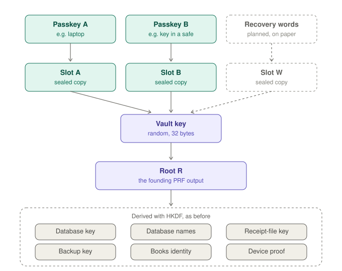

# Keys and recovery

_Deutsch: [keys.de.md](keys.de.md)_

How Belege gets its keys, what is stored where, and what happens when a passkey is lost.

## The short version

- **Your passkeys open the books.** At every unlock the passkey answers once with its PRF output; with it, it opens its slot in the books' vault, and every key is derived from what the vault holds. None of the keys is stored.
- **Add a second passkey.** Under _Einstellungen → Schlüssel_ – a security key you keep somewhere safe, say. Each passkey has a slot of its own, and every slot opens the same books and every backup, also on an empty device.
- **A synced passkey travels.** One kept in iCloud Keychain or the Google Password Manager opens the same books on every device of that account.
- **Write down recovery words.** 24 words on paper, offered right after the books are made and under _Einstellungen → Schlüssel_. When every passkey is gone, they open the books on an empty device, making a new passkey on the way.
- **No passkey and no words, no books.** With a single passkey that is not synced and no words, its loss means that neither the books nor any backup can be opened again, though the backup itself is still kept on Aleph. The keys page says so while that is the case.

Books have to be kept for years (in Germany 8 years for receipts and 10 for books, § 147 AO): write down recovery words or add a second passkey, and back up regularly.

## The vault

<picture>
  <source media="(prefers-color-scheme: dark)" srcset="media/keys-vault-en-dark.svg">
  
</picture>

- **The root R** is what every key is derived from: the PRF output of the passkey that made the books (32 bytes). Books made before the vault keep exactly the keys they had – the first unlock with the vault puts this very value into it.
- **The vault** keeps R once, sealed under a random vault key (AES-256-GCM).
- **A slot** is that vault key, sealed under a key only its passkey can make: derived from its PRF output, bound to the vault and to that passkey. Any slot opens the vault.
- **Adding a passkey** while the books are open gives it a slot: two prompts, the new passkey and its answer.
- **Removing a passkey** takes its slot out; it is refused from then on. **With renewal**, the vault also gets a new vault key, and every passkey that stays answers once – for a passkey that may be in other hands. What removing cannot do: a passkey that has opened the books knows R, and R cannot change without sealing the books anew; older backups still carry its slot.

## Recovery words

- **What they are:** 24 words after BIP39 – 256 random bits and a checksum – as paperless-anywhere uses them and as the package plans them ([#92](https://github.com/Le-Space/orbitdb-identity-provider-webauthn-did/issues/92)). Belege draws them, never a person; they are shown once, and the page asks three of them back.
- **Slot W:** the words give the BIP39 seed (PBKDF2-HMAC-SHA512), the seed by HKDF (`belege/vault-slot/words/v1`) the slot's key. Neither the words nor the seed are stored. A vault has at most one set of words; new ones replace the old.
- **On an empty device:** "Mit Wiederherstellungswörtern öffnen" on the lock screen. The words open the vault – from this browser or through their index on Aleph –, a new passkey is made (two prompts) and gets a slot; from then on it unlocks like any other. A misspelt or swapped word is caught by the checksum before anything is made.
- **What they weigh:** as much as every passkey together. Whoever saw them knows R. Renewing the vault takes the words out; make new ones after.

The vault is a record of `@le-space/orbitdb-identity-provider-webauthn-did` (`createVault`, `addSlot`), kept by `app/src/lib/books-vault.js`.

## Where an empty device finds the vault

In this browser the vault record is in `localStorage`. On an empty device, a passkey finds it on Aleph, if it was kept there (_Einstellungen → Schlüssel_, and after each backup from then on):

- **at its own index** – an address derived from that passkey's PRF output, where the vault was put when the passkey got its slot;
- **at the words' index** – an address derived from the recovery words' seed, likewise;
- **at the books' index** – an address derived from R, with the current vault and, sealed, the Aleph account the backups are kept for.

Both are sealed, signed by keys only the passkey or R lead to, and carry no names, no wallet: beside the vault only each slot's credential id and date (`app/src/lib/backup/vault-index.js`). "Mit vorhandenem Passkey wiederherstellen" asks there, unless the network is paused; then the books open with their keys, and "Wiederherstellen" lists the backups.

## What comes from R

HKDF-SHA-256 derives each key from R under a label of its own (`app/src/lib/database-keys.js`); the main ones:

| Key              | Label                       | Used for                                                                           |
| ---------------- | --------------------------- | ---------------------------------------------------------------------------------- |
| Database key     | `belege/db-key/v1`          | sealing every record                                                               |
| Replication key  | `belege/replication-key/v1` | sealing every log entry as a whole                                                 |
| Database names   | `belege/db-name/v2`         | naming the databases, so no name says what they hold                               |
| Receipt-file key | `belege/blob-key/v1`        | sealing receipt files and mails                                                    |
| Backup key       | `belege/backup-key/v1`      | sealing a backup before it leaves                                                  |
| Books' secret    | `belege/books-secret/v1`    | the books' own identity, the writer of every collection (#496)                     |
| Device proof     | `belege/device-auth/v1`     | own devices proving they hold the books' keys ([device-proof.md](device-proof.md)) |

One key reveals nothing about another.

## What is stored where

| What                                | Where                                           | In what form                                          |
| ----------------------------------- | ----------------------------------------------- | ----------------------------------------------------- |
| PRF output, R and every derived key | memory, while the books are open                | plain, gone when the tab closes                       |
| the vault                           | `localStorage` of this site; on Aleph if chosen | sealed; with the passkeys' names only in this browser |
| the books                           | IndexedDB of this site                          | sealed per record and per entry                       |
| receipt files                       | IndexedDB of this site                          | sealed                                                |
| passkey details, flags              | `localStorage` of this site                     | public: credential id, public key, DID, PRF input     |
| backups                             | Aleph Cloud                                     | sealed with the backup key ([backup.md](backup.md))   |
| the passkey's private key           | the authenticator                               | never leaves it                                       |

## Passkey prompts

- **Create:** two – the passkey, then its PRF output.
- **Unlock:** one – the PRF output.
- **Restore on a new device:** three – two touches that find the passkey and its DID, then the PRF output.
- **Add a passkey:** two – the new passkey, then its PRF output.
- **Remove with renewal:** one for each passkey that stays.
- **Open with recovery words:** two – the new passkey, then its PRF output.
