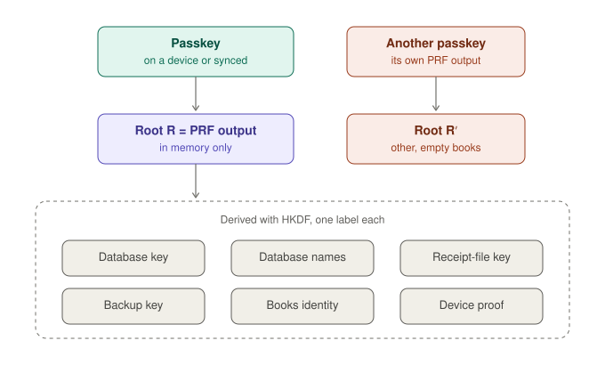

# Keys and recovery

_Deutsch: [keys.de.md](keys.de.md)_

How Belege gets its keys, what is stored where, and what happens when a passkey is lost.

## The short version

- **One passkey opens the books.** At every unlock it answers once with its PRF output. Belege derives every key from that answer and keeps none of them.
- **Nothing secret is stored.** The keys live in memory while the books are open and are gone when the tab closes.
- **A synced passkey travels.** One kept in iCloud Keychain or the Google Password Manager opens the same books on every device of that account.
- **Lose the passkey and you lose the books.** A passkey that is not synced (a security key, a passkey on one device only) cannot be replaced: without it, neither the books nor any backup can be opened, though the backup itself is still kept on Aleph.
- **A second passkey does not help yet.** It has its own PRF output and opens other, empty books.

Books have to be kept for years (in Germany 8 years for receipts and 10 for books, § 147 AO). Until the vault below exists, use a synced passkey, and back up regularly.

## Where the keys come from

<picture>
  <source media="(prefers-color-scheme: dark)" srcset="media/keys-today-en-dark.svg">
  
</picture>

The passkey's PRF output is the root of everything: 32 bytes, the same every time for this passkey and this site, released only after user verification. HKDF-SHA-256 derives each key from it under a label of its own (`app/src/lib/database-keys.js`); the main ones:

| Key              | Label                       | Used for                                                                       |
| ---------------- | --------------------------- | ------------------------------------------------------------------------------ |
| Database key     | `belege/db-key/v1`          | sealing every record                                                           |
| Replication key  | `belege/replication-key/v1` | sealing every log entry as a whole                                             |
| Database names   | `belege/db-name/v2`         | naming the databases, so no name says what they hold                           |
| Receipt-file key | `belege/blob-key/v1`        | sealing receipt files and mails                                                |
| Backup key       | `belege/backup-key/v1`      | sealing a backup before it leaves                                              |
| Books' secret    | `belege/books-secret/v1`    | the books' own identity, the writer of every collection (#496)                 |
| Device proof     | `belege/device-auth/v1`     | own devices proving they hold the passkey ([device-proof.md](device-proof.md)) |

One key reveals nothing about another.

## What is stored where

| What                             | Where                            | In what form                                        |
| -------------------------------- | -------------------------------- | --------------------------------------------------- |
| PRF output and every derived key | memory, while the books are open | plain, gone when the tab closes                     |
| the books                        | IndexedDB of this site           | sealed per record and per entry                     |
| receipt files                    | IndexedDB of this site           | sealed                                              |
| passkey details, flags           | `localStorage` of this site      | public: credential id, public key, DID, PRF input   |
| backups                          | Aleph Cloud                      | sealed with the backup key ([backup.md](backup.md)) |
| the passkey's private key        | the authenticator                | never leaves it                                     |

## Passkey prompts

- **Create:** two – the passkey, then its PRF output.
- **Unlock:** one – the PRF output.
- **Restore on a new device:** three – two touches that find the passkey and its DID, then the PRF output.

## Planned: a vault for the books ([#406](https://github.com/Le-Space/belege/issues/406))

The root R moves into a vault: kept once, sealed under a random vault key, with one slot per passkey. Each slot holds a copy of the vault key, sealed with a key only that passkey can make. A second passkey – a security key in a safe, say – then opens the same books and every backup, also on an empty device. A recovery phrase on paper follows as one more slot. This page changes with it.
