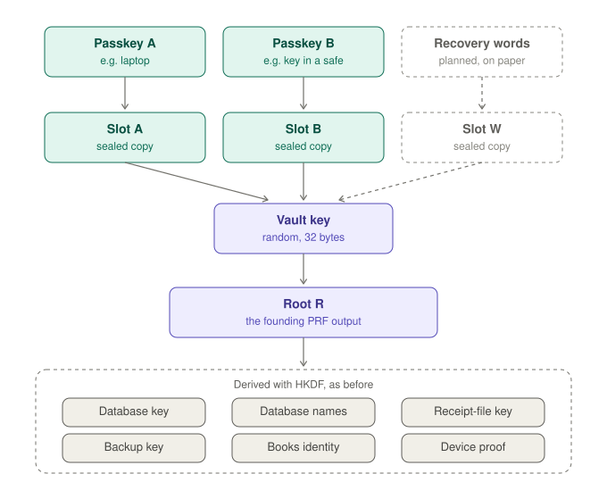
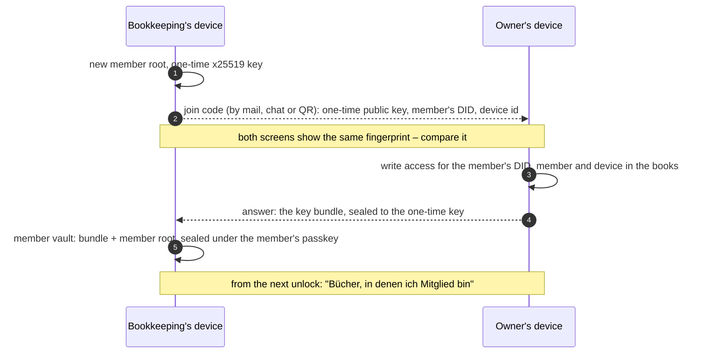

# Keys and recovery

_Deutsch: [keys.de.md](keys.de.md)_

How Belege gets its keys, what is stored where, and what happens when a passkey is lost.

## The short version

- **Your passkeys open the books.** At every unlock the passkey answers once with its PRF output; with it, it opens its slot in the books' vault, and every key is derived from what the vault holds. None of the keys is stored.
- **Add a second passkey.** Under _Einstellungen → Schlüssel_ – a security key you keep somewhere safe, say. Each passkey has a slot of its own, and every slot opens the same books and every backup, also on an empty device.
- **A synced passkey travels.** One kept in iCloud Keychain or the Google Password Manager opens the same books on every device of that account.
- **Write down recovery words.** 24 words on paper, offered right after the books are made and under _Einstellungen → Schlüssel_. When every passkey is gone, they open the books on an empty device, making a new passkey on the way.
- **No passkey and no words, no books.** With a single passkey that is not synced and no words, its loss means that neither the books nor any backup can be opened again, though the backup itself is still kept on Aleph. The keys page says so while that is the case.

Books have to be kept for years (in Germany 8 years for receipts and 10 for books, § 147 AO): write down recovery words or add a second passkey, and back up regularly.

## The vault

<picture>
  <source media="(prefers-color-scheme: dark)" srcset="media/keys-vault-en-dark.svg">
  
</picture>

- **The root R** is what every key is derived from: the PRF output of the passkey that made the books (32 bytes). Books made before the vault keep exactly the keys they had – the first unlock with the vault puts this very value into it.
- **The vault** keeps R once, sealed under a random vault key (AES-256-GCM).
- **A slot** is that vault key, sealed under a key only its passkey can make: derived from its PRF output, bound to the vault and to that passkey. Any slot opens the vault.
- **Adding a passkey** while the books are open gives it a slot: two prompts, the new passkey and its answer.
- **Removing a passkey** takes its slot out; it is refused from then on. **With renewal**, the vault also gets a new vault key, and every passkey that stays answers once – for a passkey that may be in other hands. What removing cannot do: a passkey that has opened the books knows R, and R cannot change without sealing the books anew; older backups still carry its slot.

## Recovery words

- **What they are:** 24 words after BIP39 – 256 random bits and a checksum – as paperless-anywhere uses them and as the package plans them ([#92](https://github.com/Le-Space/orbitdb-identity-provider-webauthn-did/issues/92)). Belege draws them, never a person; they are shown once, and the page asks three of them back.
- **Slot W:** the words give the BIP39 seed (PBKDF2-HMAC-SHA512), the seed by HKDF (`belege/vault-slot/words/v1`) the slot's key. Neither the words nor the seed are stored. A vault has at most one set of words; new ones replace the old.
- **On an empty device:** "Mit Wiederherstellungswörtern öffnen" on the lock screen. The words open the vault – from this browser or through their index on Aleph –, a new passkey is made (two prompts) and gets a slot; from then on it unlocks like any other. A misspelt or swapped word is caught by the checksum before anything is made.
- **What they weigh:** as much as every passkey together. Whoever saw them knows R. Renewing the vault takes the words out; make new ones after.

The vault is a record of `@le-space/orbitdb-identity-provider-webauthn-did` (`createVault`, `addSlot`), kept by `app/src/lib/books-vault.js`.

## Where an empty device finds the vault

In this browser the vault record is in `localStorage`. On an empty device, a passkey finds it on Aleph, if it was kept there (_Einstellungen → Schlüssel_, and after each backup from then on):

- **at its own index** – an address derived from that passkey's PRF output, where the vault was put when the passkey got its slot;
- **at the words' index** – an address derived from the recovery words' seed, likewise;
- **at the books' index** – an address derived from R, with the current vault and, sealed, the Aleph account the backups are kept for;
- **at its memberships' index** – for a member ([below](#members)): an address derived from that passkey's PRF output under another label, with each member vault the passkey opens and, sealed under the member's root, the account the books' backups are kept for. Written when the member backs up.

Both are sealed, signed by keys only the passkey or R lead to, and carry no names, no wallet: beside the vault only each slot's credential id and date (`app/src/lib/backup/vault-index.js`). "Mit vorhandenem Passkey wiederherstellen" asks there, unless the network is paused; then the books open with their keys, and "Wiederherstellen" lists the backups.

## What comes from R

HKDF-SHA-256 derives each key from R under a label of its own (`app/src/lib/database-keys.js`); the main ones:

| Key              | Label                                    | Used for                                                                           |
| ---------------- | ---------------------------------------- | ---------------------------------------------------------------------------------- |
| Database key     | `belege/db-key/v1`                       | sealing every record                                                               |
| Replication key  | `belege/replication-key/v1`              | sealing every log entry as a whole                                                 |
| Database names   | `belege/db-name/v2`                      | naming the databases, so no name says what they hold                               |
| Receipt-file key | `belege/blob-key/v1`                     | sealing receipt files and mails                                                    |
| Backup key       | `belege/backup-key/v1`                   | sealing a backup before it leaves                                                  |
| Books' secret    | `belege/books-secret/v1`                 | the books' own identity, the writer of every collection (#496)                     |
| Device proof     | `belege/device-auth/v1`                  | own devices proving they hold the books' keys ([device-proof.md](device-proof.md)) |
| Bridge key       | `belege/bridge-auth/v1` and a generation | the one key that leaves the browser: the bridge proves itself with it (below)      |

One key reveals nothing about another.

## What is stored where

| What                                | Where                                                                    | In what form                                                                                                                                    |
| ----------------------------------- | ------------------------------------------------------------------------ | ----------------------------------------------------------------------------------------------------------------------------------------------- |
| PRF output, R and every derived key | memory, while the books are open                                         | plain, gone when the tab closes                                                                                                                 |
| the vault                           | `localStorage` of this site; on Aleph if chosen                          | sealed; with the passkeys' names only in this browser                                                                                           |
| the books                           | IndexedDB of this site                                                   | sealed per record and per entry                                                                                                                 |
| receipt files                       | IndexedDB of this site                                                   | sealed                                                                                                                                          |
| passkey details, flags              | `localStorage` of this site                                              | public: credential id, public key, DID, PRF input                                                                                               |
| backups                             | Aleph Cloud                                                              | sealed with the backup key ([backup.md](backup.md))                                                                                             |
| the books' Aleph key                | the sealed settings of the books                                         | sealed; signs backup orders and, when switched on, Le Space Credits requests – its address is the Credits account, the same on every own device |
| the passkey's private key           | the authenticator                                                        | never leaves it                                                                                                                                 |
| the bridge's key                    | the bridge's keychain (`bridge-auth`)                                    | only if the bridge was paired by invitation                                                                                                     |
| a member vault                      | `localStorage` of the member's browser; on Aleph after a member's backup | sealed under the member's passkey                                                                                                               |

## What the bridge holds, and why

The bridge is a small program on your computer. It does what a browser may not: ask your bank,
your mailbox and a language model, and keep running when the tab is closed. For that it needs
their passwords and keys. They stay on that computer, in its keychain, and never go to the
browser ([bridge/README.md](../bridge/README.md#where-things-are-kept)).

It never gets a key of your books. The keys above stay in the browser, with one exception: if you
pair the bridge by invitation, so your phone reaches it through a relay, a device gives it a key
of its own. With that key the bridge proves to your devices that it is your bridge. It opens
nothing else: no books, no other device. "Kopplung lösen" moves the books to a new generation of
that key, and the old one is then worth nothing.

So whoever takes your computer with the bridge gets what the bridge holds – bank, mail, model –
but not your books. That is why a backup of the books needs the passkey or the recovery words,
not the bridge.

## Members

The books can let a second person in – the bookkeeping, say ([#6](https://github.com/Le-Space/belege/issues/6)). That person keeps their own passkey and their own books; they get a **key bundle** for yours.

**What the bundle holds:** the database key, the replication key, the receipt-file key, the backup key, the device-proof key and the bridge key's base, the databases' names and addresses, and the books' public identity. **What it never holds:** R, the books' secret, the vault key, a passkey slot or the recovery words.

**What a member can do:** read the books, write – under their own name, a DID from their own root, which the books' access lists allow –, back up and restore, and reach the owner's bridge. **What stays with the owner:** passkeys and recovery words of the books, moving the books, letting members in.

**The member vault** works like the books' vault: the bundle and the member's own root, sealed under a vault key, with a slot for the member's passkey. It lies in the member's browser (`belege.memberships.v1`) and, after the member's first backup, at the memberships' index on Aleph – sealed, without names. On an empty device the member's passkey finds it there ([backup.md](backup.md#members-back-up-and-restore)).

**Taking a member out** (_Integrationen → Zusammenarbeit_, [#614](https://github.com/Le-Space/belege/issues/614)): what they wrote so far stays; anything they write after is refused by every device of the books; their devices so far leave the device list and are refused. The write access is not revoked in OrbitDB – it checks old entries against the current list too, and the member's earlier entries would no longer replicate. Instead every collection's access list gets `removed:<their DID>` with the hashes of their entries so far, and an entry of theirs counts only if it is one of those (`app/src/lib/store/books-access.js`).

**What cannot be taken back:** what the member has read. With the keys in their bundle they could also read later entries, if they got hold of them, until the books get [new keys](#new-keys-for-the-books).

## New keys for the books

_Einstellungen → Schlüssel → Neue Schlüssel für die Bücher_ ([#627](https://github.com/Le-Space/belege/issues/627)) – after a member was taken out, or when a passkey may be in other hands:

1. A new random root R′, in a new vault with a slot for every passkey you tick (each answers once). The earlier roots stay inside, sealed.
2. The books are packed in this browser as a move does, sealed under a key from R′, and kept in IndexedDB until they are taken over.
3. The new vault goes into the old books. It holds nothing secret in the clear; only a passkey with a slot opens it.
4. The page reloads; one unlock opens new databases under R′ – new names, new keys, a new identity of the books – and they take the packed books over. The pack is deleted.
5. Another device of yours finds the new vault in the old books and switches, if its passkey has a slot; it then dials this device.

What does not come along: the recovery words (write down new ones), members (they join again with a new join code), the bridge pairing (pair again), the backup chain (the next backup is a full one). Backups made before still restore ([#628](https://github.com/Le-Space/belege/issues/628)): the backup opens with the earlier root kept in the vault, and its records come into today's books one by one – only where these have no newer version –, the receipt files sealed anew. A passkey you did not tick, and a member taken out, keep only the old books, which get nothing new.

## Passkey prompts

- **Create:** two – the passkey, then its PRF output.
- **Unlock:** one – the PRF output.
- **Restore on a new device:** three – two touches that find the passkey and its DID, then the PRF output.
- **Add a passkey:** two – the new passkey, then its PRF output.
- **Remove with renewal:** one for each passkey that stays.
- **Open with recovery words:** two – the new passkey, then its PRF output.
